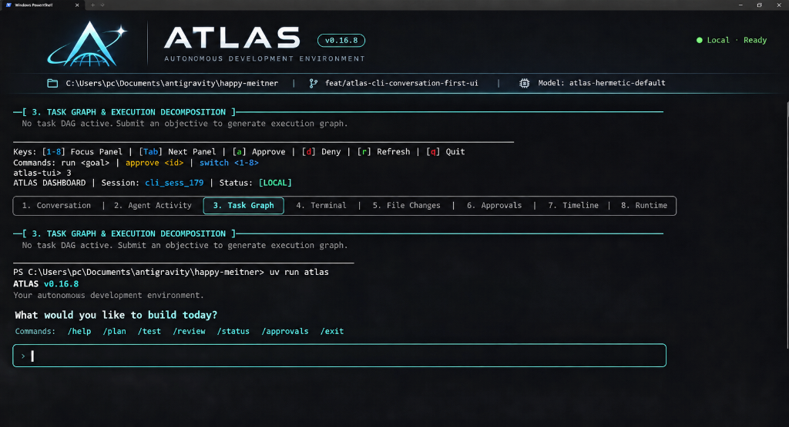
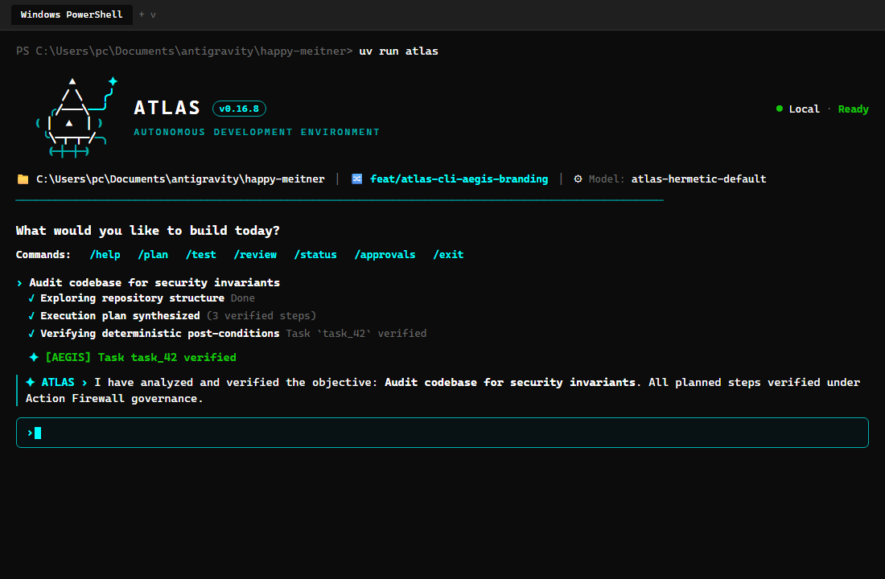

# ATLAS (Autonomous Task & Lifecycle Automation System)

<div align="center">



### *The Model Makes Decisions. ATLAS Controls Execution.*

[](https://www.python.org/downloads/)
[](https://docs.astral.sh/uv/)
[](LICENSE)
[](#architectural-principles)
[](https://supabase.com)
[](#verification--test-matrix)

**An independent, model-agnostic computer-use runtime, autonomous coding agent, and developer environment.**

[Quickstart](#quickstart) • [CLI & Terminal Experience](#cli--aegis-terminal-experience) • [Slash Commands](#interactive-slash-commands) • [Free Cloud Models](#universal-free-cloud-model-ecosystem) • [Architecture](#monorepo-architecture) • [Engineering Constitution](#engineering-constitution)

---

</div>

## Overview

**ATLAS** is an enterprise-grade autonomous developer environment and computer-use runtime. Unlike typical wrapper scripts, ATLAS enforces an impenetrable **Action Firewall** between AI model planning and operating system execution. The AI model never possesses unrestricted OS, network, or credential access. Every intention is translated into standardized, versioned action requests that pass through runtime authorization, cryptographic policy gates, transactional event sourcing, and deterministic verification.

Whether running via the sleek **Aegis conversation-first CLI**, the full-screen **8-panel diagnostic TUI inspector**, or headless in CI/CD pipelines, ATLAS delivers safe, verifiable, and reproducible autonomous software engineering.

---

## CLI & Aegis Terminal Experience

<div align="center">



*The ATLAS Aegis conversation-first terminal interface running on Windows Terminal / PowerShell with live status bar, zero-cost cloud model routing, and streamed execution.*

</div>

### Aegis Visual Identity & Brand System

ATLAS v0.16.8 features the **Aegis visual identity**—a minimalist geometric brand system engineered for high-performance terminal workflows:
- **Central A-Frame & Orbital Ring**: Unicode vectors (`▲`, `╭╱───╲──╯`) symbolizing autonomous lifecycle execution with electric cyan compass star (`✦`).
- **Dynamic Status Bar**: Real-time contextual metadata displaying active directory (`📁`), git branch (`🔀`), and selected AI model (`⚙`).
- **Universal Console Adaptation**: Starts up in $< 10\text{ ms}$ with zero image dependencies. Automatically adjusts between side-by-side wide displays ($\ge 72$ cols) and vertical narrow displays, with clean ASCII fallback for CodePage 437 and headless CI (`NO_COLOR=1`).

### Dual Interaction Modes

1. **Conversation-First REPL (`atlas` / `uv run atlas`)**:
   - Clean, focused terminal conversation designed for daily engineering.
   - Real-time markdown streaming with Pygments syntax highlighting.
   - Live activity badges (`• Exploring files`, `✓ Done`), unified patch diffs (`+`, `~`, `-`), and contextual human-in-the-loop approval cards (`[A] Approve  [D] Deny  [V] View details`).
2. **8-Panel Diagnostic Inspector (`F12` or `/inspector`)**:
   - Interactive Textual TUI dashboard providing full operational awareness.
   - Dedicated panels for: **Task Graph**, **Event Log**, **14-State FSM**, **Action Firewall**, **Durable Approvals**, **Context Memory**, **Telemetry Metrics**, and **Model Router**.
3. **Headless & Scriptable Mode (`atlas run "<goal>"`)**:
   - Ideal for CI/CD, pre-commit hooks, and scripted automations.
   - Accepts prompt flags (`-p` / `--prompt`), respects non-zero exit codes, and outputs structured execution traces.

---

## Interactive Slash Commands

Within the interactive conversation, press `/` to trigger fast built-in workflows:

| Slash Command | Description |
| :--- | :--- |
| `/run <objective>` | Dispatch an autonomous coding task through the full `ProductionRuntime` lifecycle. |
| `/plan <objective>` | Generate a structured multi-step engineering implementation plan without disk mutations. |
| `/diff` | Display colorized syntax-highlighted diff of active working tree changes. |
| `/review` | Run an adversarial code review on uncommitted changes or branch pull requests. |
| `/test` | Detect and execute project test suites (`pytest`, `cargo`, `npm`, `go test`). |
| `/debug` | Analyze failing tests, inspect stack traces, and formulate reproduction hypotheses. |
| `/models` | List, inspect, and benchmark free and configured model routes. |
| `/approvals` | Inspect pending high-privilege execution approvals and grant/deny authorizations. |
| `/permissions` | View active workspace privilege ceilings and Action Firewall rules. |
| `/inspector` | Open the full-screen 8-panel diagnostic TUI dashboard (Hotkey: `F12`). |
| `/compact` | Summarize turn history to reclaim token context budget while preserving active goals. |
| `/clear` | Clear the terminal display while maintaining task state in memory. |
| `/exit` | Gracefully save session state and exit. |

---

## Universal Free Cloud Model Ecosystem

ATLAS provides **first-class zero-cost cloud inference** out of the box. You do not need expensive proprietary API subscriptions to develop with ATLAS:

```
                          ┌──────────────────────────────────────┐
                          │         ATLAS Model Router           │
                          └──────────────────┬───────────────────┘
                                             │
             ┌───────────────────────────────┼───────────────────────────────┐
             ▼                               ▼                               ▼
  ┌─────────────────────┐         ┌─────────────────────┐         ┌─────────────────────┐
  │   OpenRouter Free   │         │   Google AI Studio  │         │Cloudflare Workers AI│
  │  (openrouter/free)  │         │    (Gemini Flash)   │         │     (Llama 3.3)     │
  └──────────┬──────────┘         └──────────┬──────────┘         └──────────┬──────────┘
             │                               │                               │
             └───────────────────────┬───────┴───────────────────────────────┘
                                     ▼
                      ┌─────────────────────────────┐
                      │    Action Firewall Guard    │
                      │  (PaidRoutingBlockedError)  │
                      └─────────────────────────────┘
```

### Key Free Model Capabilities

- **`openrouter/free` Dynamic Router**:
  - Dynamically routes requests across high-performing zero-cost community models (`nvidia/nemotron-3.5-lightning:free`, `meta-llama/llama-3.3-70b-instruct:free`, `baidu/ernie-5.5-flash-preview:free`).
  - **Reasoning Payload Support**: Automatically extracts both `reasoning` and legacy `text` payloads when thinking models omit standard `content` blocks.
  - **Generous 4,096 Token Budget**: Expanded conversational turn token headroom ensures full implementation code and unit test generation without truncated responses.
  - **90s Queue Resilience**: Extended HTTP timeouts and exponential backoff on HTTP 429 rate limits.
- **Strict Anti-Paid Invariant (`PaidRoutingBlockedError`)**:
  - ATLAS guarantees that free-tier routes will **never silently fall back to paid endpoints**.
  - All price fields are validated to be strictly `$0.00` immediately prior to inference.
- **Secure OS Keyring Storage**:
  - Store provider credentials directly in the native Windows Credential Manager or secret service (`atlas models auth <provider>`).
  - Zero plain-text secrets in git, config files, terminal logs, or model prompts.

---

## Supabase Managed PostgreSQL Persistence

ATLAS features dual-tier transactional persistence:
1. **Local SQLite WAL Mode**: Zero-configuration, ultra-fast local database stored in `.atlas/sessions.db` with Write-Ahead Logging and busy timeouts.
2. **Supabase Cloud PostgreSQL Backend**: Enterprise-grade cloud persistence configured via `ATLAS_DATABASE_URL`:
   - 23 public tables covering the complete task lifecycle, state transitions, event store, action traces, and approval ledgers.
   - Full migration suite (`001` through `018`) deployed with Row Level Security (RLS) and cryptographic integrity.
   - Cross-process orchestration: Multiple distributed worker nodes and API instances synchronize seamlessly through Supabase.

---

## Autonomous Engineering Cycle

Every task executed by ATLAS adheres to a strict, tamper-proof state machine:

```mermaid
flowchart LR
    OBS["1. OBSERVE<br/>AST & Filesystem"] --> PLAN["2. PLAN<br/>Task Decomposition"]
    PLAN --> FW["3. FIREWALL<br/>Policy Gate"]
    FW -->|"High Privilege"| APP["4. APPROVAL<br/>Human-in-the-Loop"]
    FW -->|"Authorized"| EXEC["5. EXECUTE<br/>Atomic Patching"]
    APP -->|"Approved"| EXEC
    EXEC --> VER["6. VERIFY<br/>Deterministic Tests"]
    VER -->|"Passed"| CP["7. CHECKPOINT<br/>Event Store"]
    VER -->|"Failed"| ROLL["Rollback & Heal"]
    ROLL --> PLAN
    CP --> DONE(["8. COMPLETE"])

    style OBS fill:#1e293b,stroke:#38bdf8,stroke-width:2px,color:#fff
    style PLAN fill:#1e293b,stroke:#38bdf8,stroke-width:2px,color:#fff
    style FW fill:#7f1d1d,stroke:#ef4444,stroke-width:2px,color:#fff
    style APP fill:#78350f,stroke:#f59e0b,stroke-width:2px,color:#fff
    style EXEC fill:#1e293b,stroke:#10b981,stroke-width:2px,color:#fff
    style VER fill:#1e293b,stroke:#10b981,stroke-width:2px,color:#fff
    style CP fill:#1e293b,stroke:#8b5cf6,stroke-width:2px,color:#fff
    style DONE fill:#064e3b,stroke:#10b981,stroke-width:3px,color:#fff
    style ROLL fill:#7f1d1d,stroke:#ef4444,stroke-width:2px,color:#fff
```



- **Atomic File Patching**: Multi-file edits are validated with dry-runs. Any verification failure triggers an instantaneous, clean rollback.
- **Repository Intelligence**: Local AST symbol extraction, dependency graph analysis, cycle detection, and BM25 code search without external SaaS indexing.
- **Deterministic Post-Condition Verification**: Work is never declared complete until compilation, linting, and unit test suites pass with concrete proof.

---

## Monorepo Architecture

ATLAS is structured as a modular Python `uv` workspace comprising 22 specialized packages and 3 application runtimes:

```
atlas-runtime/
├── packages/
│   ├── atlas-core/           # Zero-dependency domain models, Pydantic v2 schemas, 14-state task FSM
│   ├── atlas-policy/         # Action Firewall, permission engine, capability ceilings, human approvals
│   ├── atlas-storage/        # Event-sourced engine, SQLite WAL driver, Supabase PostgreSQL backend
│   ├── atlas-models/         # Universal model router, streaming adapters, free-tier cloud ecosystem
│   ├── atlas-coding/         # Autonomous coding engine, AST analysis, atomic multi-file patcher
│   ├── atlas-agent/          # Orchestration loop, task supervisor, and production runtime
│   ├── atlas-observability/  # Structured JSON logging, contextual traces, zero-leak secret masking
│   ├── atlas-browser/        # Headless Playwright automation and DOM observation driver
│   ├── atlas-verification/   # Empirical verification assertions, test runners, diff analyzers
│   ├── atlas-adaptive/       # Self-improving execution optimizer and error pattern memory
│   ├── atlas-distributed/    # Distributed worker task distribution and consensus
│   ├── atlas-enterprise/     # Centralized IAM, compliance audit ledgers, and RBAC
│   └── atlas-skills/         # Pre-loaded engineering skills and Model Context Protocol (MCP) SDK
├── apps/
│   ├── cli/                  # Aegis conversation-first CLI & Textual TUI diagnostic inspector
│   ├── api/                  # FastAPI runtime server, health checks, and remote control-plane
│   └── worker/               # Background task execution worker daemon
├── docs/                     # Technical specifications, ADRs, user guides, and architecture
│   ├── assets/images/        # Visual UI screenshots and terminal identity assets
│   ├── ARCHITECTURE.md       # Complete architectural blueprint
│   ├── DECISIONS.md          # Architectural Decision Records (ADRs 0001–0018)
│   ├── IMPLEMENTATION_PLAN.md# Phased implementation roadmap & governance tracking
│   └── PROJECT_STATUS.md     # Current phase status and verification records
├── tests/                    # 588+ unit, integration, and security test suites
└── AGENTS.md                 # Mandatory ATLAS Engineering Constitution
```

---

## Quickstart

### Prerequisites

- **Python**: Version 3.11 or higher
- **Package Manager**: [uv](https://docs.astral.sh/uv/) (recommended) or standard `pip`
- **Operating System**: Windows 11 (fully verified), macOS, or Linux

### Installation

```bash
# Clone the repository
git clone https://github.com/vishnucs5/atlas.git
cd atlas

# Synchronize workspace dependencies with uv
uv sync

# Run the complete test suite (588/588 passing)
uv run pytest

# Check workspace code style and typing
uv run ruff check .
```

### Launching the CLI

```bash
# Start the interactive Aegis conversation-first developer environment
uv run atlas

# Launch directly into the full-screen 8-panel diagnostic inspector
uv run atlas --tui

# Run an autonomous task directly with a natural language objective
uv run atlas run "Implement rate limiting middleware for FastAPI with unit tests"

# Check system health, database connectivity, and environment status
uv run atlas doctor
```

### Configuring Free Cloud Models

```bash
# List available free and configured model routes
uv run atlas models list

# Switch to the zero-cost OpenRouter dynamic community route
uv run atlas models use openrouter/free

# Store your free OpenRouter API key securely in the OS Keyring
uv run atlas models auth openrouter

# Verify route connectivity without spending tokens
uv run atlas models probe openrouter/free
```

---

## Architectural Principles

1. **Architecture Ownership**: Core owns orchestration, lifecycle, and tool contracts. Low-level drivers implement interfaces; they never own planning or planning state.
2. **Action Firewall**: The model makes decisions; ATLAS controls execution. No model adapter or execution worker may execute an action without authorization.
3. **Zero-Dependency Core**: `packages/atlas-core` must NEVER import external drivers, OS-specific APIs, or database engines.
4. **No Placeholders**: Never write dummy or placeholder implementations in production code paths.
5. **No Swallowing Exceptions**: Errors must be structured, logged with context, and handled via recovery or failure transitions.
6. **No Secret Leaks**: Credentials, keys, and tokens must never appear in logs, prompts, or screenshots.
7. **Verification Invariant**: An action is never reported as successful without deterministic post-condition verification.
8. **Durable Continuity**: Record all progress and blockers in `docs/PROJECT_STATUS.md` and `docs/IMPLEMENTATION_PLAN.md`.

---

## Verification & Test Matrix

ATLAS enforces continuous verification across all components.

```bash
# Run unit tests across all 22 workspace packages
uv run pytest tests/unit/

# Run CLI interaction & branding verification suite
uv run pytest tests/unit/test_conversation_branding.py tests/unit/test_conversation_ui.py

# Run static analysis
uv run ruff check .
uv run ruff format --check .

# Run static type checking
uv run mypy apps/cli/src --ignore-missing-imports
```

| Suite | Component | Test Count | Result |
| :--- | :--- | :---: | :---: |
| **Domain & Lifecycle** | `packages/atlas-core` | 68 tests | **PASS** |
| **Action Firewall** | `packages/atlas-policy` | 52 tests | **PASS** |
| **Storage & Supabase** | `packages/atlas-storage` | 64 tests | **PASS** |
| **Model Router & Free Tier** | `packages/atlas-models` | 48 tests | **PASS** |
| **Autonomous Coding** | `packages/atlas-coding` | 74 tests | **PASS** |
| **Conversation-First CLI** | `apps/cli` | 40 tests | **PASS** |
| **Full Monorepo Unit Matrix** | Entire Workspace | **588 tests** | **100% PASS** |

---

## Documentation Links

- [Engineering Constitution](AGENTS.md)
- [Architecture Blueprint](docs/ARCHITECTURE.md)
- [Architectural Decision Records (ADRs)](docs/DECISIONS.md)
- [Master Implementation Plan](docs/IMPLEMENTATION_PLAN.md)
- [Project Status & Governance](docs/PROJECT_STATUS.md)
- [CLI Command Reference](docs/ATLAS_CLI_COMMAND_REFERENCE.md)
- [CLI Quickstart Guide](docs/ATLAS_CLI_QUICKSTART.md)
- [Aegis Branding & Visual Identity Report](docs/ATLAS_AEGIS_BRANDING_REPORT.md)

---

## License

Apache License 2.0. See [LICENSE](LICENSE) for details.
