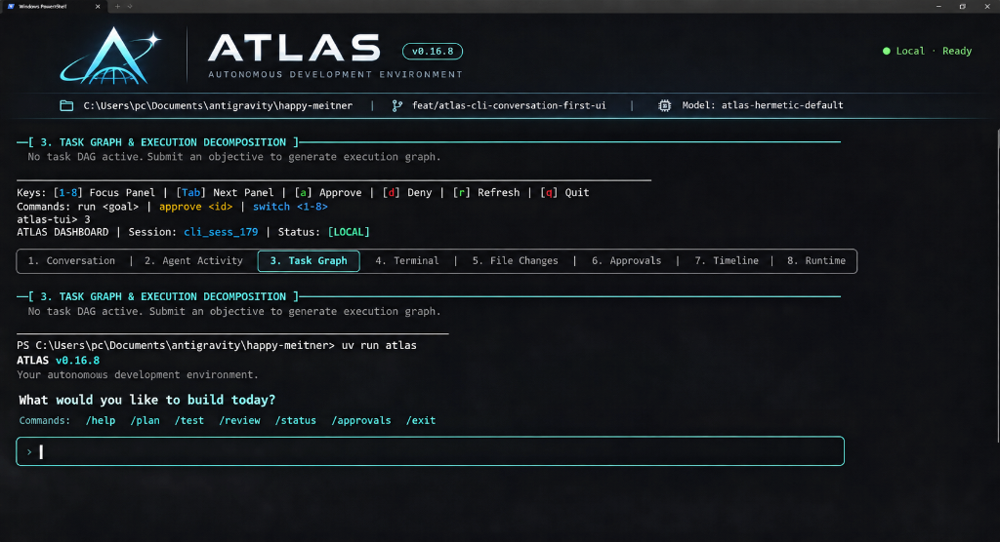
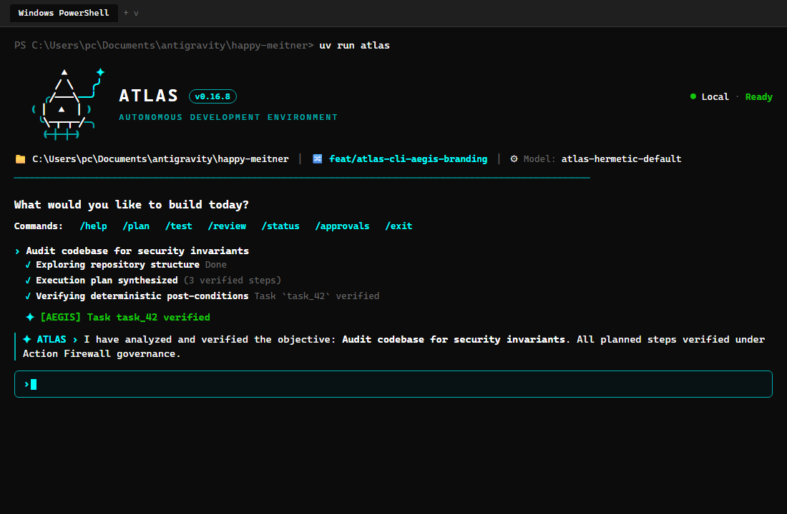

# ATLAS CLI — Autonomous Developer Environment & Enterprise Coding Agent

<div align="center">



[](LICENSE)
[](https://www.python.org/downloads/)
[](#aegis-terminal-interface)
[](https://supabase.com)

</div>

ATLAS CLI is an open-source, model-agnostic autonomous coding agent and developer environment. It understands complex codebases, plans engineering work, writes and tests code, coordinates specialist agents, and recovers interrupted execution safely under the **Action Firewall**.

---

## Aegis Terminal Interface

<div align="center">



*The Aegis conversation-first developer environment with live status metadata, streaming markdown, and integrated free cloud model routing.*

</div>

- **Conversation-First REPL**: Streamlined interactive session featuring real-time activity indicators (`• Exploring files`, `✓ Done`), syntax-highlighted code blocks, and inline unified diffs.
- **Contextual Approval Cards**: High-privilege actions are presented with immediate inline approvals (`[A] Approve  [D] Deny  [V] View details`).
- **On-Demand Diagnostic Inspector**: Access the 8-panel diagnostic TUI dashboard anytime with `/inspector` or `F12`.
- **Responsive Layout**: Adapts automatically to console widths ($\ge 72$ cols for side-by-side welcome header, $< 72$ cols for compact vertical stack) with automatic ASCII fallback for legacy terminals and CI.

---

## Key Capabilities

- **Zero-Cost Cloud Inference**:
  - Out-of-the-box support for `openrouter/free` (NVIDIA Nemotron, Meta Llama 3.3, Baidu Ernie), Google Gemini Flash, and Cloudflare Workers AI.
  - Automatic extraction of `reasoning` and legacy `text` blocks for thinking models.
  - Strict `PaidRoutingBlockedError` guarantee against accidental paid model usage.
- **Autonomous Coding Engine**:
  - `OBSERVE -> PLAN -> FIREWALL -> APPROVAL -> EXECUTE -> VERIFY -> CHECKPOINT -> COMPLETE`.
  - Transactional patch application with dry-runs and automated multi-file rollback.
- **Repository Intelligence**:
  - Multi-language AST symbol extraction, dependency graph analysis, cycle detection, and BM25 local code search.
- **Multi-Agent Specialist Engineering**:
  - 11 specialized agent roles coordinated by a supervisory task-graph engine with dynamic collision prevention.
- **Durable Persistence**:
  - High-speed local SQLite WAL persistence (`.atlas/sessions.db`) or managed Supabase PostgreSQL backend via `ATLAS_DATABASE_URL`.
- **Extensible Ecosystem**:
  - Model Context Protocol (MCP) integrations over stdio/sse.
  - Cryptographically verified plugins with SHA-256 integrity and publisher trust checks.
  - Adversarially defended skill SDK pre-loaded with engineering workflows.

---

## Interactive Slash Commands

| Command | Shortcut / Description |
| :--- | :--- |
| `/run <goal>` | Execute an autonomous coding task with specified goal. |
| `/plan <goal>` | Generate a structured engineering implementation plan without executing modifications. |
| `/diff` | Display colorized syntax-highlighted diff of active working tree changes. |
| `/review [--diff]` | Run independent adversarial code review on active working tree or diff. |
| `/test` | Run project test suites with automated framework detection (`pytest`, `npm`, `cargo`, `go`). |
| `/debug` | Inspect failed test runs and generate reproduction hypotheses. |
| `/models` | List, inspect, and benchmark free and configured model routes. |
| `/approvals` | Review and resolve pending human-in-the-loop permission requests. |
| `/inspector` | Open the full-screen 8-panel diagnostic TUI dashboard (`F12`). |
| `/compact` | Compact conversation history to free context window budget. |
| `/clear` | Clear screen output while preserving active task state. |
| `/exit` | Save session state and exit. |

---

## Quickstart

### Installation

```bash
# Using uv (recommended)
uv tool install atlas-cli

# Using pip
pip install atlas-cli
```

### Initializing a Project

```bash
cd /path/to/your/repository
atlas init
```

### Starting an Autonomous Coding Task

```bash
# Interactive conversation-first environment
atlas

# Run a direct objective prompt
atlas "Implement rate limiting middleware for FastAPI endpoints and write unit tests"

# Advanced interactive 8-panel dashboard
atlas --tui

# Diagnostic health check
atlas doctor
```

### Managing Free Cloud Models

```bash
# List available free model routes
atlas models list

# Switch to OpenRouter Free community route
atlas models use openrouter/free

# Configure API key in secure OS keyring
atlas models auth openrouter
```

---

## Security Invariants

1. **Core Ownership**: Core owns planning and orchestration; drivers only execute authorized interfaces.
2. **Action Firewall**: Every action is gated by deterministic policy checks; model descriptions cannot bypass permissions.
3. **No Direct OS Execution**: Shell commands execute via `shell=False` argument vectors with secret scrubbing.
4. **Zero Silent Overwrites**: Optimistic concurrency checks prevent overwriting out-of-date files.

For full architectural documentation, refer to the [`docs/`](../../docs/) directory.
