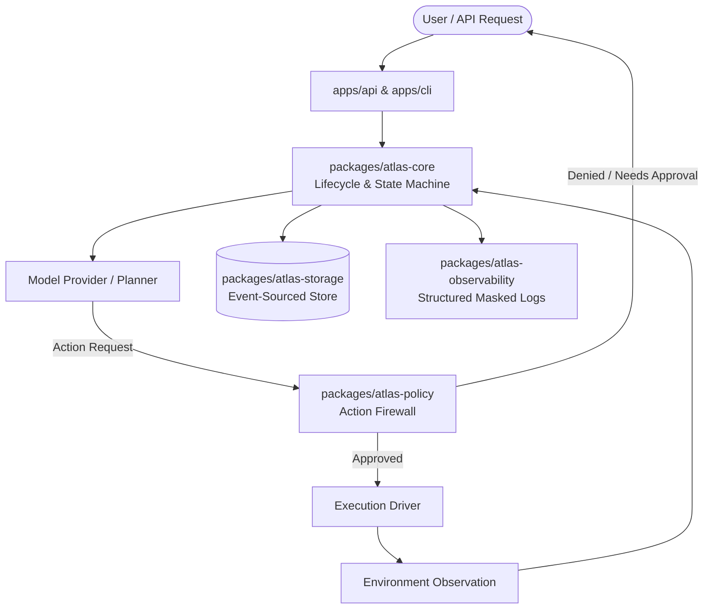
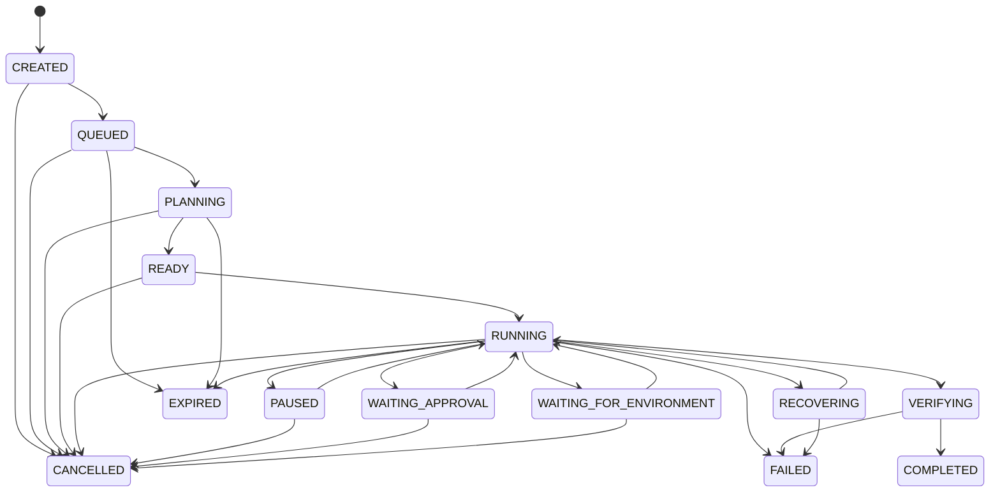
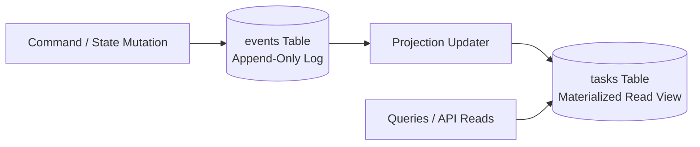

# ATLAS Architecture Specification

## 1. Overview & Core Philosophy

ATLAS (Autonomous Task & Lifecycle Automation System) is an independent, model-agnostic computer-use runtime designed to orchestrate AI agents operating across web browsers, desktop applications, and operating systems.

The core axiom of ATLAS is:

> **The model makes decisions. ATLAS controls execution.**

The AI model never possesses unrestricted operating system, network, or credential access. All agent intentions are translated into standardized, versioned action requests that pass through runtime authorization, verification, and transactional event sourcing.



---

## 2. Package Boundaries & Dependency Hierarchy

ATLAS is structured as a `uv` workspace divided into domain packages and application entry points. Strict dependency layering is enforced:

```
packages/atlas-core (Zero external dependencies)
    ▲                ▲                 ▲
    │                │                 │
packages/         packages/         packages/
atlas-storage     atlas-policy      atlas-observability
    ▲                ▲                 ▲
    └────────┬───────┴─────────────────┘
             │
      apps/api & apps/cli
```

### 2.1 Package Definitions

| Package | Purpose | Allowed Dependencies | Invariants |
| :--- | :--- | :--- | :--- |
| `packages/atlas-core` | Core domain entities, Pydantic contracts, state machine, lifecycle exceptions | Standard Library, `pydantic >= 2.0` | **Zero external dependencies**. Never imports storage, policy, OS, or drivers. |
| `packages/atlas-storage` | Event store, task projection, SQLite engine, PostgreSQL interface | `atlas-core`, `sqlite3` (stdlib) | Guarantees sequential event numbering and immutable audit trail. |
| `packages/atlas-policy` | Action Firewall, policy rules, human approval gating | `atlas-core` | Evaluates every action prior to execution dispatch. |
| `packages/atlas-observability` | Structured JSON logging, contextual correlation, secret masking | `atlas-core` | Masks credentials in memory before emitting logs. |
| `apps/api` | FastAPI web service, health endpoints, task control API | `atlas-core`, `atlas-storage`, `atlas-policy`, `atlas-observability`, `fastapi`, `uvicorn` | Stateless API routing. |
| `apps/cli` | Developer command-line suite (`atlas doctor`, `atlas init`, `atlas task`) | `atlas-core`, `atlas-storage`, `atlas-policy`, `atlas-observability` | Ergonomic terminal experience. |

---

## 3. Task Lifecycle & State Machine

ATLAS enforces an explicit finite state machine with 14 distinct task states:



### 3.1 Transition Rules & Invariants

1. **Deterministic Validation**: Transitions must be registered in the valid transition table. Any unregistered transition raises `InvalidStateTransitionError`.
2. **Terminal States**: `COMPLETED`, `FAILED`, `CANCELLED`, and `EXPIRED` are terminal states; no transitions out of terminal states are permitted.
3. **Event Emission**: Every state transition emits an immutable `ExecutionEvent` recording the prior state, target state, timestamp, reason, and actor.

---

## 4. Action Firewall & Policy Engine

The Action Firewall sits between model action proposal and driver execution. It guarantees that no action executes without rigorous pre-flight validation.

### 4.1 Evaluation Pipeline

1. **Schema & Parameter Validation**: Verifies that the requested action conforms to versioned contract schemas.
2. **Permission Rule Matching**: Matches action type and target against configured rules:
   - `ALLOW`: Safe, read-only actions (e.g., screenshot, read accessibility tree).
   - `REQUIRE_APPROVAL`: Sensitive actions (e.g., file writes, external HTTP requests, form submissions).
   - `BLOCK`: Dangerous or forbidden operations (e.g., privilege escalation, executing arbitrary binary scripts).
   - `DRY_RUN`: Simulates action evaluation without invoking drivers.
3. **Audit Trail**: Every firewall decision (whether allowed, blocked, or deferred for approval) is persisted to the event log.

---

## 5. Event-Sourced Storage Architecture

ATLAS separates immutable write events from query-optimized projections:



- **Event Sourcing**: The `events` table records all events with an auto-incrementing `sequence_number`, `event_id`, `task_id`, `event_type`, `payload`, and `created_at`.
- **Materialized Views**: The `tasks` table maintains current status, priority, objective, metadata, and latest checkpoint.
- **SQLite Engine**: Configured with Write-Ahead Logging (`PRAGMA journal_mode = WAL;`), `synchronous = NORMAL`, and `busy_timeout = 5000` to support fast concurrency.
- **PostgreSQL Interface**: Defines identical transactional contracts for enterprise deployment.

---

## 6. Observability & Secret Masking

The observability package provides structured JSON logging designed for automated parsing and ingestion into log aggregation systems.

- **Context Binding**: Logs automatically include `task_id`, `session_id`, and `step_id` across asynchronous call chains.
- **Automated Secret Sanitization**: Employs pre-compiled regex filters that identify and redact API keys (OpenAI, Anthropic, Gemini, AWS), authorization headers, bearer tokens, passwords, and private keys (`***REDACTED***`) before serialization.

---

## 7. Target Platform & Windows 11 Support

ATLAS is engineered for first-class operation on Windows 11 while maintaining strict cross-platform compatibility:

- **Path Handling**: All paths utilize standard Python `pathlib.Path` with explicit normalization for Windows extended paths (`\\?\`) where appropriate.
- **Process Management**: Handles Windows process trees cleanly (`taskkill /T /F` vs Unix `SIGTERM/SIGKILL`).
- **Desktop Automation Ready**: Built to integrate with Windows UI Automation (UIA) alongside cross-platform browser automation.
