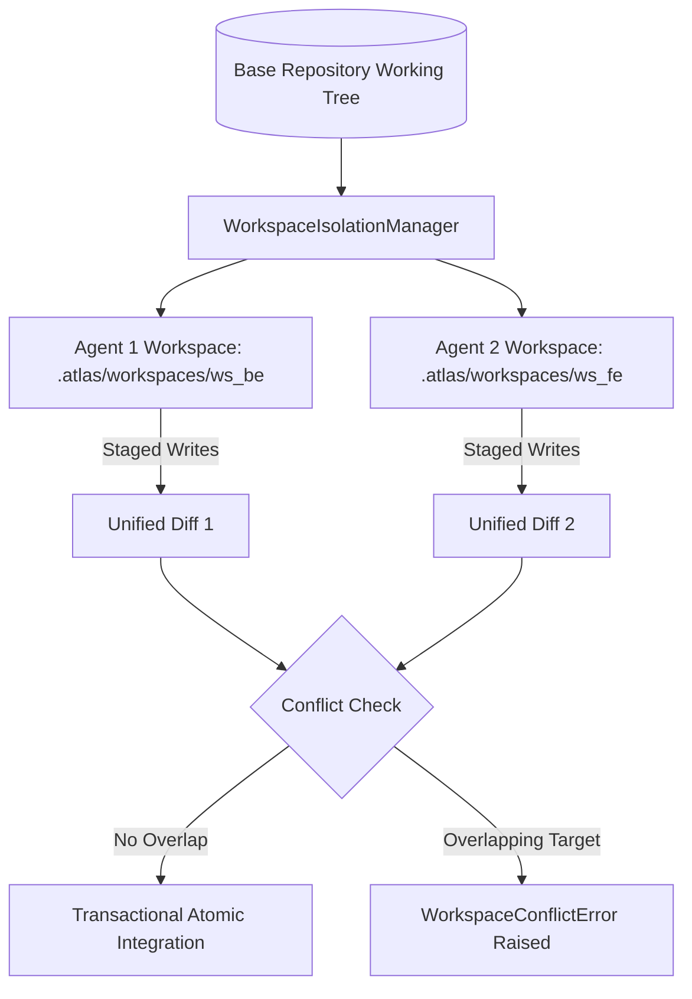

# ATLAS Agent Workspace Isolation and Concurrent Integration

## 1. The Isolation Problem in Multi-Agent Coding

When multiple agents write code concurrently to a single working directory:
- Files are overwritten silently.
- Git working tree becomes corrupted with partial, incompatible modifications.
- Merge conflicts emerge without clear provenance or ownership.

ATLAS solves this through `WorkspaceIsolationManager`.

---

## 2. Isolation Modes and Architecture

### 1. Dedicated Scratch Workspaces (`SCRATCH_DIRECTORY`)
- Each specialist agent receives an isolated directory view at `.atlas/workspaces/<workspace_id>/`.
- Read operations look up modified files in the isolated workspace first, falling back to base repository files.
- Write operations occur **exclusively** within the isolated directory; the base repository remains untouched during execution.

### 2. Patch-Based Collaboration (`PATCH_STAGING`)
- Agents generate unified diffs (`UnifiedDiff`) relative to the base repository.
- Diffs are inspected, audited, and tested before integration.

### 3. Conflict-Free Transactional Integration
When an agent completes its subtask:
1. `WorkspaceIsolationManager.integrate_workspace_changes()` verifies that no modified file has already been integrated by another concurrent agent in the same cycle.
2. If an overlap is detected, integration is rejected with `WorkspaceConflictError`. Automatic silent overwrites are strictly disallowed.
3. Clean changes are committed atomically to the base repository.
4. On task completion, all temporary agent workspaces are purged cleanly via `cleanup_all()`.
