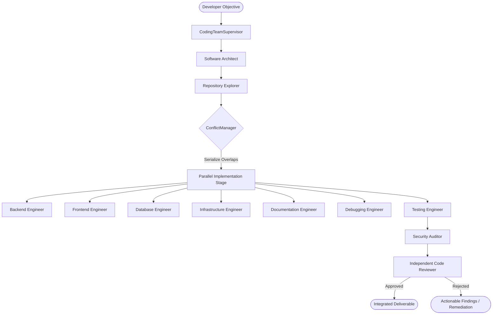

# ATLAS Multi-Agent Coding Developer Environment

## 1. Architectural Mission and Invariants

The ATLAS Multi-Agent Coding Environment coordinates a specialized engineering team to autonomously plan, explore, implement, test, audit, and review complex software projects. Rather than creating an unconstrained swarm of generic agents, ATLAS enforces a disciplined engineering structure governed by the **Universal Engineering Constitution**:

1. **Supervisor Authority**: `CodingTeamSupervisor` remains the single execution and decomposition authority. Specialist agents execute bounded subtasks and never mutate global plans directly.
2. **Action Firewall Invariant**: Specialist roles do not imply elevated permissions. Every file write, terminal command, and git operation must pass Action Firewall policy evaluation.
3. **Workspace Isolation**: Concurrent agents operate in isolated workspaces (scratch directories, patch staging, worktrees). Silent overwrites between concurrent agents are strictly disallowed.
4. **Deterministic Independent Review**: Deliverables are audited by an `IndependentCodeReviewer` that directly inspects diffs, tests, security flags, and architectural boundaries.
5. **Shared Context Integrity**: Unverified agent claims cannot masquerade as authoritative facts. Only verified test results, security audits, and approved reviews obtain `VERIFIED` status.

---

## 2. Multi-Agent Team Architecture

---

## 3. Specialist Roster Overview

ATLAS provides 11 predefined specialist engineering roles:

| Role Name | Capability | Primary Focus | Tooling / Permissions |
| :--- | :--- | :--- | :--- |
| **Software Architect** | `ARCHITECT` | System boundaries, interface design, invariant enforcement | Safe file reading, repository indexing |
| **Repository Explorer** | `EXPLORER` | Rapid file discovery, symbol mapping, codebase topology | Safe file discovery, symbol search |
| **Backend Engineer** | `BACKEND` | Server logic, REST/gRPC APIs, data models, services | Authorized file ops, patch engine |
| **Frontend Engineer** | `FRONTEND` | UI components, client state, styling, web views | Authorized file ops, patch engine |
| **Database Engineer** | `DATABASE` | Relational/NoSQL schemas, SQL migrations, index design | Authorized file ops, schema validation |
| **Infrastructure Engineer** | `INFRASTRUCTURE` | Dockerfiles, CI workflows, build environments | Authorized file ops, safe terminal commands |
| **Testing Engineer** | `TESTING` | Unit/integration tests, regression suites, test runs | Authorized file ops, test runner, terminal |
| **Security Auditor** | `SECURITY_AUDITOR` | Secret leaks, prompt injection, Action Firewall policies | Sensitive file scanner, policy evaluator |
| **Code Reviewer** | `CODE_REVIEWER` | Independent diff review, non-conformance detection | Unified diff parser, AST inspector |
| **Documentation Engineer** | `DOCUMENTATION` | Technical specs, user manuals, markdown guides | Authorized file ops, docstring extraction |
| **Debugging Engineer** | `DEBUGGING` | Root-cause analysis, reproduction tests, bug patches | Authorized file ops, patch engine, test runner |

---

## 4. Concurrency and Conflict Control

- **File Collision Detection**: `ConflictManager` analyzes all planned file modifications before DAG execution.
- **Dependency Serialization**: If two tasks target the same file (e.g. `src/auth.py`), a hard sequential dependency is automatically injected, converting an unsafe parallel race into a deterministic pipeline.
- **Transactional Integration**: `WorkspaceIsolationManager` verifies that staged changes do not collide with another agent's integrated work.
