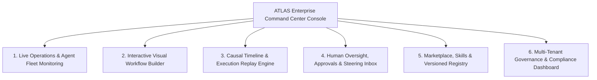

# ATLAS v1.0 Target State Specification & Gap Analysis Matrix

**Document Type:** Strategic Target State Architecture & Product Requirements  
**Target Release:** ATLAS v1.0 (End of Phase 17 GA)  
**Current Release Candidate:** ATLAS v0.16.8 (Phase 16.13 Standby)  
**Date:** 2026-11-17  
**Authority:** ATLAS Lead Architecture Directorate  

---

## 1. Executive Summary & North Star Vision

The ultimate objective of ATLAS is to deliver an **independently verified, production-grade, secure, model-agnostic autonomous computer-use and enterprise automation platform**.

ATLAS transforms high-level user objectives into executed, verified, and audited business reality across browsers, desktop environments, terminal sessions, and enterprise systems while ensuring that human operators retain sovereign authority over sensitive, high-risk, and irreversible operations.

> [!IMPORTANT]
> **Governance Invariant:** This document defines the **target state specification** for ATLAS v1.0 at the conclusion of Phase 17. It serves as the authoritative yardstick against which future audits, staging deployments, and implementation milestones will be evaluated.

---

## 2. Capabilities Traceability & Current Readiness Matrix

| # | Platform Capability | v1.0 Target State Requirement | Current State (v0.16.8 / Phase 16.13) | Implementation Gap & Path to v1.0 |
| :- | :--- | :--- | :---: | :--- |
| **1** | **Autonomous Execution** | Multi-step planning, dynamic replanning, error recovery, and tool execution with minimal human intervention. | **VERIFIED** | Core execution loop and DAG task engines complete across `packages/atlas-core` and `packages/atlas-process`. |
| **2** | **Browser Automation** | Reliable navigation, DOM element manipulation, file upload/download, visual assertion, anti-bot resilience. | **VERIFIED** | Playwright-based runtime in `packages/atlas-browser` with DOM interaction, downloads, and visual verifications. |
| **3** | **Desktop Automation** | Native desktop window inspection, UI automation, mouse/keyboard simulation in interactive worker sessions. | **PARTIALLY VERIFIED** | Windows desktop worker implemented in `packages/atlas-agent/worker.py` and Session 0 isolation guards; staging validation required. |
| **4** | **Terminal Automation** | Sandboxed shell command execution, real-time output streaming, exit code inspection, path traversal guards. | **VERIFIED** | Implemented in `packages/atlas-runtime` and `packages/atlas-sandbox` with Action Firewall path traversal checks. |
| **5** | **Multi-Model Intelligence**| Model-agnostic adapters supporting OpenAI, Anthropic, Gemini, and local GGUF/Ollama endpoints. | **IMPLEMENTED** | Adapter interfaces in `packages/atlas-model` and `packages/atlas-models`; runtime routing policies operational. |
| **6** | **Multi-Agent Orchestration**| Supervisor-guided task decomposition, specialist agents (Research, Coder, QA, Data), DAG concurrency control. | **VERIFIED** | Active in production runtime; verified on localhost dashboard with `agent_res_default`, `agent_code_default`, `agent_qa_default`. |
| **7** | **Workflow Ecosystem** | Reusable package manifests, semantic versioning, Ed25519 signatures, skill registry, visual workflow builder. | **IMPLEMENTED** | Marketplace routes, skill packages, and builder canvas in `apps/api` and `packages/atlas-marketplace`. |
| **8** | **Distributed Execution** | Clustered workers, atomic lease acquisition, monotonic fencing tokens, heartbeat health sweeps. | **VERIFIED** | PostgreSQL 18.6 lease management, `FOR UPDATE` locks, and dead-letter quarantine queues in `packages/atlas-storage`. |
| **9** | **Multimodal Intelligence**| Grounded visual understanding, document OCR, audio/video ingestion, multimodal context memory. | **IMPLEMENTED** | Vision and multimodal pipelines operational in `packages/atlas-multimodal`. |
| **10**| **Adaptive Intelligence** | Autonomous self-improvement, benchmark evaluation, governed prompt/strategy mutation experiments. | **IMPLEMENTED** | Mutation engines and experiment frameworks operational in `packages/atlas-adaptive`. |
| **11**| **Federation** | Secure cross-organization communication, cryptographic identity attestation, sovereign task delegation. | **IMPLEMENTED** | FederationGateway, mTLS, and delegation contracts operational in `packages/atlas-federation`. |
| **12**| **Enterprise Processes** | Durable workflows, human approvals, saga compensations, no-blind-retry, unknown outcome reconciliation. | **VERIFIED** | Full state machine, idempotency manager, and saga coordinator operational in `packages/atlas-process`. |
| **13**| **Human-AI Collaboration** | Shared dual-custody workspaces, active steering, decision lineage, policy simulation. | **SPECIFIED (PHASE 17)** | Architecture fully remediated in `PHASE_17_ARCHITECTURE_RISK_REMEDIATION.md`. **Implementation pending Phase 17.** |

---

## 3. Production-Grade Engineering Invariants

The target v1.0 platform must deterministically demonstrate:

1. **Host Crash & Restart Durability**:
   - Zero state loss on abrupt process or machine failure.
   - In-flight tasks automatically transition to `SUSPENDED` rather than blindly replaying uncommitted side-effects.
2. **Action Firewall Enforcement**:
   - Every execution path (browser click, desktop keystroke, terminal command, ERP write) must be evaluated and authorized by the Action Firewall before execution.
3. **Durable Idempotency & Replay Prevention**:
   - Duplicate requests return cached responses.
   - Modifying parameters generates derived child idempotency keys:
     $$\text{key}_{\text{child}} = \text{SHA-256}(\text{key}_{\text{parent}} \,||\, \text{steering\_id} \,||\, \text{SHA-256}(\text{params}))$$
4. **Network Isolation & SSRF Immunity**:
   - Direct socket dial-time IP pinning (`PinnedResolutionAsyncTransport`) strictly blocks private CIDR ranges (RFC 1918) and cloud metadata services (169.254.169.254) while preserving public TLS certificate validation.
5. **Database Resilience & Disaster Recovery**:
   - Full migration down-scripts (`018` $\to$ `001`).
   - Verified Point-in-Time Recovery (PITR) procedures restoring WAL archives with $\text{RPO} < 1\text{ minute}$.
6. **Supply Chain & Vulnerability Gate**:
   - Pinned dependencies with SHA-256 integrity hashes in `uv.lock`.
   - Continuous CI security gate (`scripts/audit_dependencies.py`) blocking builds on vulnerabilities $\ge \text{MODERATE}$.

---

## 4. Final Enterprise Console & Command Center UX Vision

The completed ATLAS v1.0 will deliver an integrated enterprise command center UI:



### Visual & Functional Components:
- **Live Fleet Monitoring**: Real-time worker health, active lease fencing tokens, CPU/memory telemetry, and live agent token expenditure graphs.
- **Visual Workflow Builder**: Drag-and-drop canvas with hard/soft dependency edges, conditional branches, input/output schemas, and one-click Ed25519 signing.
- **Causal Execution Timeline**: Step-by-step trace showing *why* an agent selected an action, retrieved evidence documents, and Action Firewall evaluation results.
- **Human Oversight & Steering**: Dual-signoff quorum inbox, real-time workflow pause, parameter injection, and rollback controls.
- **Compliance & Security Dashboard**: Live cryptographic verification of Merkle audit hash chains, tenant isolation metrics, and one-click regulatory export (SOC 2, ISO 27001, EU AI Act).

---

## 5. Roadmap & Path to Completion

```
[Phase 16 Core Engine & Hardening]  ──> COMPLETED (928/928 Tests, 0 CVEs)
               │
               ▼
[Phase 16.13 Staging Canary]         ──> PENDING HUMAN AUTHORIZATION
               │
               ▼
[Phase 17 Sprint M17.1 - M17.6]      ──> Human-AI Collab, Lineage & Command Center UI
               │
               ▼
[Independent Release Audit]          ──> Final Verification & Live Chaos Testing
               │
               ▼
[ATLAS v1.0 General Availability]    ──> PRODUCTION-READY ENTERPRISE OPERATING PLATFORM
```

---

## 6. Conclusion

This Target State Specification defines the complete, non-negotiable definition of success for ATLAS. It establishes that while Phase 16 has achieved robust, verified engine foundations, the journey to v1.0 requires disciplined progression through staging canary validation, Phase 17 implementation, and final independent release certification.
