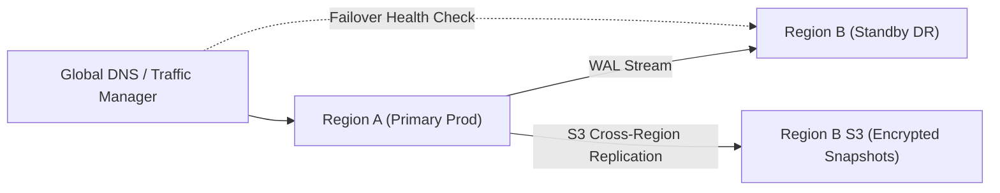

# ATLAS Enterprise Disaster Recovery Plan

## 1. Scope & Recovery Tiers

This disaster recovery plan covers major regional outages, catastrophic datacenter loss, unrecoverable database corruption, and ransomware scenarios for the ATLAS platform.

| Service Tier | Recovery Point Objective (RPO) | Recovery Time Objective (RTO) |
| :--- | :---: | :---: |
| **Tier 1: Core Process DB & State** | < 5 Minutes | < 30 Minutes |
| **Tier 2: API & Worker Compute** | 0 Minutes (Stateless) | < 15 Minutes |
| **Tier 3: Audit Logs & Historical Telemetry** | < 1 Hour | < 4 Hours |

---

## 2. Multi-Region Replication Architecture



---

## 3. Disaster Declaration & Failover Steps

1. **Disaster Declared:** By CTO or VP of Infrastructure.
2. **DNS Shift:** Failover Global Traffic Manager to Region B ingress VIP.
3. **Promote Standby Database:**
   ```bash
   pg_ctl promote -D /var/lib/postgresql/data
   ```
4. **Scale Up Secondary Worker Clusters:**
   ```bash
   kubectl scale deployment/atlas-worker --replicas=12 -n atlas-prod-dr
   ```
5. **Run Engine Recovery Sweep:**
   Trigger `recover_after_restart()` across the DR cluster to detect in-flight tasks and place ambiguous operations in reconciliation status.
