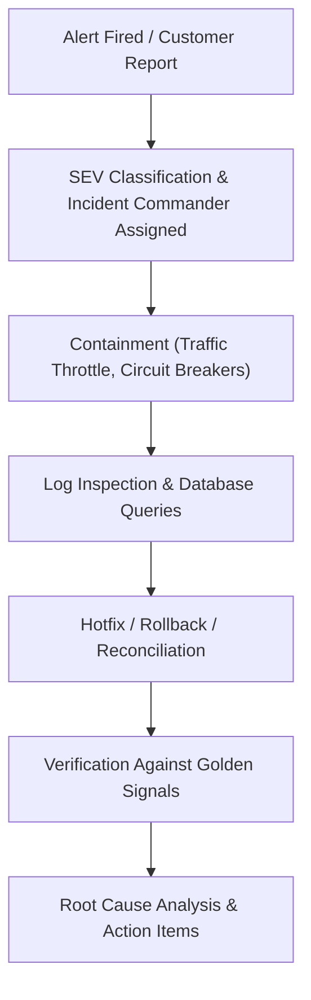

# ATLAS Incident Response & Escalation Runbook

## 1. Severity Classifications

| Severity | Definition | Target Response (MTTA) | Target Resolution (MTTR) |
| :--- | :--- | :---: | :---: |
| **SEV-1 (Critical)** | Core execution halted, tenant boundary breach, data corruption | < 15 minutes | < 2 hours |
| **SEV-2 (High)** | Major workflow degraded, worker pool crash looping, high latency | < 30 minutes | < 4 hours |
| **SEV-3 (Medium)** | Single connector outage, non-critical task delays | < 2 hours | < 24 hours |
| **SEV-4 (Low)** | Minor reporting or UI glitch with operational workaround | < 1 business day | Next release |

---

## 2. Incident Handling Workflow



---

## 3. Immediate Diagnostic Commands

### Inspect API Latency and Error Spikes:
```bash
kubectl logs -l app=atlas-api -n atlas-staging --tail=200 | grep -E "ERROR|CRITICAL|500"
```

### Inspect Stalled Worker Leases in PostgreSQL:
```sql
SELECT task_instance_id, worker_id, fencing_token, expires_at, NOW() 
FROM process_worker_leases 
WHERE expires_at < NOW() - INTERVAL '60 seconds';
```

### Check Reconciliation Queue for Ambiguous Operations:
```sql
SELECT tenant_id, idempotency_key, operation_name, status, error_message 
FROM process_operation_idempotency 
WHERE status = 'RECONCILIATION_REQUIRED';
```

### Emergency Circuit Breaker Trip:
If an external API is flooding or hanging, trip the circuit breaker manually via admin endpoint:
```bash
curl -X POST http://localhost:8000/api/v1/connectors/erp/circuit/trip -H "Authorization: Bearer $ADMIN_TOKEN"
```
