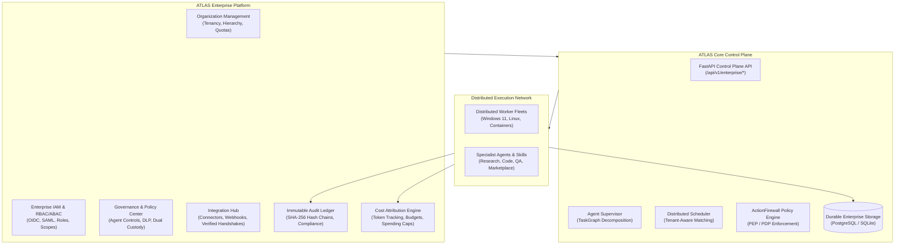

# ATLAS Phase 10 Architecture Specification: Enterprise Autonomous Operating Platform

## 1. High-Level Architectural Blueprint

Phase 10 introduces the enterprise governance, multi-tenancy, and compliance layer above the ATLAS distributed autonomous runtime.

---

## 2. Core Architectural Subsystems

### 2.1 Multi-Tenant Organization Hierarchy
- **Organization Root**: Represents enterprise customer or isolated operational domain. Owns budgets, policies, and root administrators.
- **Department**: Business unit (e.g., Engineering, Finance, Operations) with delegated administration and isolated resource quotas.
- **Team**: Operational subdivision with shared workflows and agent permissions.
- **Project**: Workstream container for specific autonomous task graphs.

### 2.2 Enterprise Identity & Access Management (IAM)
- Extensible authentication provider interface (`IdentityProviderProtocol`):
  - Local authentication, OIDC (OpenID Connect), SAML 2.0, and OAuth 2.0.
  - SCIM directory synchronization for automated user lifecycle provisioning.
- 9-Role Granular RBAC:
  1. `OrganizationOwner`: Full organization lifecycle, billing, and root policy.
  2. `OrganizationAdmin`: User, department, and integration provisioning.
  3. `SecurityAdmin`: Policy creation, approval rules, CRL, and audit exports.
  4. `DepartmentAdmin`: Department agent, workflow, and budget management.
  5. `Developer`: Agent and workflow authoring, test execution.
  6. `WorkflowPublisher`: Marketplace workflow publishing and signing.
  7. `Operator`: Task dispatch, manual approval response, worker lease control.
  8. `Auditor`: Read-only access to immutable audit logs and compliance reports.
  9. `Viewer`: Read-only status and analytics inspection.

### 2.3 Centralized Agent Governance
- Agent descriptors register approved toolchains, skills, and model adapters.
- Multi-tier policy inheritance: Organization policies override department policies; department policies override team policies.
- Gated execution: Autonomous actions must be explicitly authorized by `ActionFirewall`.

### 2.4 Enterprise Integration Hub
- Standardized `IntegrationConnector` protocol:
  - Secure credential storage: Secrets are encrypted or vaulted, never exposed in plain text.
  - Verification handshake: Integrations cannot be invoked without passing deterministic health and authentication checks.
  - Webhook authenticity: Cryptographic HMAC signature validation.

### 2.5 Immutable Audit & Cost Attribution
- Cryptographic hash-chained audit log: Each audit record contains `record_hash = sha256(canonical_json(data) + ":" + previous_hash)`.
- Real cost attribution: Measures actual token usage and compute duration, deducting from departmental budget envelopes.
