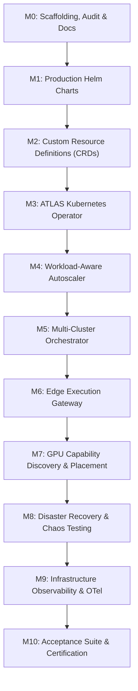

# ATLAS Phase 12 Master Implementation Plan
## Kubernetes-Native Orchestration & Edge Execution Infrastructure

**Phase:** Phase 12  
**Branch:** `feat/phase-12-kubernetes-edge-infrastructure`  
**Date Started:** 2026-11-16  
**Status:** In Progress (Milestone 0 Scaffolding Complete)  

---

## 1. Executive Mission & Strategic Scope

The mission of **ATLAS Phase 12** is to evolve ATLAS from an enterprise-grade autonomous operating runtime into a cloud-native, Kubernetes-compatible, multi-cluster autonomous execution platform.

Phase 12 enables organizations to deploy, scale, monitor, upgrade, and recover ATLAS across:
- **Production Kubernetes Clusters**: EKS, GKE, AKS, OpenShift, and on-premises vanilla Kubernetes.
- **Heterogeneous Hybrid Fleet**: Cloud containers, Linux virtual machines, and physical Windows 11 desktops.
- **Constrained Edge Worker Environments**: Edge industrial gateways, local branch servers, and field devices with intermittent network connectivity.

### Core Architecture Invariant (`AGENTS.md`)
- **No Duplicate Task Orchestration**: Kubernetes manages infrastructure, container lifecycles, and workload placement. ATLAS retains exclusive ownership of autonomous task orchestration, authorization, action execution, policy verification, and failure recovery.
- **Zero-Dependency Core**: `packages/atlas-core` remains untouched. All Kubernetes and cloud-native controller logic is housed in `packages/atlas-operator` and `packages/atlas-distributed`.
- **Action Firewall Authority**: The model plans; ATLAS controls execution. No Kubernetes controller or edge gateway may execute actions or bypass policy without authorization.

---

## 2. Infrastructure Baseline & Gap Assessment

### Verified Baseline
- **Monorepo Tests**: 628 / 628 passing (100% green rate).
- **Installed Toolchain**:
  - `python 3.11.9`
  - `uv 0.0.0`
  - `helm v4.3.2`
  - `kubectl v1.36.1`
  - `docker 29.7.2` (client)
  - `git 2.55.0.5`

### Infrastructure Gaps & Constraints
1. **Windows Host Without WSL**: Docker Desktop Linux Engine daemon cannot run directly on the local Windows host without WSL installed. Local verification must utilize real Helm CLI linting (`helm lint`), template rendering (`helm template`), Kubernetes client dry-run validation (`kubectl apply --dry-run=client`), and in-memory mock/simulated Kubernetes API controllers for automated test suites.
2. **Cluster Secret Boundary**: Plaintext credentials must never exist in Helm values committed to Git or ordinary ConfigMaps. Production Helm charts must reference external secrets or sealed secrets.
3. **Edge Worker Inbound Port Exposure**: Edge nodes must never expose incoming SSH, RDP, or HTTP ports. All edge connections must be reverse outbound-initiated via TLS/WebSocket.

---

## 3. Milestone Delivery Schedule

### Milestone 0: Baseline Verification, Infrastructure Audit & Scaffolding (COMPLETED)
- Verified Phase 11 baseline (628/628 passing).
- Scaffolded `packages/atlas-operator` (`atlas_operator`) in UV workspace.
- Documented infrastructure baseline, gaps, and risks.
- Authored full Phase 12 documentation suite.

### Milestone 1: Production Helm Charts & Manifest Infrastructure
- Author production-grade Helm chart in `deploy/helm/atlas`:
  - `Chart.yaml`, `values.yaml`, `values-dev.yaml`, `values-staging.yaml`, `values-prod.yaml`.
  - Templates: `api-deployment.yaml`, `api-service.yaml`, `api-ingress.yaml`, `api-hpa.yaml`, `api-pdb.yaml`, `supervisor-deployment.yaml`, `worker-pool-deployment.yaml`, `configmap.yaml`, `secrets.yaml`, `serviceaccount.yaml`, `rbac.yaml`, `networkpolicy.yaml`, `service-monitor.yaml`.
- Enforce non-root execution (`10001:10001`), dumb-init, probes (liveness, readiness, startup), preStop lifecycle hooks, and resource bounds.
- Validate via `helm lint` and `helm template`.

### Milestone 2: Custom Resource Definitions (CRDs) & Validation Engine
- Define versioned OpenAPI v3 CRD manifests in `deploy/crds/`:
  - `AtlasCluster` (`atlas.io/v1alpha1`)
  - `AtlasWorkerPool` (`atlas.io/v1alpha1`)
  - `AtlasAgentPool` (`atlas.io/v1alpha1`)
  - `AtlasExecutionPolicy` (`atlas.io/v1alpha1`)
  - `AtlasDeployment` (`atlas.io/v1alpha1`)
- Implement Pydantic domain schemas in `packages/atlas-operator/src/atlas_operator/models.py`.
- Implement admission validation engine in `atlas_operator/admission.py` rejecting malformed specs.

### Milestone 3: ATLAS Kubernetes Operator & Reconciliation Engine
- Implement idempotent reconciliation loops in `packages/atlas-operator/src/atlas_operator/reconciler.py`.
- Implement condition tracking, status reporting, drift detection, and rolling upgrade progression.
- Implement rollback on failure and finalizers for safe deletion.
- Implement operator entrypoint in `atlas_operator/main.py`.

### Milestone 4: Workload-Aware Autoscaler
- Implement `WorkloadAwareAutoscaler` in `packages/atlas-operator/src/atlas_operator/autoscaler.py`.
- Calculate desired replicas dynamically from queue depth, pending task assignments, worker utilization, task priority, task deadlines, and tenant quotas.
- Implement anti-flapping dampening with cooldown timers and step limits.

### Milestone 5: Multi-Cluster Orchestration & Placement Engine
- Implement `MultiClusterManager` in `packages/atlas-distributed/src/atlas_distributed/multi_cluster.py`.
- Support cluster registration, health probing, capability aggregation, and latency tracking.
- Global task scheduler placing workloads based on capabilities, policy, locality, and tenant boundary.
- Cross-cluster failover with monotonic lease fencing to prevent duplicate action execution.

### Milestone 6: Edge Execution Gateway & Resilient Buffer
- Implement `EdgeExecutionGateway` and `EdgeWorkerClient` in `packages/atlas-distributed/src/atlas_distributed/edge_gateway.py`.
- Reverse outbound connection architecture with mutual cryptographic authentication.
- Message buffering and intermittent connectivity resilience with local durable offline store.
- Capability reporting (OS, CPU, RAM, battery/power, disk) and remote revocation.

### Milestone 7: GPU Capability Discovery & Intelligent Scheduling
- Implement `GPUCapabilityManager` in `packages/atlas-distributed/src/atlas_distributed/gpu.py`.
- Discover GPU vendor, model, total/free VRAM, driver version, compute capability, and runtime support (CUDA, ROCm, TensorRT, vLLM, Ollama).
- Match task `gpu_requirements` with worker fleet and gracefully reject/queue incompatible workloads.

### Milestone 8: Disaster Recovery & Automated Fault Injection
- Implement `DisasterRecoveryCoordinator` in `packages/atlas-distributed/src/atlas_distributed/disaster_recovery.py`.
- Automated chaos test suite simulating: pod termination, node drain, network partition, database outage, worker interruption, and stale lease fencing.

### Milestone 9: Infrastructure Observability & OpenTelemetry Metrics
- Extend metrics and tracing in `packages/atlas-observability` and `packages/atlas-operator/src/atlas_operator/metrics.py`.
- Track cluster availability, pod health, queue depth, scheduler latency, GPU utilization, and autoscaling events.
- Cross-cluster and edge W3C `traceparent` context propagation.

### Milestone 10: Phase 12 Acceptance Suite & Final Certification
- Author comprehensive integration suite `tests/integration/test_phase12_acceptance.py` covering scenarios K8S-01 through K8S-24.
- Verify 100% monorepo regression pass rate.
- Author final `docs/PHASE_12_ACCEPTANCE_REPORT.md`.
