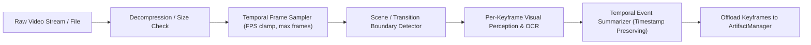

# ATLAS Phase 13 Audio & Video Intelligence Specification

---

## 1. Video Processing & Understanding Pipeline

ATLAS agents handle video inputs (e.g. screen recordings, live streams, UI tutorials, user-submitted bug videos) via a resource-controlled frame extraction and event summarization pipeline.



### 1.1 Temporal Frame Sampling
- **Dynamic Downsampling**: Video inputs often have high frame rates (30-60 fps). ATLAS samples keyframes at a configurable rate (default: 1.0 fps or max 60 keyframes per clip) to avoid context exhaustion and latency spikes.
- **Scene Segmentation**: Changes in visual hash beyond threshold $\theta_{scene} = 0.35$ delineate a scene change. Keyframes are preserved at each boundary.
- **Timestamp Integrity**: Every extracted keyframe maintains its exact fractional second offset (`timestamp_offset_sec`) from the start of the video.

### 1.2 Video Observation Model
```python
class VideoObservation:
    video_id: str
    duration_seconds: float
    total_frames_sampled: int
    keyframes: list[
        VideoFrame
    ]  # (frame_index, timestamp_offset_sec, image_artifact_ref, visual_hash)
    temporal_events: list[TemporalEvent]  # (start_sec, end_sec, label, description)
```

---

## 2. Audio Processing & Microphone Consent Framework

Audio understanding provides speech-to-text, speaker diarization, and synthetic speech output. Because audio recording carries severe privacy and compliance risks (e.g. GDPR, wiretap regulations, HIPAA), ATLAS enforces explicit, tokenized consent.

### 2.1 Mandatory Microphone Consent Protocol
1. **Consent Token Requirement**:
   - Any attempt to activate microphone recording requires an explicit, active `AudioConsentToken`.
   - The token contains: `tenant_id`, `user_id`, `granted_at`, `expires_at`, `scopes` (e.g. `['transcription_only']`).
2. **Action Firewall Gate**:
   - The Action Firewall intercepts all `START_AUDIO_RECORDING` calls.
   - If `consent_token` is missing, expired, or tampered with, execution immediately halts with `UnauthorizedRecordingError`.
   - Recording is strictly prohibited from running silently or in the background without user knowledge.
3. **Audit Trail**:
   - Every audio recording session generates an immutable audit log entry documenting start time, end time, duration, and consent token fingerprint.

### 2.2 Speech Transcription & Diarization
- **Timestamped Transcripts**: Audio is chunked into utterances with `start_time_sec`, `end_time_sec`, and word-level timestamps.
- **Speaker Segmentation**: Transcripts identify speaker labels (`speaker_0`, `speaker_1`) enabling multi-participant conversational understanding.
- **Privacy Masking**: High-entropy strings (e.g. credit card numbers, passwords mentioned aloud) are redacted prior to storage or prompting.
