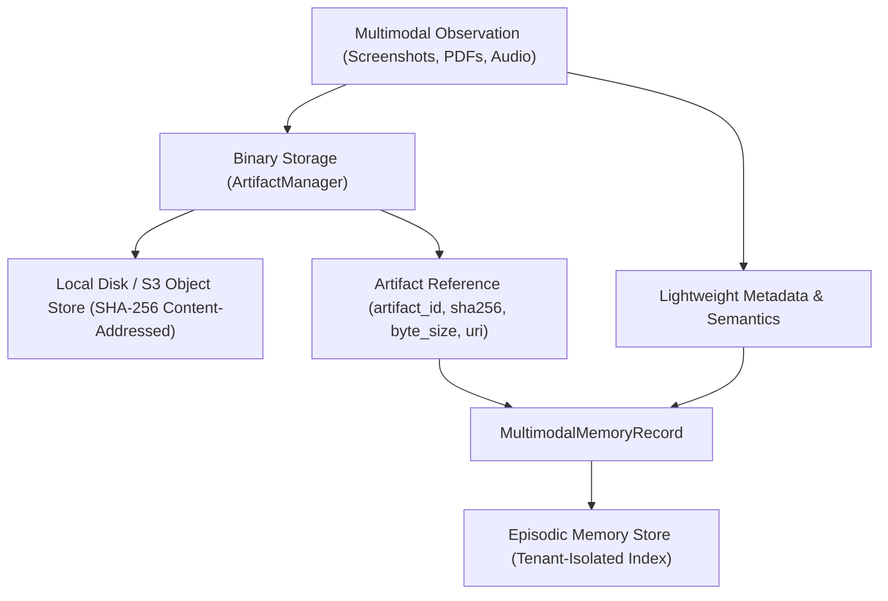

# ATLAS Phase 13 Multimodal Episodic Memory Specification

---

## 1. Multimodal Memory Architecture & Storage Offloading

Multimodal reasoning generates heavy binary artifacts: high-resolution screenshots, video keyframes, audio clips, and PDF pages. Storing these directly in memory or vector databases causes severe memory bloat and context exhaustion.

ATLAS separates **lightweight metadata & embeddings** from **heavy binary storage**:



### 1.1 Multimodal Memory Record Schema
```python
class MultimodalMemoryRecord:
    record_id: str
    tenant_id: str
    task_id: str
    timestamp: float
    modality: MultimodalModality
    summary: str
    semantic_tags: list[str]
    artifact_ref: str  # content-addressed URI managed by ArtifactManager
    artifact_hash: str
    byte_size: int
    extracted_text: str | None
    bounding_boxes: list[BoundingBox] | None
```

---

## 2. Strict Tenant Isolation & Cross-Tenant Boundary Enforcement

ATLAS is an enterprise multi-tenant platform (Phase 10/11 guarantees). Under no circumstances may an agent querying episodic memory observe, recall, or cross-reference multimodal artifacts belonging to another tenant.

### 2.1 Boundary Rules

1. **Mandatory Tenant Scoping**:
   - Every lookup, filter, or vector search in `MultimodalMemoryStore` requires an explicit `tenant_id`.
   - Any query omitting `tenant_id` or passing wildcard tenant identifiers is rejected with a `TenantContextRequiredError`.
2. **Cross-Tenant Access Detection**:
   - If a caller attempts to retrieve an artifact reference or memory record with an mismatched `tenant_id`, the store raises `CrossTenantMemoryAccessViolation`.
   - An alert is immediately emitted to the security audit logger.
3. **Artifact Authorization Check**:
   - Downloading raw binary media via `ArtifactManager` requires validation that the requesting task/agent belongs to the owning `tenant_id`.

---

## 3. Retention & Lifecycle Management

- **Task-Level Retention**: Ephemeral visual observations from routine UI steps expire after task completion unless explicitly pinned as a task deliverable or bug report.
- **Durable Milestones**: Verification screenshots, signed receipts, and compliance evidence are marked `RETAIN_PERMANENT` or governed by organization retention policies (e.g. 90-day compliance retention).
