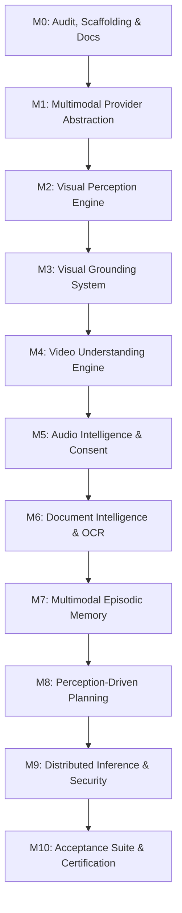

# ATLAS Phase 13 Master Implementation Plan
## Multimodal Autonomous Perception & Intelligence Platform

**Phase:** Phase 13  
**Branch:** `feat/phase-13-multimodal-intelligence`  
**Date Started:** 2026-11-16  
**Status:** In Progress (Milestone 0 Scaffolding Complete)  

---

## 1. Executive Mission & Strategic Scope

The mission of **ATLAS Phase 13** is to build a production-oriented multimodal perception and intelligence platform. It enables ATLAS agents to perceive, understand, reason about, and interact with:
- **Visual Information**: High-resolution screenshots, UI element identification, OCR text detection, visual anomaly detection, and state comparisons.
- **Visual Grounding**: Precision mapping across coordinate spaces (Normalized, Viewport, Screen, multi-monitor offsets, DPI/DPR scaling, browser zoom) with strict stale coordinate rejection.
- **Video Streams**: Temporal sampling, frame extraction, scene segmentation, and event summarization with timestamp fidelity.
- **Audio & Speech**: Consent-driven microphone recording, timestamped transcription, speaker segmentation, and speech synthesis.
- **Document Intelligence**: Scanned document processing, PDF parsing, table extraction, and structured JSON extraction with page-level evidence.
- **Multimodal Episodic Memory**: Provenance tracking, durable media storage via `ArtifactManager`, semantic indexing, and strict tenant isolation.

### Architectural Governance & Invariants (`AGENTS.md`)
1. **Core Zero-Dependency Preservation**: `packages/atlas-core` remains 100% zero-dependency. All multimodal engine logic is contained in `packages/atlas-multimodal`.
2. **Perception Gating Through Action Firewall**: Multimodal observations provide sensory input; they NEVER bypass the Action Firewall or execute actions directly.
3. **No Hallucinated Modalities**: Capabilities must be explicitly declared and validated per provider. Unsupported modalities must fail fast.
4. **Stale Observation Rejection**: Coordinates from outdated observations (> 5s) are rejected; fresh visual capture is mandatory before executing clicks or typing.
5. **Untrusted External Media**: All external media (images, PDFs, audio) are treated as untrusted and subjected to decompression bomb checks, dimension limits, and prompt-injection scanning.

---

## 2. Milestone Breakdown & Delivery Schedule

- **M0: Audit, Scaffolding & Docs**: Monorepo verification (652 tests passing), scaffold `packages/atlas-multimodal`, author full documentation suite.
- **M1: Multimodal Provider Abstraction**: Capability negotiation, model routing, fallback selection, resource accounting, timeouts, and structured error hierarchies.
- **M2: Visual Perception Engine**: Screenshot analysis, button/control/window detection, OCR text extraction, visual state comparison, ROI extraction.
- **M3: Visual Grounding System**: Coordinate normalization, DPR/zoom scaling, multi-monitor offsets, and stale coordinate rejection.
- **M4: Video Understanding Engine**: Frame sampling, scene segmentation, temporal event detection, and timestamp preservation.
- **M5: Audio Intelligence & Consent**: Audio ingestion, transcription, speaker segmentation, and consent-gated microphone recording.
- **M6: Document Intelligence & OCR**: PDF parsing, table extraction, structured JSON extraction, and decompression bomb protection.
- **M7: Multimodal Episodic Memory**: Media offloading to `ArtifactManager`, semantic indexing, and strict tenant isolation.
- **M8: Perception-Driven Planning**: Perception bridge to hierarchical planner with Action Firewall authorization.
- **M9: Distributed Multimodal Inference**: GPU placement matching, local vs remote routing, and anti-prompt-injection scanner.
- **M10: Acceptance Suite & Certification**: 27 automated scenarios (MM-01 to MM-27), full monorepo regression, and final certification report.
