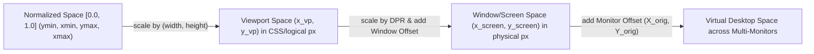

# ATLAS Phase 13 Visual Grounding & Coordinate Systems Specification

---

## 1. Overview & Coordinate Spaces

ATLAS agents operate across heterogeneous environments: headless Linux containers, virtualized web browsers, local desktops, and multi-monitor physical workstations. To reliably click, drag, scroll, and type without drift, ATLAS defines three formal coordinate spaces and explicit transformations between them.

### 1.1 Coordinate Space Definitions

1. **Normalized Space $[0.0, 1.0]$**:
   - Model-native coordinate bounding box: `ymin`, `xmin`, `ymax`, `xmax` in the range $[0.0, 1.0]$.
   - Independent of display resolution, DPR, or aspect ratio.
   - Origin $(0.0, 0.0)$ is top-left; $(1.0, 1.0)$ is bottom-right.
   - Point center calculation:
     $$\bar{x} = \frac{xmin + xmax}{2}, \quad \bar{y} = \frac{ymin + ymax}{2}$$

2. **Viewport Space (CSS / Logical Pixels)**:
   - Coordinates relative to the application or browser viewport.
   - $x_{vp} = \bar{x} \times \text{viewport\_width}$
   - $y_{vp} = \bar{y} \times \text{viewport\_height}$
   - Affected by internal browser zoom factor $z$:
     $$x_{vp, zoomed} = \frac{x_{vp}}{z}, \quad y_{vp, zoomed} = \frac{y_{vp}}{z}$$

3. **Screen / OS Space (Physical Device Pixels)**:
   - Operating system mouse cursor target coordinates.
   - Accounts for Device Pixel Ratio ($\text{DPR}$), OS display scaling (e.g. 125%, 150%, 200%), and window chrome / client rect offsets $(x_{chrome}, y_{chrome})$:
     $$x_{screen} = (x_{vp} \times \text{DPR}) + x_{chrome}$$
     $$y_{screen} = (y_{vp} \times \text{DPR}) + y_{chrome}$$

4. **Multi-Monitor Virtual Desktop Space**:
   - Multi-monitor setups arrange screens on a continuous 2D virtual canvas.
   - Each monitor $M_i$ has geometry $(X_{origin}, Y_{origin}, W_{phys}, H_{phys}, \text{DPR}_i)$.
   - Global coordinate:
     $$x_{global} = M_i.X_{origin} + x_{screen, i}$$
     $$y_{global} = M_i.Y_{origin} + y_{screen, i}$$

---

## 2. Stale Coordinate Rejection Protocol

Executing a click or input based on an outdated visual observation is a major cause of unintended automation failures (e.g. clicking where a button used to be after a page has scrolled or modal has appeared).

### 2.1 Rejection Rules

1. **Max Age Threshold**:
   - Default maximum age is $\tau_{max} = 5.0$ seconds.
   - If $\Delta t = t_{current} - t_{observation} > \tau_{max}$, the coordinate is marked **STALE** and execution is immediately rejected.
2. **Boundary Containment Check**:
   - A target bounding box must fall strictly inside the current active viewport boundaries:
     $$0.0 \le xmin < xmax \le 1.0, \quad 0.0 \le ymin < ymax \le 1.0$$
   - Coordinates outside viewport bounds trigger an `OutOfBoundsCoordinateError`.
3. **Mandatory Fresh Capture**:
   - When coordinates are rejected as stale, the execution loop forces a new screenshot observation before retrying.

---

## 3. Grounding Verification Invariant

Following Constitution Rule 7 (Deterministic Post-Condition Verification):
- Every visually-grounded action (e.g. `click(elem_id)`) must verify:
  1. The target element exists in the visual perception tree.
  2. The timestamp is within $\tau_{max}$.
  3. Pre-action visual state hash $H_{pre}$ is recorded.
  4. Post-action screenshot is taken, resulting in $H_{post}$.
  5. If $H_{pre} == H_{post}$ and the action expected a UI transition (e.g. navigation, modal open), verification fails or enters retry with exponential backoff.
