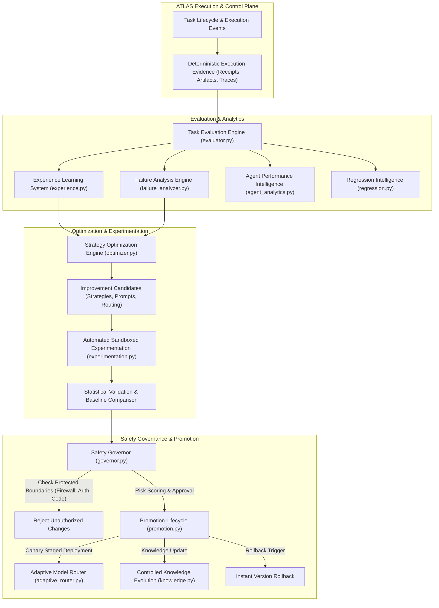

# ATLAS Phase 14 Architecture Specification
## Autonomous Self-Improvement, Evaluation & Adaptive Intelligence Platform

---

## 1. System Architecture & Component Interaction

Phase 14 introduces the `atlas-adaptive` package as a closed-loop evaluation, learning, and controlled optimization layer on top of the existing ATLAS control plane:

---

## 2. Immutable Boundaries & Safety Invariants

The fundamental architectural principle of Phase 14 is **bounded adaptation**:

1. **Mutable Domain**:
   - Strategy parameters (planning depth, retry backoffs, fallback order).
   - Adaptive model routing weights (cost/latency trade-offs).
   - Knowledge artifacts and prompt examples.
   - Tool selection heuristics within approved tool catalogs.
2. **Strictly Immutable Domain (Safety Governor Protected)**:
   - Action Firewall rules and policy engine.
   - Core authorization, authentication, and token verification.
   - Tenant isolation and cross-tenant boundary controls.
   - Credential and secret management.
   - Production source code (`packages/atlas-*`, `apps/*`).
   - Audit trail persistence and integrity.

Any candidate modification targeting the immutable domain triggers immediate rejection with `ProtectedComponentModificationError` and emits an alert to the security audit ledger.
