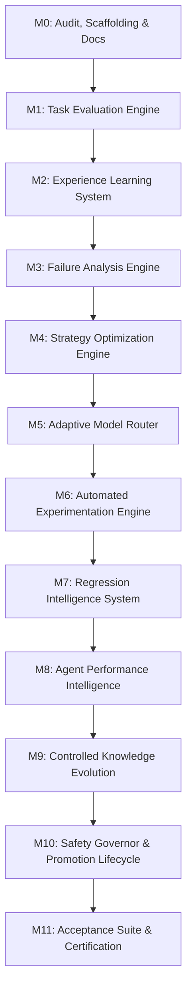

# ATLAS Phase 14 Master Implementation Plan
## Autonomous Self-Improvement, Evaluation & Adaptive Intelligence Platform

**Phase:** Phase 14  
**Branch:** `feat/phase-14-autonomous-self-improvement`  
**Date Started:** 2026-11-16  
**Status:** In Progress (Milestone 0 Scaffolding Complete)  

---

## 1. Executive Mission & Strategic Scope

The mission of **ATLAS Phase 14** is to build a controlled, evidence-driven autonomous self-improvement platform. It enables ATLAS to:
- **Evaluate** its own task performance objectively using verifiable execution evidence rather than LLM self-reporting.
- **Learn** from execution history by indexing successful and failed execution patterns with full provenance.
- **Analyze** failures with structured multi-class root cause attribution.
- **Optimize** strategies across planning, agent selection, model selection, retry/recovery, and tool routing.
- **Route** model requests adaptively based on measured latency, cost, and historical quality while preserving data privacy boundaries.
- **Experiment** in isolated sandboxes comparing candidate improvements against fixed baselines with statistical rigor.
- **Detect** performance regressions across accuracy, cost, latency, recovery frequency, and safety.
- **Govern** self-improvement with an immutable Safety Governor that blocks autonomous tampering with Action Firewall rules, core security boundaries, tenant isolation, authentication, and production source code.
- **Promote** validated improvements through a disciplined lifecycle: Candidate $\to$ Validation $\to$ Isolated Experiment $\to$ Baseline Comparison $\to$ Safety Review $\to$ Approval $\to$ Canary Deployment $\to$ Monitoring $\to$ Acceptance / Rollback.

### Core Architectural Principle
> **CRITICAL INVARIANT:**
> ATLAS may autonomously optimize approved strategies, prompt configurations, routing policies, and knowledge artifacts.
> ATLAS **must not** autonomously rewrite its own security boundaries, authorization engine, action firewall, credential handling, tenant isolation, or production source code.
> Any candidate attempting to modify protected components or production code must be immediately rejected by the Safety Governor.

---

## 2. Milestone Breakdown & Delivery Schedule

- **M0: Audit, Scaffolding & Docs**: Baseline verification (679 tests passing), scaffold `packages/atlas-adaptive`, author comprehensive docs suite.
- **M1: Task Evaluation Engine (`evaluator.py`)**: Evidence-backed outcome measurement across completion, verification evidence, duration, model usage, recovery frequency, policy denials, and domain-specific rubrics.
- **M2: Experience Learning System (`experience.py`)**: Structured experience store capturing success/failure patterns, tool/model performance, environmental constraints, with provenance tracking and rejection of unverified memory.
- **M3: Failure Analysis Engine (`failure_analyzer.py`)**: Multi-class failure classification (planning, model reasoning, tool selection, browser/desktop errors, visual grounding, network, worker, permission, verification) with evidence-backed root cause attribution.
- **M4: Strategy Optimization Engine (`optimizer.py`)**: Multi-objective optimization (Pareto / weighted utility) comparing candidates against fixed baselines without degrading safety.
- **M5: Adaptive Model Router (`adaptive_router.py`)**: Routing based on latency, cost, and historical quality with strict enforcement of data classification boundaries (preventing confidential data dispatch).
- **M6: Automated Experimentation Engine (`experimentation.py`)**: Sandboxed candidate evaluations against fixed benchmark datasets with statistical testing, repeated trials, and resource ceilings.
- **M7: Regression Intelligence System (`regression.py`)**: Real-time performance regression monitoring across success rate, verification accuracy, latency, recovery frequency, and cost.
- **M8: Agent Performance Intelligence (`agent_analytics.py`)**: Specialist agent performance tracking across completion, latency, recovery, and policy denials, without auto-expanding permissions.
- **M9: Controlled Knowledge Evolution (`knowledge.py`)**: Versioned knowledge candidate generation, duplicate and contradiction detection, human review, cryptographic signing, approval, rollback, and deprecation.
- **M10: Safety Governor & Promotion Lifecycle (`governor.py`, `promotion.py`)**: Strict enforcement of immutable security boundaries, risk scoring, change classification, canary deployment, and rollback protocol.
- **M11: Acceptance Suite & Final Certification (`tests/integration/test_phase14_acceptance.py`)**: Automated verification of scenarios AUTO-01 through AUTO-27, full monorepo regression, and publication of `PHASE_14_ACCEPTANCE_REPORT.md`.
