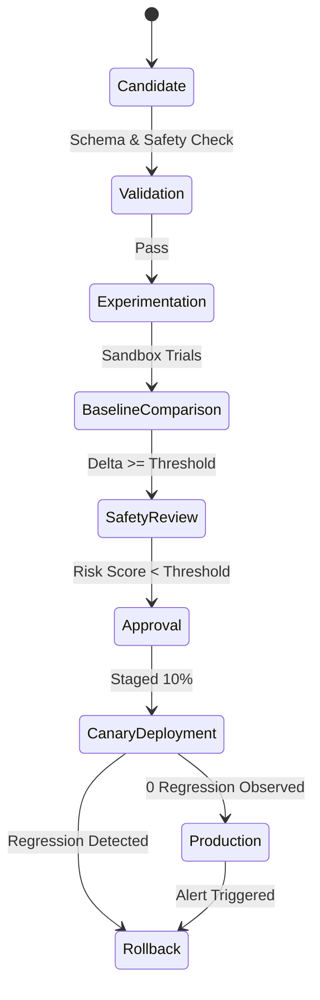

# ATLAS Phase 14 Safety Governance Specification
## Safety Governor, Immutable Boundaries & Promotion Protocol

---

## 1. Safety Governor Architecture

The Safety Governor is the non-negotiable firewall between autonomous self-improvement and the core operating system.

### 1.1 Protected Assets (Strictly Immutable)
The Safety Governor enforces that the following components can never be modified or superseded by autonomous proposals:
- `ActionFirewall` policy rules and evaluation logic.
- Authentication, worker HMAC tokens, and JWT issuance.
- Multi-tenant data isolation and schema scoping.
- Core source code (`packages/atlas-core/`, `packages/atlas-policy/`, etc.).
- Secret and credential storage.
- Immutable audit log storage.

Any candidate attempting to target protected components is permanently rejected:

```python
class SafetyGovernor:
    PROTECTED_PATHS = [
        "packages/atlas-core",
        "packages/atlas-policy",
        "packages/atlas-storage",
        "packages/atlas-enterprise",
        "deploy/",
        "AGENTS.md",
    ]

    def validate_candidate(self, candidate: ImprovementCandidate) -> None:
        if candidate.targets_protected_component(self.PROTECTED_PATHS):
            raise ProtectedComponentModificationError(
                f"Candidate '{candidate.candidate_id}' attempted to modify protected component! "
                "Autonomous self-modification of core security/code is strictly forbidden."
            )
```

---

## 2. Promotion & Rollback Lifecycle



1. **Canary Staged Deployment**: New strategies are routed only 10% of non-critical traffic initially.
2. **Instant Automated Rollback**: If the Regression Intelligence system detects an increase in error rate or cost beyond 5%, the canary is instantly terminated and the pinned prior version is restored.
