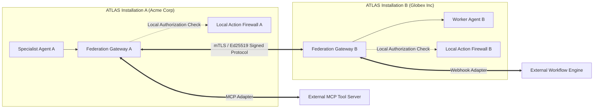

# ATLAS Phase 15 Architecture Specification
## Federated Autonomous Intelligence Network & Global Agent Interoperability

---

## 1. Network Topology & Federation Boundaries

Phase 15 introduces decentralized federation where independent ATLAS installations interact peer-to-peer or across private federation meshes without surrendering sovereign control:

---

## 2. Core Architectural Pillars

### 2.1 Independent Sovereign Control
- Every installation maintains its own identity roots, tenant schemas, worker pools, and Action Firewall policy rules.
- Under no circumstances does a remote task proposal execute without evaluation and approval by the local Action Firewall of the receiving node.

### 2.2 Independent Verification Invariant
- The sending node never marks a delegated task as complete simply because the remote agent returned `{"status": "SUCCESS"}`.
- The remote worker must attach deterministic post-condition verification evidence (signed receipts, cryptographic hashes, output artifacts).
- The sending node's verification engine independently evaluates the evidence against the task's acceptance criteria before confirming completion.

### 2.3 Defense in Depth Against Adversarial Federation Participants
- **Zero Local Host Access**: Remote delegated agents run in sandboxed worker containers with no local host filesystem, browser, or desktop access.
- **Tenant Isolation**: Cross-tenant data transfer across federation boundaries requires explicit authorization tokens.
- **Action Firewall Immutability**: No federation protocol message or remote task contract can modify, disable, or append rules to the local Action Firewall.
