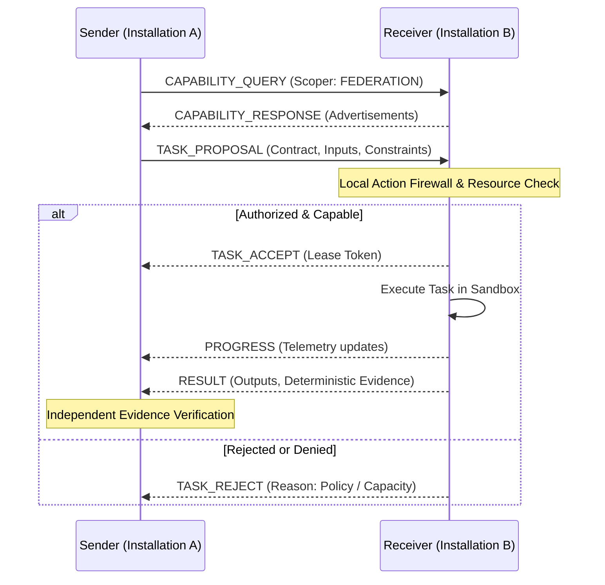

# ATLAS Phase 15 Agent-to-Agent Federation Protocol Specification

---

## 1. Versioned Message Envelope Structure

All messages exchanged between participating ATLAS installations must use the versioned `FederationMessage` envelope:

```json
{
  "protocol_version": "1.0.0",
  "message_id": "msg_fed_987654321",
  "correlation_id": "corr_task_8812",
  "message_type": "TASK_PROPOSAL",
  "sender": {
    "organization_id": "org_acme",
    "installation_id": "inst_us_east_1",
    "agent_id": "agent_procurement_01"
  },
  "recipient": {
    "organization_id": "org_globex",
    "installation_id": "inst_eu_west_1",
    "agent_id": "agent_supplier_02"
  },
  "timestamp": 1731799200.125,
  "expires_at": 1731799260.125,
  "nonce": "a4f89d3c2e1b",
  "payload": { ... },
  "signature": "ed25519:3b94a..."
}
```

---

## 2. Message Types & Lifecycle



### 2.1 Replay & Expiry Defenses
1. **Nonce Validation**: Each message specifies a unique nonce. Receiving gateways cache nonces for the duration of the message TTL ($60\text{s}$). If a nonce is re-observed, the message is rejected with `ReplayAttackDetectedError`.
2. **TTL Clock Skew Check**: If `current_time > expires_at` or `current_time < timestamp - 10s`, the message is rejected with `ExpiredMessageError`.
3. **Cryptographic Signature Verification**: The envelope signature is verified against the sender's public key; tampered payloads immediately fail verification.
