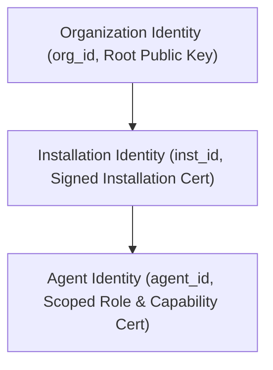

# ATLAS Phase 15 Federated Identity & Trust Model

---

## 1. Identity Hierarchy & Cryptographic Verification

Federation participants are identified hierarchically using public-key cryptography (Ed25519 / RSA-4096 / mTLS X.509 certificates):



### 1.1 Federation Credentials Schema
```python
class FederationCredentials:
    credential_id: str
    organization_id: str
    installation_id: str
    issued_at: float
    expires_at: float
    public_key_pem: str
    scopes: list[str] = ["federation:discover", "federation:propose"]
    issuer_signature: str
```

---

## 2. Credential Rotation & Immediate Revocation

1. **Regular Rotation**: Credentials expire after a short lifecycle (e.g. 24 hours) and must be rotated using mutual TLS authentication.
2. **Revocation Registry**: Gateways maintain an in-memory and persisted `RevocationList`.
   - If an organization or agent credential is compromised, a signed revocation event is broadcast.
   - Any message signed by a revoked credential is instantaneously rejected (`CredentialRevokedError`).
3. **Trust Relationships**:
   - Organizations define pairwise trust policies (e.g. `ALLOW_DELEGATION`, `DISCOVERY_ONLY`, `BLOCKED`).
   - Trust does not imply blanket authorization; it only permits protocol message exchange.
