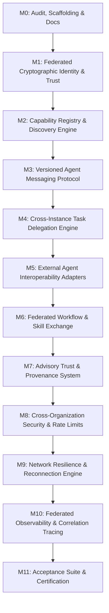

# ATLAS Phase 15 Master Implementation Plan
## Federated Autonomous Intelligence Network & Global Agent Interoperability

**Phase:** Phase 15  
**Branch:** `feat/phase-15-federated-agent-network`  
**Date Started:** 2026-11-16  
**Status:** In Progress (Milestone 0 Scaffolding Complete)  

---

## 1. Executive Mission & Strategic Scope

The mission of **ATLAS Phase 15** is to build a secure, decentralized federated autonomous intelligence network. It enables independently operated ATLAS installations, enterprise environments, trusted agents, and external automation platforms to:
- **Discover** capabilities with granular visibility controls (`PRIVATE`, `ORGANIZATION`, `FEDERATION`, `PUBLIC`).
- **Communicate** via a versioned, cryptographically-signed agent-to-agent protocol with replay and tampering protection.
- **Delegate** structured tasks across independent installations where the receiving party independently authorizes execution via local Action Firewall rules, and the sending party independently verifies returned evidence.
- **Interoperate** with external ecosystems (Model Context Protocol, HTTP/Webhooks, compatible agent protocols).
- **Exchange** verified workflows and skills from Phase 8 with signature verification without granting permission inheritance.
- **Maintain** network resilience during WAN partitions with idempotent outbox messaging and state reconciliation.

### Core Architectural Governance & Invariants
1. **Decentralized Sovereign Authority**: Each ATLAS installation retains 100% independent administrative, security, policy, and execution authority. No global service has universal or unrestricted access.
2. **Discovery $\ne$ Authorization**: Discovering an agent's capability never grants automatic permission to invoke it.
3. **Reputation $\ne$ Security**: Advisory reputation scores cannot substitute for cryptographic authentication and policy authorization.
4. **Independent Verification**: Remote agent claims are never accepted as proof of completion; receiving installations independently authorize execution, and sending installations independently verify returned evidence.
5. **Action Firewall Immutability**: Remote participants can never modify local Action Firewall rules or gain unrestricted host/browser/desktop access.

---

## 2. Milestone Breakdown & Delivery Schedule

- **M0: Audit, Scaffolding & Docs**: Baseline verification (706 tests passing), scaffold `packages/atlas-federation`, author docs suite (`PHASE_15_*.md`).
- **M1: Federated Cryptographic Identity & Trust (`identity.py`)**: Participant/Installation/Agent identities, signed credentials, mutual authentication, rotation, and revocation.
- **M2: Capability Registry & Discovery (`discovery.py`)**: Capability advertisement with 4-tier visibility scoping (`PRIVATE`, `ORGANIZATION`, `FEDERATION`, `PUBLIC`) and zero secret leakage.
- **M3: Versioned Agent Messaging Protocol (`protocol.py`)**: Signed message envelopes, correlation IDs, TTL expiration, nonce-based replay prevention, and duplicate detection.
- **M4: Cross-Instance Task Delegation Engine (`delegation.py`)**: Explicit task contracts, local authorization gate on receiving node, independent evidence verification on sending node.
- **M5: External Agent Interoperability (`external_adapters.py`)**: Adapters for Model Context Protocol (MCP), HTTP/Webhook integrations, and external agent protocols.
- **M6: Federated Workflow & Skill Exchange (`workflow_exchange.py`)**: Signed package discovery, provenance validation, private registry isolation, and zero-permission inheritance.
- **M7: Advisory Trust & Provenance System (`reputation.py`)**: Evidence-backed advisory reputation scoring without bypassing cryptographic policy.
- **M8: Cross-Organization Security (`security.py`)**: Quotas, rate limiting, Action Firewall protection, and tenant boundary enforcement.
- **M9: Network Resilience & Reconnection (`resilience.py`)**: Durable outbox/inbox messaging, idempotency keys, and safe state reconciliation.
- **M10: Federated Observability (`observability.py`)**: Trace/correlation ID propagation, telemetry redaction, and participant health monitoring.
- **M11: Acceptance Suite & Certification (`tests/integration/test_phase15_acceptance.py`)**: Verification of FED-01 to FED-30 scenarios, full monorepo regression, and publication of `PHASE_15_ACCEPTANCE_REPORT.md`.
