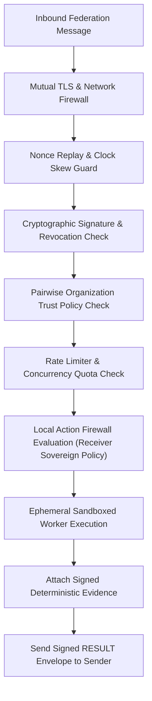

# ATLAS Phase 15 Federated Security Model & Threat Mitigations

---

## 1. Federation Threat Matrix

| Threat Vector | Description | Impact | ATLAS Mitigation |
| :--- | :--- | :--- | :--- |
| **Spoofed Federation Peer** | Malicious server impersonating a trusted business partner. | Unauthorized task proposals, data exfiltration. | Mutual authentication (mTLS) and signed `FederationCredentials` with revocation checks. |
| **Replay Attacks** | Attacker intercepts a valid signed proposal and resubmits it repeatedly. | Resource exhaustion, duplicate payments/actions. | Nonce cache with 60s TTL; duplicate nonces rejected with `ReplayAttackDetectedError`. |
| **Tampered Proposals** | Man-in-the-middle alters task parameters or destination accounts. | Misdirected transactions, unauthorized system states. | End-to-end Ed25519 payload signing; signature mismatches abort immediately. |
| **Firewall Modification** | Remote proposal attempts to insert rules into local Action Firewall. | Loss of local security boundary. | Strict immutability: Action Firewall rejects external edits; proposals only specify task parameters. |
| **False Evidence Spoofing** | Compromised remote worker returns forged success without executing work. | Premature task completion, corruption of dependent tasks. | Independent evidence verification by sender; unverified results rejected. |
| **Cross-Tenant Exfiltration**| Malicious peer requests data from another tenant on the local installation. | Cross-tenant data leakage. | Tenant context enforced in all gateway handlers; cross-tenant requests raise `CrossTenantViolation`. |
| **Runaway Resource Consumption** | Peer floods installation with thousands of task proposals. | Denial of Service (DoS) of local workers. | Inbound rate limiting, concurrency quotas, and per-organization resource ceilings. |
| **Malicious Skill Packages** | Remote organization distributes backdoored marketplace skills. | Remote code execution on worker pods. | Phase 8 package signing, sandboxed container isolation, zero permission inheritance. |

---

## 2. In-Depth Defense Architecture

