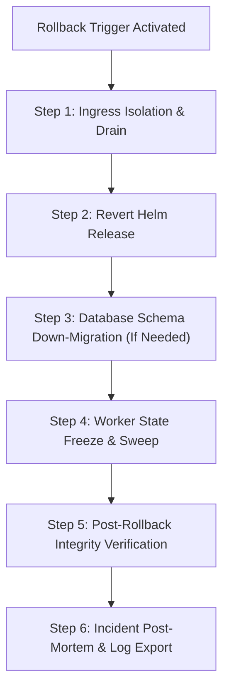

# ATLAS Phase 16.13 — Staging Canary Rollback & Disaster Recovery Protocol

## 1. Executive Summary

This protocol defines the exact, rehearsable emergency abort, rollback, and disaster recovery procedures for the ATLAS Phase 16.13 Staging Canary deployment.

**Operational Rule:** A rollback procedure is not considered production-ready until it has been dry-run and rehearsed in the target environment.

---

## 2. Emergency Abort Triggers

The Release Incident Commander or automated monitoring systems must immediately initiate this rollback protocol if any of the following triggers are met:

1. **Safety Trigger:** Duplicate execution of any irreversible synthetic transaction.
2. **Availability Trigger:** Process error rate $> 0.5\%$ over 5 minutes.
3. **Integrity Trigger:** Fencing token validation failure resulting in uncoordinated concurrent writes.
4. **Latency Trigger:** P95 latency $> 500\text{ ms}$ sustained over 10 minutes.
5. **Security Trigger:** Unauthorized network egress attempt detected by Kubernetes NetworkPolicy logs.

---

## 3. Step-by-Step Staging Canary Rollback Runbook



### Step 1: Traffic Isolation & Canary Ingress Drain
Immediately disconnect inbound synthetic webhook generators and API clients to prevent new workflows from starting:
```bash
# 1. Scale ingress and mock event generators to zero
kubectl scale deployment/synthetic-traffic-generator --replicas=0 -n atlas-staging-canary

# 2. Block inbound external HTTP traffic
kubectl patch service/atlas-api -n atlas-staging-canary \
  -p '{"spec":{"selector":{"app.kubernetes.io/name":"nonexistent"}}}'
```

### Step 2: Application Fleet Helm Reversion
Revert the container deployment to the previous known-good baseline:
```bash
# 1. Trigger atomic Helm rollback
helm rollback atlas-canary -n atlas-staging-canary

# 2. Monitor rollout status
kubectl rollout status deployment/atlas-api -n atlas-staging-canary --timeout=120s
kubectl rollout status deployment/atlas-worker -n atlas-staging-canary --timeout=120s
```

### Step 3: Database Schema Down-Migration (If Triggered by Schema Regression)
If the rollback is triggered by a database schema defect, down-migrate to the stable schema version:
```bash
# Run schema rollback job
kubectl run atlas-rollback-job --image=ghcr.io/atlas/atlas-engine:0.16.8 \
  --namespace=atlas-staging-canary --restart=Never \
  -- env ATLAS_DATABASE_URL=$CANARY_DB_URL atlas-admin migrate down --to-version=017

# Wait for completion
kubectl wait --for=condition=complete job/atlas-rollback-job -n atlas-staging-canary --timeout=180s
```

### Step 4: Worker State Freeze & Recovery Sweep
Force all in-flight worker tasks to release leases and suspend ambiguous operations:
```bash
# 1. Hard restart worker pods
kubectl rollout restart deployment/atlas-worker -n atlas-staging-canary

# 2. Verify worker recovery execution
kubectl logs -l app.kubernetes.io/name=atlas-worker -n atlas-staging-canary --tail=100 | grep "recover_after_restart"
```
*Expected Invariant:* All in-flight operations with active locks revert to `ProcessStatus.SUSPENDED` with `ReconciliationRequiredError`. Zero uncommitted tasks auto-complete.

### Step 5: Post-Rollback Integrity Verification
Execute deterministic post-condition assertions:
```bash
# 1. Verify API health
curl -f http://atlas-api.atlas-staging-canary.svc.cluster.local/healthz

# 2. Query database for orphan locks
psql $CANARY_DB_URL -c "SELECT COUNT(*) FROM process_task_leases WHERE expires_at > NOW();"

# 3. Verify audit log integrity
atlas-admin verify-audit-chain --tenant=tenant_synthetic_canary
```

---

## 4. Disaster Recovery: Database Point-In-Time Recovery (PITR)

If database corruption occurs during failure injection:

1. **Halt Database Operations**:
   ```bash
   kubectl scale deployment --all --replicas=0 -n atlas-staging-canary
   ```
2. **Restore PostgreSQL Volume to Pre-Canary Snapshot**:
   ```bash
   aws rds restore-db-instance-to-point-in-time \
     --source-db-instance-identifier atlas-staging-canary-db \
     --target-db-instance-identifier atlas-staging-canary-db-restored \
     --restore-time $(cat /tmp/canary_preflight_timestamp.txt)
   ```
3. **Verify Integrity Check**:
   ```sql
   SELECT count(*) FROM process_definitions;
   SELECT count(*) FROM process_instances;
   ```
4. **Resume Baseline Services**:
   ```bash
   kubectl scale deployment/atlas-api --replicas=2 -n atlas-staging-canary
   kubectl scale deployment/atlas-worker --replicas=2 -n atlas-staging-canary
   ```

---

## 5. Rollback Verification Checklist

- [ ] Synthetic traffic generator scaled to zero.
- [ ] Inbound HTTP requests drained with 0 dropped active connections.
- [ ] Helm release rolled back to previous revision in $< 120\text{ seconds}$.
- [ ] In-flight tasks successfully suspended with zero duplicate transactions.
- [ ] Orphan leases cleared and fencing tokens reset.
- [ ] Database integrity check confirms zero corrupted rows.
- [ ] Post-mortem diagnostics and audit logs exported for engineering review.
