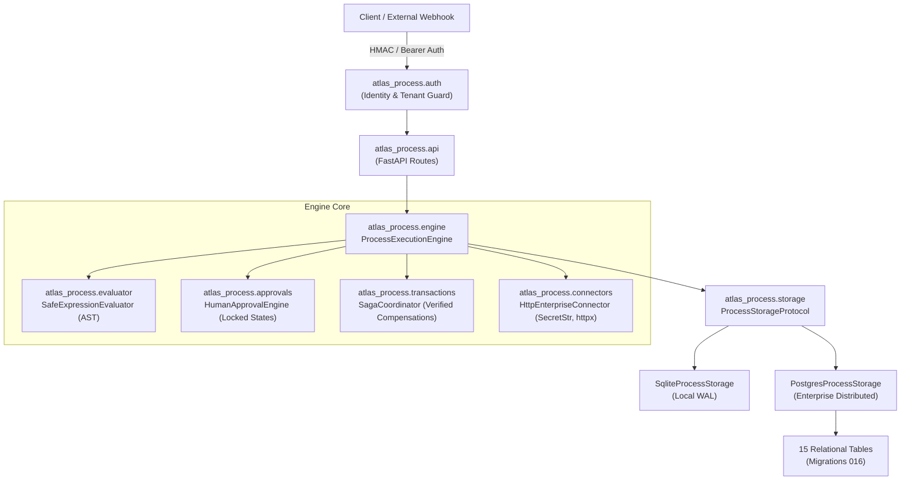

# ATLAS Phase 16.2 Architecture Specification
## Durable, Resilient & Multi-Tenant Process Execution

**Date:** 2026-11-17  
**Branch:** `feat/phase-16-2-remediation`  

---

## 1. Architectural Overview

Phase 16.2 solidifies the business-process layer of ATLAS (`packages/atlas-process`), transforming simulated mechanisms into a hardened, production-grade engine backed by relational durability, cryptographic security, and deterministic state transitions.

---

## 2. Key Subsystems & Design Hardening

### 2.1 Storage & Durability Architecture (`atlas_process.storage`)
- **Protocol Contract (`ProcessStorageProtocol`):** Unifies definition persistence, checkpoint snapshots, event logs, approval records, saga states, worker leases, and historical archival.
- **Implementations:**
  - `PostgresProcessStorage`: Production distributed backend using connection pooling (`psycopg_pool`), parameterized SQL queries, row-level locks, and monotonic fencing validation.
  - `SqliteProcessStorage`: Embedded single-node engine configured with WAL journaling (`PRAGMA journal_mode=WAL`), busy timeouts, foreign key integrity, and reentrant locking (`threading.RLock`).
  - `InMemoryProcessStorage`: Ephemeral memory store for rapid unit test cycles.

### 2.2 Crash-Recovery Invariants (`recover_after_restart`)
- Upon engine initialization or recovery signal, `recover_after_restart()` queries durable storage for all instances in non-terminal states (`RUNNING`, `SUSPENDED`).
- Expired worker leases (`expires_at < now`) are revoked, clearing `assigned_to` and `lease_token`.
- Interrupted tasks are systematically transitioned back to `ProcessTaskStatus.READY` and persisted back to durable storage in a recovery checkpoint.

### 2.3 Safe Conditional Expression Evaluator (`atlas_process.evaluator`)
- Replaces unsafe `eval`/`exec` and hardcoded `return True` stubs.
- Operates via Python AST parsing (`ast.parse`) enforcing:
  - Allowed AST nodes: `Expression`, `Compare`, `UnaryOp`, `BinOp`, `Name`, `Constant`, `BoolOp`.
  - Prohibited: `Call`, `Attribute`, `Import`, `Lambda`, `Subscript` on private attributes, comprehensions.
  - Max expression length: 500 characters. Max AST tree depth: 10 levels.
  - Resolves identifiers exclusively from the process instance variables dictionary.

### 2.4 Transactional Sagas & Honest Compensation (`atlas_process.transactions`)
- Deterministic compensation tracking: If a compensation step has no registered handler, it is immediately marked as `COMPENSATION_UNAVAILABLE`.
- Saga state advances to `SagaStatus.MANUAL_INTERVENTION_REQUIRED` / `COMPENSATION_FAILED`, returning `False` and logging structured reconciliation events.
- Post-condition verification functions (`verification_fn`) deterministically audit compensation completion.

### 2.5 API Security & Multi-Tenant Authorization (`atlas_process.auth`)
- Every endpoint in `api.py` enforces `Depends(get_current_identity)`.
- Rejects unauthenticated calls with HTTP 401.
- Validates Bearer tokens (HMAC-SHA256 signed `atk_proc_` tokens or Enterprise IAM sessions) and API keys (`X-API-Key`).
- Enforces strict tenant isolation: calls targeting foreign tenant IDs are blocked with HTTP 403 Forbidden.
- Prevents approval impersonation: non-admin callers cannot approve decisions on behalf of another user ID.

### 2.6 Enterprise Connector Transport & Credential Redaction (`atlas_process.connectors`)
- Credential protection: `SecretCredential(SecretStr)` wraps all secrets, redacting sensitive tokens in string conversions, `__repr__`, exception logs, and traces.
- Real HTTP transport: `HttpEnterpriseConnector` utilizes `httpx.Client` with connection pooling, explicit timeout boundaries, bounded retries with exponential backoff and jitter, and circuit breaker status tracking.
