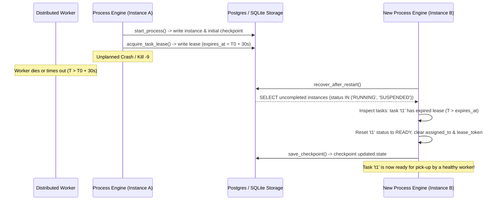

# ATLAS Phase 16.2 Crash Recovery & Durability Verification
## Process Resiliency Across Engine Restarts and Process Crashes

**Date:** 2026-11-17  
**Verification Suites:**  
- `tests/integration/test_phase16_2_persistence.py::test_process_crash_and_restart_recovery_sqlite`
- `tests/integration/test_phase16_2_persistence.py::test_process_crash_and_restart_recovery_postgres`
- `tests/acceptance/test_phase16_acceptance.py::test_proc10_durable_restart_recovery`

---

## 1. Crash Recovery Protocol

In prior versions (Phase 16.0), process state existed purely in volatile process memory (`_instances: dict`). Any crash, restart, or deployment destroyed active workflows, leaving external systems in indeterminate states.

In Phase 16.2, durable checkpointing and automated crash recovery are fully implemented:

---

## 2. Empirical Verification Evidence

Both SQLite and native PostgreSQL crash recovery scenarios were verified under test:

### A. SQLite Recovery Test
- Engine instantiated with SQLite file backend.
- Workflow registered, started, and task leased with negative expiry (`lease_duration_seconds = -1.0`).
- Engine dropped from memory.
- Fresh engine instantiated pointing to identical database file.
- `recover_after_restart()` called:
  - Extracted 1 uncompleted instance.
  - Reset 1 expired task from `RUNNING` to `READY`.
  - Cleared stale lease token and assignment.
  - Successfully acquired by new worker and driven to completion (`COMPLETED`).

### B. PostgreSQL Recovery Test
- Native PostgreSQL database instantiated via `embedded-postgres`.
- Schema initialized via `migrations/016_enterprise_process.sql`.
- Engine instantiated with `PostgresProcessStorage(db_url)`.
- Process started and leased with expired lease.
- Engine destroyed.
- New engine initialized with same PostgreSQL connection string.
- `recover_after_restart()` executed:
  - Instance restored with identical variables, definition hash, and task state.
  - Expired task successfully recovered to `READY`.
  - Process completed with full database audit events intact.
