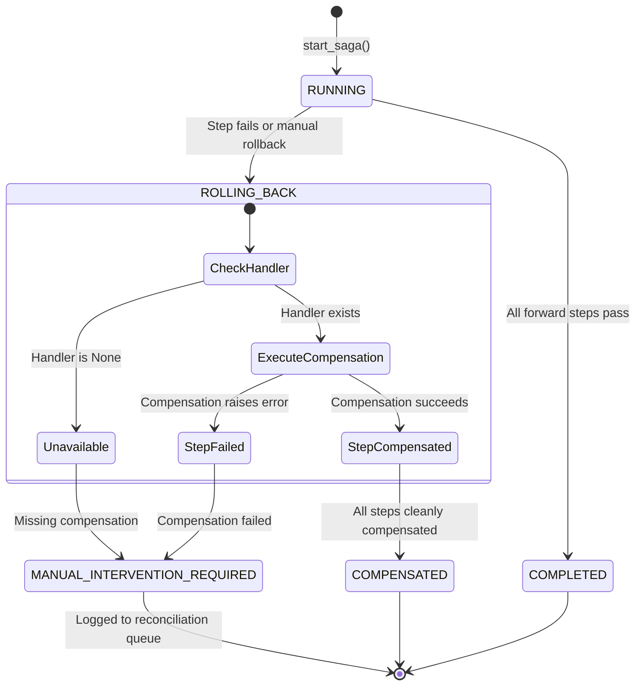

# ATLAS Phase 16.2 Saga Compensation Integrity
## Transactional Honesty and Reconciliation Guarantees

**Date:** 2026-11-17  
**Module:** `packages/atlas-process/src/atlas_process/transactions.py`  
**Verification Suite:** `tests/unit/test_phase16_2_saga_integrity.py`  

---

## 1. Finding Background (REM-16.1-02)

In Phase 16.0, the saga compensation coordinator contained a critical architectural defect:
When a saga rollback was triggered, steps lacking a compensation handler (`step.compensation_handler is None`) were silently treated as successful rollbacks (`step.status = SagaStepStatus.COMPENSATED`). The saga reported `saga.status = SagaStatus.COMPENSATED` and returned `True`.

This created a severe operational hazard:
- External enterprise systems (e.g. ERP, payment gateways, CRM) were left in half-committed, mutated states.
- The system falsely recorded that the transaction had been cleanly rolled back.
- No alerts, events, or reconciliation records were generated for manual intervention.

---

## 2. Remediated State Machine & Behavior

In Phase 16.2, `SagaTransactionCoordinator` strictly enforces honest compensation reporting:

### Key Integrity Rules Implemented:
1. **Missing Handler Invariant:**
   - Any completed step lacking a compensation handler is marked `SagaStepStatus.COMPENSATION_UNAVAILABLE`.
   - The overall saga transitions to `SagaStatus.MANUAL_INTERVENTION_REQUIRED`.
   - `rollback_saga()` returns `False`.
2. **Deterministic Error Handling:**
   - If an existing compensation handler raises an unhandled exception, the step transitions to `SagaStepStatus.COMPENSATION_FAILED`.
   - The error message and stack context are captured in `compensation_history`.
   - The saga transitions to `SagaStatus.MANUAL_INTERVENTION_REQUIRED` and `rollback_saga()` returns `False`.
3. **Post-Condition Verification Functions:**
   - Compensation steps can define a `verification_fn(context) -> bool`.
   - Even if the compensation handler does not raise an exception, if `verification_fn` returns `False`, compensation is deemed failed, and the saga is marked for manual intervention.
4. **Reconciliation Queue Ingestion:**
   - Unresolvable sagas publish structured events and append records to `process_reconciliation_records` in persistent storage for operator review.
