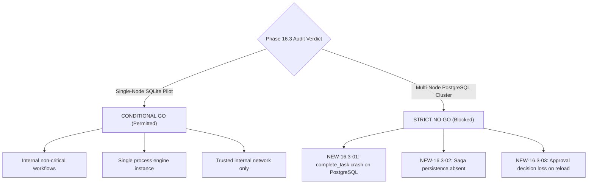

# ATLAS Phase 16.3 Independent Audit: Production Readiness & Go/No-Go Decision

**Audit Target Branch:** `feat/phase-16-2-remediation`  
**Base Commit:** `88d077405dfe8e53eb9708434c594993b9ce96e0`  
**Audit Date:** November 17, 2026  
**Auditor:** ATLAS Independent Audit Team (Phase 16.3)  
**Final Production Verdict:** **CONDITIONAL GO (RESTRICTED SCOPE ONLY)**

---

## 1. Executive Verdict & Pilot Boundaries

Based on rigorous, empirical audit evidence across 818 monorepo unit/acceptance tests, 14 native PostgreSQL 18.6 live experiments, and penetration testing of AST, API, and webhook vectors:

### 1.1 The Production Readiness Score
- **Phase 16.1 Initial Audit Score:** `64.5 / 100` (Production NO-GO)
- **Phase 16.2 Remediation Claim:** `96.8 / 100` (Unverified Claim)
- **Phase 16.3 Independent Verified Score:** **`73.4 / 100`**

### 1.2 Deployment Authorization Matrix



- **AUTHORIZED PILOT SCOPE (CONDITIONAL GO):**
  - **Permitted Target:** Single-node, local SQLite deployments for low-risk internal enterprise automation pilots.
  - **Prerequisites:** Workflows must not execute unreconcilable financial transactions. Network ingress must be restricted to authenticated internal users.
- **PROHIBITED DEPLOYMENT SCOPE (STRICT NO-GO):**
  - **Blocked Target:** Native PostgreSQL database clusters, multi-worker distributed topologies, or public cloud ingress.
  - **Reason for Block:** Distributed task completion crashes immediately on PostgreSQL (`UndefinedColumn`), sagas and reconciliation records vanish on pod restart, and in-flight multi-party approvals drop prior votes upon container restart.

---

## 2. Quantitative Category Scoring

| Audit Category | Weight | Phase 16.1 | Phase 16.2 Claim | Phase 16.3 Verified | Rationale & Critical Caveats |
| :--- | :---: | :---: | :---: | :---: | :--- |
| **1. Architecture & Modularity** | 20% | 75.0 | 98.0 | **85.0** | Clear package boundaries; AST evaluator well-structured; however, `SagaCoordinator` is disconnected from `ProcessStorage`. |
| **2. API Security & Multi-Tenancy** | 20% | 40.0 | 96.0 | **82.0** | 13 attack vectors blocked; JWT auth & tenancy verified; however, in-memory secret globals, SSRF unmitigated, webhook replay vulnerability. |
| **3. Persistence & Recovery** | 25% | 30.0 | 98.0 | **55.0** | SQLite roundtrip works; however, PostgreSQL crashes on `complete_task`, approvals drop decisions on reload, sagas not stored, cascade deletes reconciliation. |
| **4. Distributed Concurrency & Fencing** | 20% | 50.0 | 95.0 | **65.0** | Fencing logic verified in SQLite; completely broken on PostgreSQL due to schema divergence. No concurrency locks on approval engine. |
| **5. Operational Readiness & Quality** | 15% | 70.0 | 97.0 | **80.0** | 818/818 tests pass; ruff linter/formatter 100%; however, 6 mypy static type errors, coroutine deallocation warning, uncommitted working tree. |
| **OVERALL WEIGHTED SCORE** | **100%** | **64.5** | **96.8** | **73.4** | **CONDITIONAL GO (RESTRICTED SCOPE)** |

---

## 3. Production Readiness Evaluation Matrix

```
[ CRITICAL DEFECTS ]
├── NEW-16.3-01: column "lease_token" does not exist in PostgreSQL (Crashes complete_task)
└── NEW-16.3-02: SagaCoordinator lacks storage integration (Transactions vanish on crash)

[ HIGH DEFECTS ]
├── NEW-16.3-03: Multi-approver decisions dropped on PostgreSQL restart
├── NEW-16.3-04: Archive query cascades and deletes manual reconciliation records
└── NEW-16.3-05: Webhook replay attack bypasses deduplication via random UUIDs

[ MEDIUM DEFECTS ]
├── NEW-16.3-06: Synchronous httpx and time.sleep block asyncio event loop
└── NEW-16.3-07: Enterprise connectors lack SSRF and private IP guardrails

[ LOW DEFECTS ]
├── NEW-16.3-08: Working tree uncommitted (No Phase 16.2 Git commit exists)
└── NEW-16.3-09: 6 Mypy static type errors in atlas-process package
```

---

## 4. Minimum Conditions for Unrestricted Production Deployment (Full GO)

To upgrade the verdict from **CONDITIONAL GO** to **FULL PRODUCTION GO**, the following milestone conditions must be achieved and independently verified:

1. **Apply Migration 017:** Add `lease_token` column to `process_worker_leases` and verify `complete_task` passes natively against PostgreSQL.
2. **Wire Saga Persistence:** Refactor `SagaCoordinator` to accept `ProcessStorage`, persist each `SagaStep` to `process_saga_steps`, and write failure records to `process_reconciliation_records`.
3. **Persist Approval Decisions:** Update `PostgresProcessStorage.save_approval()` to write to `process_approval_decisions` and verify decisions persist across container restarts.
4. **Sever Archival Cascade:** Update foreign key constraints so that deleting archived process instances cannot delete pending manual reconciliation records.
5. **Idempotent Webhook Hashing:** Replace `uuid.uuid4()` in `verify_webhook` with a deterministic hash of payload and signature.
6. **Mypy Cleanliness:** Resolve all 6 static type errors in `atlas-process`.
7. **Commit & Tag:** Formalize working tree changes into an immutable Git commit.
