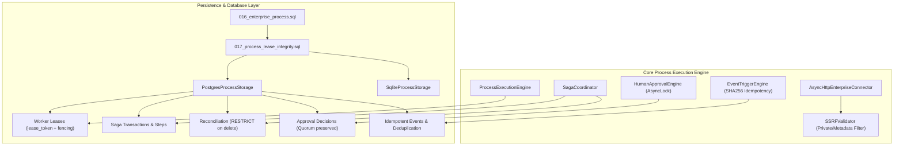

# ATLAS Phase 16.4 — Critical Remediation Implementation Plan

**Target Branch:** `feat/phase-16-4-critical-remediation`  
**Base Commit:** `88d077405dfe8e53eb9708434c594993b9ce96e0`  
**Audit Reference:** Phase 16.3 Independent Audit Report  
**Author:** ATLAS Core Architecture & Engineering Team  
**Status:** Approved for Execution

---

## 1. Context & Remediation Scope

The Phase 16.3 independent audit established that while Phase 16.2 resolved several security controls, critical persistence and transaction durability gaps remain:
1. **NEW-16.3-01 (P0):** Worker lease completion crashes on PostgreSQL (`UndefinedColumn: column "lease_token" does not exist`).
2. **NEW-16.3-02 (P0):** `SagaCoordinator` is completely in-memory; sagas and financial reconciliation queues vanish on node restart.
3. **NEW-16.3-03 (P1):** Multi-party approval decisions are dropped upon PostgreSQL restart; concurrency lacks synchronization.
4. **NEW-16.3-04 (P1):** Process instance archival triggers foreign-key cascade deleting unresolved financial reconciliation records.
5. **NEW-16.3-05 (P1):** Webhook verification assigns random UUIDs, enabling replay attacks within the 300s timestamp window.
6. **NEW-16.3-06 (P1):** `HttpEnterpriseConnector` blocks the asyncio event loop using synchronous `httpx.Client` and `time.sleep()`.
7. **NEW-16.3-07 (P1):** Enterprise connectors lack SSRF guardrails and cloud metadata / private IP filtering.
8. **NEW-16.3-08 (P2):** Uncommitted working tree on remediation branch.
9. **NEW-16.3-09 (P2):** 6 Mypy static type errors in `atlas-process`.
10. **Runtime Warning (P2):** Unawaited `AutonomousAgentLoop.run` coroutine warning during test teardown.

---

## 2. Architectural Blueprint

---

## 3. Detailed Work Breakdown

### P0 — Task 1: PostgreSQL Worker Lease Integrity & Fencing (NEW-16.3-01)
- Create migration `migrations/017_process_lease_integrity.sql`:
  - Add `lease_token VARCHAR(64) NOT NULL` to `process_worker_leases`.
  - Add index on `(task_instance_id, lease_token)`.
- Update `PostgresProcessStorage.record_lease()`:
  - Insert `lease_token` into the SQL statement and populate `token` correctly.
- Update `PostgresProcessStorage.verify_lease()`:
  - Query `lease_token, fencing_token, expires_at`.
- Update `PostgresProcessStorage.release_lease()` and `complete_task()`.
- Ensure parity between `PostgresProcessStorage` and `SqliteProcessStorage`.

### P0 — Task 2: Durable Saga Persistence & Crash Recovery (NEW-16.3-02)
- Inject `ProcessStorage` into `SagaCoordinator(storage: ProcessStorage | None = None)`.
- Implement full CRUD in `storage.py` for sagas:
  - `save_saga(saga: SagaTransaction) -> None` (persisting saga summary and every step to `process_saga_steps` in PostgreSQL, `steps_json` in SQLite).
  - `get_saga(saga_id: str) -> SagaTransaction | None` (reconstructing steps with status, payload, compensation history).
  - `record_reconciliation(record: ReconciliationRecord) -> None`.
  - `list_reconciliations(tenant_id: str | None = None, status: str | None = None) -> list[ReconciliationRecord]`.
  - `resolve_reconciliation(record_id: str, resolved_by: str, notes: str) -> None`.
- In `SagaCoordinator`:
  - Persist forward execution and step status changes before and after execution.
  - Persist compensation attempts and outcomes.
  - Persist failure records to `process_reconciliation_records` immediately upon failure.
  - Implement `recover_active_sagas()` to reload in-flight sagas on restart.

### P1 — Task 3: Human Approval Persistence & Concurrency Safety (NEW-16.3-03)
- In `PostgresProcessStorage`:
  - Update `save_approval()` to insert/update each `ApprovalRecord` into `process_approval_decisions`.
  - Update `get_approval()` to query `process_approval_decisions WHERE approval_id = %s` and reconstruct `decisions: list[ApprovalRecord]`.
- In `HumanApprovalEngine`:
  - Fall back to `storage.get_approval()` if approval is not found in memory.
  - Add `asyncio.Lock` per approval request or global engine lock to prevent race conditions during concurrent voting.
  - Enforce terminal state immutability.

### P1 — Task 4: Reconciliation Retention & Sever Cascade Archival (NEW-16.3-04)
- In `migrations/017_process_lease_integrity.sql`:
  - Alter `process_reconciliation_records` to remove `ON DELETE CASCADE` from `process_saga_transactions`, replacing with `ON DELETE RESTRICT` or decoupling parent instance lifecycle.
- In `archive_completed_instances()`:
  - Exclude process instances that have unresolved reconciliation records (`WHERE status = 'PENDING'`).
  - Ensure manual financial reconciliation records remain queryable forever until explicitly resolved.

### P1 — Task 5: Webhook Idempotency & Replay Defense (NEW-16.3-05)
- In `triggers.py`:
  - Derive deterministic `event_id` in `verify_webhook()` from `tenant_id`, webhook signature, timestamp, and SHA-256 of payload.
  - Support provider delivery IDs (e.g., `X-Delivery-ID`, `X-GitHub-Delivery`).
  - Wire `EventTriggerEngine` to `ProcessStorage` to persist processed event IDs in `process_event_inbox` or `process_idempotency_records` with unique constraints.
  - Reject duplicate webhook submissions within the replay window.

### P1 — Task 6: Dedicated SSRF Outbound Guard (NEW-16.3-07)
- Author `SSRFValidator` in `packages/atlas-process/src/atlas_process/connectors.py`:
  - Reject private IPv4 (`10.0.0.0/8`, `172.16.0.0/12`, `192.168.0.0/16`).
  - Reject loopback (`127.0.0.0/8`, `::1`).
  - Reject link-local / cloud metadata (`169.254.0.0/16`, `fe80::/10`).
  - Reject multicast, broadcast, and unspecified addresses (`0.0.0.0`, `::`).
  - Perform DNS pre-resolution and validate all resolved IP addresses.
  - Validate redirect targets before following redirects.
  - Restrict allowed schemes to HTTPS (HTTP allowed only in explicitly trusted test mode).
  - Enforce timeouts and maximum response size (10 MB).

### P1 — Task 7: Non-Blocking Async Enterprise Connectors (NEW-16.3-06)
- In `connectors.py`:
  - Implement `AsyncHttpEnterpriseConnector` using `httpx.AsyncClient` and `await asyncio.sleep()`.
  - Provide async `call_http_endpoint_async()` and async `execute_async()`.
  - Integrate SSRF validation before every request.
  - Implement exponential backoff with jitter and status code discrimination (retry only 429, 502, 503, 504; reject 400, 401, 403, 404, 422).

### P2 — Task 8: Code Quality, Mypy Typing & Runtime Cleanup
- Fix 6 mypy errors:
  - Annotate operator dictionaries in `evaluator.py`.
  - Handle `None` safely in list comprehensions in `storage.py`.
- Fix unawaited coroutine warning in `packages/atlas-agent/src/atlas_agent/runtime.py`:
  - In `ProductionRuntime.shutdown()`, await cancelled tasks using `await asyncio.gather(*pending, return_exceptions=True)`.

### Task 9: Comprehensive Test Suite & PostgreSQL Verification
- Dedicated tests:
  - `tests/unit/test_phase16_4_leases.py`
  - `tests/unit/test_phase16_4_sagas.py`
  - `tests/unit/test_phase16_4_approvals.py`
  - `tests/unit/test_phase16_4_archival.py`
  - `tests/unit/test_phase16_4_webhooks.py`
  - `tests/unit/test_phase16_4_ssrf.py`
  - `tests/unit/test_phase16_4_connectors.py`
  - `tests/integration/test_phase16_4_postgres_full.py`
- Run against real native PostgreSQL 18.6 and SQLite.
- Run full 818+ monorepo test suite.
- Run Ruff lint, format, and Mypy.

### Task 10: Commit and Final Delivery
- Stage and commit changes to `feat/phase-16-4-critical-remediation`.
