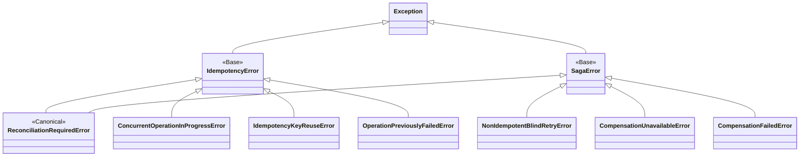

# ATLAS Phase 16.8 — Canonical Exception Architecture & Contract

## 1. Scope & Objective

This document defines the formal exception contract for ambiguous and unknown transaction/operation outcomes across ATLAS process execution, durable task idempotency, and distributed sagas.

---

## 2. Class Hierarchy Specification



---

## 3. Contractual Invariants

### Invariant 1: Uniqueness of Identity
There is exactly one `ReconciliationRequiredError` class object in the Python runtime:
```python
from atlas_process import ReconciliationRequiredError as RootError
from atlas_process.idempotency import ReconciliationRequiredError as IdemError
from atlas_process.transactions import ReconciliationRequiredError as TransError

assert RootError is IdemError is TransError
```

### Invariant 2: Polymorphic Catchability
Any caller catching `IdempotencyError`, `SagaError`, or `ReconciliationRequiredError` will intercept ambiguous operation outcomes regardless of the raising subsystem:
```python
try:
    coordinator.execute_step(...)
except ReconciliationRequiredError as err:
    # Catches saga timeout, network drop, or task crash
    logger.warning("Operation entered reconciliation queue: %s", err)
```

### Invariant 3: Zero Circular Import Invariant
`atlas_process.idempotency` does NOT import `atlas_process.transactions`.  
`atlas_process.transactions` imports from `atlas_process.idempotency`.  
Both modules remain decoupled from the execution engine and storage layers.

### Invariant 4: Chaining and Diagnostic Context
When an operation enters `RECONCILIATION_REQUIRED` due to an underlying infrastructure or network exception (such as `TimeoutError` or `ConnectionResetError`), the original exception MUST be preserved via PEP 3134 explicit exception chaining:
```python
raise ReconciliationRequiredError(
    f"Step '{step.name}' entered RECONCILIATION_REQUIRED: outcome unknown after timeout."
) from original_error
```
