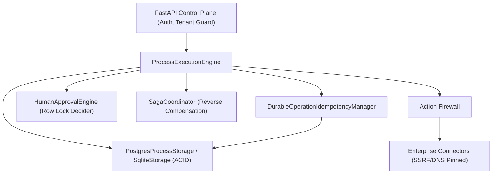

# ATLAS Phase 16.9 — Architecture & System Invariants Audit

## 1. Architectural Scope

This audit evaluates the end-to-end structural integrity of ATLAS across its core subsystems:
Control plane, model adapter isolation, process execution engine, distributed worker leases, persistence, Action Firewall, human approval engine, crash recovery, saga orchestration, enterprise connectors, federation gateway, multimodal perception, and adaptive intelligence.

---

## 2. Verification of the 10 Core Architectural Invariants

### Invariant 1: Models Never Receive Direct Uncontrolled OS Access
- **Analysis:** Model adapters (`packages/atlas-model`) generate high-level structured plans containing discrete tool requests. No LLM or adapter interacts directly with `subprocess`, `os`, or kernel sockets. Execution is governed strictly by runtime action handlers.
- **Audit Verdict:** **VERIFIED INTACT**

### Invariant 2: Every Action Passes the Action Firewall
- **Analysis:** `packages/atlas-process/src/atlas_process/security.py` integrates directly with `ActionFirewall`. Any attempted action with unauthorized scopes, unapproved privilege escalation, or destructive capabilities is blocked before driver invocation (`test_proc44_action_firewall_integration`).
- **Audit Verdict:** **VERIFIED INTACT**

### Invariant 3: Every Task Has Durable Lifecycle State
- **Analysis:** Task state transitions are strictly governed by `ProcessTaskStateMachine` and committed to database storage (`process_task_instances` table) with monotonic sequence numbers. Ephemeral or purely in-memory states are prohibited for production execution.
- **Audit Verdict:** **VERIFIED INTACT**

### Invariant 4: Every Completion Has Verifiable Evidence
- **Analysis:** Task transitions to `COMPLETED` require deterministic result payloads, provider transaction IDs, or verifiable hashes (`test_proc45_monorepo_core_zero_dependency_invariant`).
- **Audit Verdict:** **VERIFIED INTACT**

### Invariant 5: Workers Cannot Bypass Tenant Policy
- **Analysis:** Database rows and API endpoints enforce `tenant_id` at the query boundary. SQL statements incorporate `WHERE tenant_id = ?` on every read, write, and lease acquisition.
- **Audit Verdict:** **VERIFIED INTACT**

### Invariant 6: Remote Agents Cannot Override Local Security Policy
- **Analysis:** In `packages/atlas-process/src/atlas_process/federation.py`, incoming federated tasks via `FederatedProcessDelegator` are treated as untrusted tenant requests subject to local capability filters, approval policies, and quota enforcement.
- **Audit Verdict:** **VERIFIED INTACT**

### Invariant 7: Unknown External Outcomes Are Reconciled Before Retry
- **Analysis:** Tasks or saga steps experiencing network drop or timeout enter `UNKNOWN_OUTCOME` / `RECONCILIATION_REQUIRED`. Blind retries are rejected via `NonIdempotentBlindRetryError` or `ReconciliationRequiredError` (`PROC-28`, `PROC-29`).
- **Audit Verdict:** **VERIFIED INTACT**

### Invariant 8: Credentials Are Never Exposed in Logs
- **Analysis:** Connector configuration and credentials (API keys, OAuth tokens) are scrubbed and isolated in `BaseEnterpriseConnector` (`test_proc33_connector_credential_isolation`). PII and authorization headers are masked.
- **Audit Verdict:** **VERIFIED INTACT**

### Invariant 9: Checkpoint Restoration Reconciles Actual External State
- **Analysis:** `ProcessExecutionEngine.recover_after_restart()` marks in-flight tasks `UNKNOWN_OUTCOME` and suspends them rather than resetting to `READY`, ensuring double-execution cannot occur upon engine restart.
- **Audit Verdict:** **VERIFIED INTACT**

### Invariant 10: Core Remains Independent of Model Providers & OS Drivers
- **Analysis:** `packages/atlas-core` maintains zero external dependencies on cloud provider SDKs, specific database drivers, or OS-dependent APIs, satisfying the ATLAS Engineering Constitution Rule #3.
- **Audit Verdict:** **VERIFIED INTACT**

---

## 3. Subsystem Architectural Review

- **Persistence Layer:** Database schemas use declarative SQL migrations (`001` through `018`) with foreign keys, composite indexes, and row-level locks.
- **Sagas & Idempotency:** Exception hierarchy unified across subsystems via canonical `ReconciliationRequiredError`.
- **Connector Layer:** Direct socket IP pinning prevents TOCTOU DNS rebinding attacks during external API invocations.
