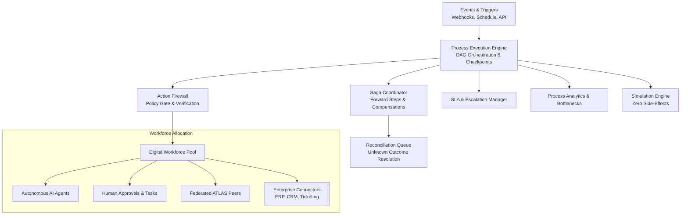

# ATLAS Phase 16 Architecture Specification
## Autonomous Enterprise Process Execution & Digital Workforce Platform

**Phase:** Phase 16  
**Package:** `packages/atlas-process` (`atlas_process`)  
**Version:** `0.16.0`  
**Date:** 2026-11-17  

---

## 1. System Architecture Overview

Phase 16 layers an enterprise-grade autonomous process execution engine on top of ATLAS's foundational state machine, Action Firewall, distributed worker network, and sovereign federation gateway.

---

## 2. Core Subsystems

### 2.1 Process Definition & Execution Subsystem
- **Declarative DAGs**: Definitions specify sequential tasks, parallel forks, join conditions, and conditional branches.
- **Topological & Cycle Validation**: DFS cycle detection prevents infinite loops at definition registration.
- **Durable State Machine**: Process instances transition through `PENDING` $\to$ `RUNNING` $\to$ `COMPLETED` / `FAILED` / `COMPENSATED` / `CANCELLED`.
- **Fencing Tokens & Leases**: Workers receive leases with monotonic fencing tokens. Stale worker commits are deterministically rejected with `StaleWorkerFencingError`.

### 2.2 Human Workforce & Approval Subsystem
- **Immutable Binding**: Approval requests bind parameters, requesting identity, target resource, and policy version.
- **Tamper Protection**: Hashes parameter payloads. Mutating parameters after creation trips `ParameterTamperedError`.
- **Separation of Duties (SoD)**: The requesting entity is blocked from approving its own request (`SeparationOfDutiesViolationError`).
- **Quorum Support**: Multi-person approvals require configurable thresholds (e.g. 2 of 2).

### 2.3 Distributed Transactions (Saga Subsystem)
- **Forward & Compensating Actions**: Sagas record completed steps and execute compensations in reverse order upon failure.
- **No Blind Retries**: Non-idempotent steps reject blind retries (`NonIdempotentBlindRetryError`).
- **Reconciliation Queue**: External timeouts move tasks into `RECONCILIATION_REQUIRED` for deterministic verification.

### 2.4 Enterprise Connector Subsystem
- **Standard Connector SDK**: Integrates ERP (SAP/NetSuite), CRM (Salesforce), Ticketing (Jira/ServiceNow), and REST APIs.
- **Per-Tenant Credential Isolation**: Secure in-memory credentials never leak into logs or telemetry.
- **Least-Privilege Scoping**: Operations without required scopes fail fast with `ConnectorScopeViolationError`.
- **Circuit Breaker**: Trips to `OPEN` after repeated failures to prevent cascade crashes.

### 2.5 Digital Workforce Allocation
- **Capability Matching**: Directs tasks to workers possessing required skills.
- **Workload Awareness**: Selects available workers with lowest active load.
- **Policy Routing**: Routes according to `AGENT_ONLY`, `HUMAN_ONLY`, or hybrid policies.
