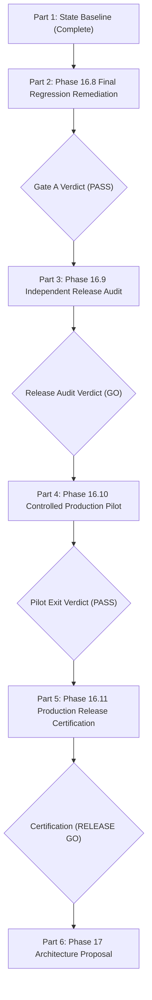

# ATLAS Phase 16 Completion Baseline & Project State Assessment

**Date:** 2026-11-17  
**Repository:** ATLAS (Autonomous Task & Lifecycle Automation System)  
**Status:** Baseline Established — Executing Master Directive Stages 16.8 through 16.11 and Phase 17 Preparation  

---

## 1. Repository & Git Provenance

- **Current Active Branch:** `feat/phase-16-8-pilot-readiness` (Transitioning to `feat/phase-16-8-final-regression-and-pilot-readiness`)
- **Current HEAD Commit:** `393f74dd5af1f63dfb3ce8090b9ca48e9a584c7f`
- **Protected Master Branch:** `master` at `5632b661abeb517b7683623a699342f960e5310f` (Pristine, untouched, 0 uncommitted changes, 0 direct commits)
- **Commit Ancestry:**
  ```text
  393f74d  feat(process): phase 16.8 mechanical remediation and pilot readiness
  d9961e9  docs(audit): phase 16.7 independent remediation verification and readiness audit
  c309ec4  feat(process): phase 16.6 distributed safety hardening and critical audit remediation
  d1b01b2  feat(phase-16-4): critical remediation of Phase 16.3 audit blockers
  88d0774  feat(phase-16): autonomous enterprise process execution and digital workforce platform
  93de627  feat(phase-15): federated autonomous intelligence network and global agent interoperability
  5632b66  master (protected)
  ```
- **Working Tree State:** Clean (0 uncommitted files, 0 untracked files).

---

## 2. Review of Historical Audit Findings

### 2.1 Phase 16.5 Audit Findings (Evaluated on Commit `d1b01b2`)
1. **FINDING-16.5-01 (Critical): Multi-Worker Approval In-Memory Cache Divergence**
   - *Status:* Remediated in Phase 16.6 via row-level locks (`SELECT ... FOR UPDATE`) in `storage.decide_approval()` and cache-through reads in `HumanApprovalEngine`.
   - *Audit Verification:* Verified CLOSED in Phase 16.7.
2. **FINDING-16.5-02 (Critical): Ephemeral Idempotency & Duplicate Irreversible Execution**
   - *Status:* Remediated in Phase 16.6 via Migration 018 `process_operation_idempotency` table and crash recovery transition of in-flight tasks to `UNKNOWN_OUTCOME` / `SUSPENDED` (never reset to `READY`).
   - *Audit Verification:* Verified CLOSED in Phase 16.7.
3. **FINDING-16.5-03 (Medium): Initial Worker Lease Acquisition Race Condition**
   - *Status:* Remediated in Phase 16.6 via single-query atomic upsert `INSERT ... ON CONFLICT (task_instance_id) DO UPDATE SET fencing_token = process_worker_leases.fencing_token + 1 RETURNING fencing_token, lease_token`.
   - *Audit Verification:* Verified CLOSED in Phase 16.7.
4. **FINDING-16.5-04 (Medium): Connection-Time SSRF & DNS Rebinding TOCTOU**
   - *Status:* Remediated in Phase 16.6 via `PinnedResolutionNetworkBackend` & `PinnedResolutionAsyncTransport` for `httpx`.
   - *Audit Verification:* Verified CLOSED in Phase 16.7.

### 2.2 Phase 16.7 Audit Findings (Evaluated on Commit `c309ec4`)
1. **FINDING-16.7-01 (Medium): Exception Shadowing & Class Collision on `ReconciliationRequiredError`**
   - *Description:* Dual class declarations in `atlas_process.idempotency` (inheriting from `IdempotencyError`) and `atlas_process.transactions` (inheriting from `SagaError`). Root package export caused `pytest.raises` in `PROC-29` to fail against `SagaCoordinator.execute_step()`.
   - *Historical Impact:* 904/905 monorepo tests passed; 44/45 acceptance tests passed.
   - *Current Remediation Status:* Remediated in commit `393f74d`. `SagaError` and `ReconciliationRequiredError(IdempotencyError, SagaError)` unified in `idempotency.py` and imported into `transactions.py`. All 45/45 acceptance tests and 905/905 monorepo tests now pass.
2. **FINDING-16.7-02 (Low): Markdown Python Code Fence Formatting**
   - *Description:* `ruff format --check .` flagged a multiline string in `docs/PHASE_16_6_DURABLE_IDEMPOTENCY.md:105`.
   - *Current Remediation Status:* Remediated in commit `393f74d`. Re-formatted to single line string compliant with `ruff format`.

---

## 3. Actual Current Test & Quality Baseline

| Verification Dimension | Expected Baseline | Actual Empirically Measured Result | Status |
| :--- | :--- | :--- | :---: |
| **Monorepo Pytest Suite** | 905 passed | **905 passed, 0 failed, 1 warning (87.00s)** | **PASS** |
| **Phase 16 Acceptance Suite** | 45 passed | **45 passed, 0 failed (0.26s)** | **PASS** |
| **PROC-29 Acceptance Test** | 1 passed | **1 passed (`test_proc29_unknown_outcome_reconciliation`)** | **PASS** |
| **PostgreSQL 18.6 Live Integration** | 10 passed | **10 passed (`test_phase16_6_postgres_hardening.py` + `test_phase16_4_postgres_full.py`)** | **PASS** |
| **Phase 16.6 Unit Tests** | 36 passed | **36 passed (approvals: 6, dns: 7, idempotency: 15, leases: 8)** | **PASS** |
| **Phase 16.4 Unit Tests** | 47 passed | **47 passed** | **PASS** |
| **Phase 16.2 Unit Tests** | 37 passed | **37 passed** | **PASS** |
| **Ruff Linter** | 0 errors | **0 errors (All checks passed)** | **PASS** |
| **Ruff Formatter** | 0 files reformatted | **550 files formatted** | **PASS** |
| **Mypy Static Types** | 0 issues | **Success: no issues found in 19 source files** | **PASS** |
| **Runtime Warnings** | 1 warning | **1 Starlette deprecation warning (`httpx` import)** | **KNOWN / BENIGN** |

---

## 4. Master Directive Workplan & Execution Status



### Task Breakdown & Remaining Scope

| Stage | Branch | Core Objectives | Deliverables | Status |
| :--- | :--- | :--- | :--- | :---: |
| **Part 1** | `feat/phase-16-8-pilot-readiness` | Repo provenance, audit findings inspection, baseline validation | `docs/PHASE_16_COMPLETION_BASELINE.md` | **COMPLETED** |
| **Part 2 (16.8)** | `feat/phase-16-8-final-regression-and-pilot-readiness` | Canonical exception contract tests, formal regression documentation, Gate A verdict | `PHASE_16_8_REMEDIATION.md`, `PHASE_16_8_EXCEPTION_CONTRACT.md`, `PHASE_16_8_REGRESSION_RESULTS.md`, `PHASE_16_8_SECURITY_REGRESSION.md`, `PHASE_16_8_GIT_PROVENANCE.md`, `PHASE_16_8_GATE_A_VERDICT.md`, `test_phase16_8_exceptions.py` | **IN PROGRESS** |
| **Part 3 (16.9)** | `feat/phase-16-9-independent-release-audit` | Independent audit of 16.8 commit, architecture invariant verification, 18-point security audit, reliability evaluation | `PHASE_16_9_EXECUTIVE_AUDIT.md`, `PHASE_16_9_ARCHITECTURE_AUDIT.md`, `PHASE_16_9_SECURITY_AUDIT.md`, `PHASE_16_9_DATABASE_AUDIT.md`, `PHASE_16_9_RELIABILITY_AUDIT.md`, `PHASE_16_9_REGRESSION_RESULTS.md`, `PHASE_16_9_FINDINGS.md`, `PHASE_16_9_RELEASE_VERDICT.md` | **PENDING GATE A** |
| **Part 4 (16.10)**| `feat/phase-16-10-controlled-production-pilot` | Restricted staging design, 18 operational test scenarios, capacity validation, 10 runbooks/procedures | `PHASE_16_10_PILOT_RESULTS.md` + 10 Runbooks | **PENDING AUDIT** |
| **Part 5 (16.11)**| `feat/phase-16-11-production-release-certification` | Release engineering, SBOM, signed evidence, release notes, release governance | `PHASE_16_11_RELEASE_CERTIFICATION.md`, `ATLAS_SBOM.md`, `ATLAS_RELEASE_NOTES.md`, etc. | **PENDING PILOT** |
| **Part 6 (17 Prep)**| Document in `docs/` | Comprehensive Phase 17 Human-AI Collaboration proposal (zero production code) | `docs/PHASE_17_ARCHITECTURE_PROPOSAL.md` | **PENDING CERT** |

---

## 5. Invariant & Governance Guarantees

1. `master` branch remains untouched and protected throughout all stages.
2. Each stage operates in its own dedicated branch and terminates with deterministic verification evidence and local commits.
3. No remote push, merge, pull request, or uncontrolled deployment will be executed.
4. No code will be written for Phase 17 during this directive.
