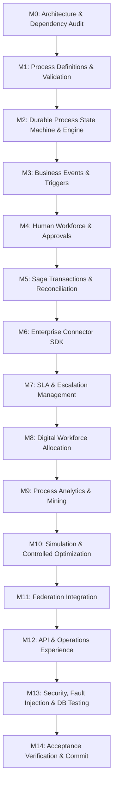

# ATLAS Phase 16 Master Implementation Plan
## Autonomous Enterprise Process Execution & Digital Workforce

**Phase:** Phase 16  
**Branch:** `feat/phase-16-enterprise-process-execution`  
**Date:** 2026-11-17  
**Status:** In Progress (M0 Audit Complete)  

---

## 1. Executive Mission

Transform ATLAS into an enterprise-grade autonomous process execution platform capable of orchestrating complex, end-to-end business workflows across AI agents, human workers, enterprise applications (ERP, CRM, finance, ticketing), and federated ATLAS installations.

### Core Architectural Invariants:
1. **Lifecycle Authority**: ATLAS remains the authoritative controller of process lifecycle, task execution, and state transitions.
2. **Action Firewall Gate (Rule 2)**: All model proposals, connector calls, and external side-effects must pass through the deterministic Action Firewall.
3. **Zero-Dependency Core (Rule 3)**: Core contracts remain dependency-free.
4. **Deterministic Evidence (Rule 7)**: No process or task is marked successful without verifiable post-condition evidence.
5. **Human Approval Binding**: Approvals are immutably bound to exact task parameters, tenant context, and identities; self-approval by agents is strictly prohibited.
6. **Saga Transaction Safety**: Distributed multi-system interactions use explicit sagas with forward steps, compensations, idempotency keys, and reconciliation; no blind retries of non-idempotent operations.
7. **Strict Multi-Tenancy**: Complete isolation across process definitions, instances, events, credentials, and analytics.
8. **Side-Effect-Free Simulation**: Process simulations execute against synthetic or historical data with 0 external mutations.

---

## 2. Milestone Roadmap

- **M0**: Initial audit and baseline verification.
- **M1**: `definitions.py` (ProcessDefinition, ProcessTaskDefinition, DAG validation, cycle detection).
- **M2**: `state_machine.py`, `engine.py` (Instance lifecycle, durable state machine, checkpointing, worker leases, crash recovery).
- **M3**: `triggers.py`, `events.py` (Signed webhooks, scheduled triggers, deduplication, event correlation).
- **M4**: `approvals.py` (Human tasks, approval binding, separation of duties, multi-person approvals, anti-tampering).
- **M5**: `transactions.py` (Saga coordination, compensation steps, idempotency keys, reconciliation queue).
- **M6**: `connectors.py` (Connector SDK, rate limiting, circuit breaker, credential isolation, ERP/CRM/ticketing adapters).
- **M7**: `sla.py` (Deadlines, business calendars, escalation policies, proactive breach detection).
- **M8**: `workforce.py` (Capability matching, skill requirements, agent vs human routing, workload balancing).
- **M9**: `analytics.py` (End-to-end metrics, cycle time, bottleneck detection, SLA compliance).
- **M10**: `simulation.py` (Synthetic/historical replay, capacity analysis, side-effect isolation).
- **M11**: `federation.py` (Cross-installation process delegation via Phase 15 FederationGateway).
- **M12**: `api.py` (FastAPI router endpoints for definitions, instances, approvals, analytics).
- **M13**: `security.py` (Action Firewall integration, tenant isolation, anti-tamper).
- **M14**: `tests/acceptance/test_phase16_acceptance.py` (45 acceptance scenarios, full monorepo pass, commit).
