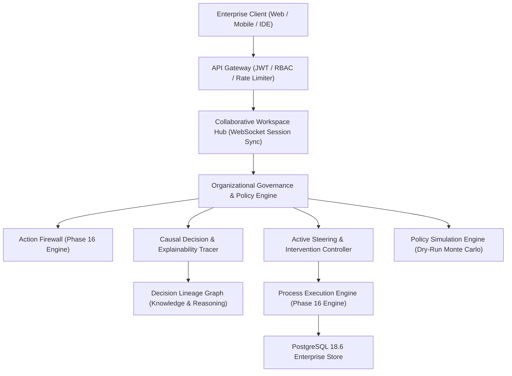

# ATLAS Phase 17 Architecture Proposal — Human–AI Collaboration & Governance Ecosystem

**Phase:** Phase 17 Architectural Design & RFC  
**Topic:** Human–AI Collaborative Workspaces, Enterprise Governance, Explainability, & Policy Simulation  
**Status:** REFINED ARCHITECTURE (Phase 16.13 Audit Remediations Incorporated; Implementation Strictly Blocked Pending Authorization)  
**Target Release:** ATLAS v0.17.0  
**Author:** ATLAS Architecture Strategy Committee  
**Last Updated:** 2026-11-17 (Phase 16.13 Review)  

---

## 1. Executive Summary & Vision

Phase 17 elevates ATLAS from an autonomous process execution engine into an enterprise-wide **Human–AI Collaboration & Governance Ecosystem**.

While Phase 16 established verifiable, fault-tolerant execution, durable task idempotency, multi-worker concurrency, and saga compensation, Phase 17 bridges the gap between autonomous digital workers and human enterprise operators. It introduces:
1. **Interactive Collaborative Workspaces:** Real-time dual-custody environments where humans and AI agents co-edit artifacts, review structured plans, and execute step-by-step paired tasks.
2. **Dynamic Policy & Delegation Engine:** Organizational delegation rules (e.g. temporary out-of-office delegation, dynamic authority limits, dual-signoff policies).
3. **Causal Decision Explainability:** Provable audit trails tracing *why* an agent selected an action, which documents it retrieved, and which policies guided its judgment.
4. **Active Human Intervention & Steering:** Real-time pause, inject, modify, and rewind capabilities for in-flight agent workflows.
5. **Continuous Compliance & Evidence Generation:** Cryptographically signed compliance bundles verifying adherence to SOC 2, HIPAA, ISO 27001, and EU AI Act requirements.

---

## 2. Product Requirements Document (PRD)

### 2.1 Target User Personas
1. **Enterprise Knowledge Worker:** Interacts with digital workers inside paired workspaces, reviews drafts, delegates subtasks, and provides corrective feedback.
2. **Operations Manager:** Oversees cross-team agent schedules, configures SLA escalation rules, monitors workforce capacity, and manages operational exceptions.
3. **Chief Compliance & Risk Officer:** Audits decision explanations, reviews Action Firewall rejections, and exports tamper-evident regulatory evidence.
4. **Platform Administrator:** Configures tenant quotas, IAM provider bindings, model adapter routing policies, and secret scopes.

### 2.2 Functional Requirements (FR)
- **FR-1 (Collaborative Sessions):** Multi-tenant collaborative workspaces supporting concurrent human-agent state synchronization via WebSockets.
- **FR-2 (Dynamic Delegation):** Time-bounded, scope-restricted authority delegation between humans, human-to-agent, and agent-to-agent.
- **FR-3 (Decision Lineage):** Every autonomous plan step must record causal reasoning, context embeddings, and policy constraints in an immutable graph.
- **FR-4 (Runtime Steering):** Operators must be able to inject mid-flight parameter overrides or pause execution without terminating leases or corrupting idempotency.
- **FR-5 (Policy Simulation):** Synthetic Monte Carlo evaluation of proposed governance policies against historical workflow runs prior to deployment.
- **FR-6 (Continuous Audit Export):** Single-click generation of verifiable compliance evidence packages containing signed state transitions and hash proofs.

### 2.3 Non-Functional Requirements (NFR)
- **NFR-1 (Zero Core Invariant Violation):** Zero dependencies introduced into `packages/atlas-core`.
- **NFR-2 (Latency):** Interactive workspace latency < 50ms P95; policy decision latency < 10ms P99.
- **NFR-3 (Data Isolation):** Zero cross-tenant data leakage in vector memory, policy caches, or audit streams.
- **NFR-4 (Explainability Overhead):** Decision graph generation must not increase agent planning latency by more than 15%.

---

## 3. High-Level System Architecture



---

## 4. Threat Model & Security Boundaries

### 4.1 Attacker Vectors & Mitigations
1. **Threat: Agent Impersonation in Collaborative Space**
   - *Vector:* Attacker masquerades as an approved agent to inject unauthorized actions into a paired workspace.
   - *Mitigation:* Mutual TLS (mTLS) and cryptographically signed session tokens tied to specific agent instance IDs.
2. **Threat: Delegated Authority Escalation**
   - *Vector:* User delegates temporary junior approval rights; receiver attempts to use it for high-value expenditure.
   - *Mitigation:* Immutable delegation envelopes specifying maximum monetary thresholds, required secondary approvers, and strict expiration timestamps.
3. **Threat: Decision Lineage Tampering**
   - *Vector:* Malicious worker modifies reasoning logs to conceal policy violations.
   - *Mitigation:* Merkle tree hashing of decision graphs with root hash committed into PostgreSQL `process_audit_events`.
4. **Threat: In-Flight Parameter Poisoning during Steering**
   - *Vector:* Operator injects unvalidated parameters during a live workflow pause.
   - *Mitigation:* Injected parameters re-validated against the original `ProcessDefinition.input_schema` and evaluated through the Action Firewall before task resumption.

---

## 5. Proposed API Contracts (OpenAPI Preview)

### 5.1 Collaborative Workspace Session
```http
POST /api/v1/workspaces/sessions
Content-Type: application/json
Authorization: Bearer <token>

{
  "tenant_id": "tenant_finance_01",
  "workspace_name": "Q4 Financial Close",
  "collaborators": [
    {"identity": "sarah.cfo@corp.com", "role": "OWNER"},
    {"identity": "agent_reconcile_01", "role": "AUTONOMOUS_WORKER"}
  ],
  "associated_process_instance_id": "pinst_close_9918"
}

Response: 201 Created
{
  "session_id": "ws_sess_77a90b1c",
  "websocket_url": "wss://atlas.corp.internal/ws/v1/sessions/ws_sess_77a90b1c",
  "created_at": 1794916000.0,
  "status": "ACTIVE"
}
```

### 5.2 Dynamic Policy Delegation
```http
POST /api/v1/governance/delegations
Content-Type: application/json
Authorization: Bearer <token>

{
  "tenant_id": "tenant_finance_01",
  "grantor_id": "user_vp_finance",
  "delegatee_id": "user_finance_director",
  "scope": "APPROVAL_DECISION",
  "constraints": {
    "max_amount_usd": 50000,
    "allowed_task_types": ["EXPENSE_APPROVAL", "PO_RELEASE"]
  },
  "valid_from": 1794916000.0,
  "valid_until": 1795520800.0,
  "reason": "Executive Annual Leave Coverage"
}

Response: 200 OK
{
  "delegation_id": "del_8829f012",
  "status": "ACTIVE",
  "signature": "hmac_sha256_..."
}
```

### 5.3 Active Workflow Steering (Pause / Inject)
```http
POST /api/v1/instances/{instance_id}/steering/pause
Content-Type: application/json
Authorization: Bearer <token>

{
  "tenant_id": "tenant_finance_01",
  "reason": "Suspected anomalous supplier invoice",
  "operator_id": "compliance_officer_dan"
}

Response: 200 OK
{
  "instance_id": "pinst_close_9918",
  "status": "PAUSED_FOR_STEERING",
  "current_active_tasks": ["t_wire_transfer"],
  "paused_at": 1794916050.0
}
```

---

## 6. Proposed Data Models (Pydantic Schemas)

```python
from __future__ import annotations
from enum import StrEnum
from typing import Any
from pydantic import BaseModel, Field


class WorkspaceRole(StrEnum):
    OWNER = "OWNER"
    EDITOR = "EDITOR"
    REVIEWER = "REVIEWER"
    AUTONOMOUS_WORKER = "AUTONOMOUS_WORKER"


class DecisionFactor(BaseModel):
    """Atomic evidence or policy item used by an agent to justify an action."""

    factor_id: str
    factor_type: str  # "DOCUMENT", "POLICY_RULE", "USER_DIRECTIVE", "HISTORICAL_OUTCOME"
    source_reference: str
    confidence_weight: float
    description: str


class AgentDecisionLineage(BaseModel):
    """Causal, auditable record explaining why an autonomous action was selected."""

    decision_id: str
    tenant_id: str
    agent_id: str
    task_instance_id: str
    selected_action: str
    rationale: str
    factors: list[DecisionFactor] = Field(default_factory=list)
    policy_checks_passed: list[str] = Field(default_factory=list)
    merkle_root_hash: str
    timestamp: float


class DelegationEnvelope(BaseModel):
    """Time-bounded, capability-restricted authority delegation."""

    delegation_id: str
    tenant_id: str
    grantor_id: str
    delegatee_id: str
    scope: str
    constraints: dict[str, Any] = Field(default_factory=dict)
    valid_from: float
    valid_until: float
    revoked: bool = False


class CASArtifactRef(BaseModel):
    """Content-addressable reference to a bulk lineage artifact in object storage."""

    uri: str  # Format: "atlas-cas://<sha256>"
    sha256_hash: str
    size_bytes: int
    content_type: str
    encryption_algorithm: str = "AES-256-GCM"


class SteeringEvent(BaseModel):
    """Immutable audit record of a human intervention on a paused workflow."""

    steering_id: str
    process_instance_id: str
    task_instance_id: str
    operator_id: str
    parent_operation_key: str
    child_operation_key: str
    original_parameters: dict[str, Any]
    modified_parameters: dict[str, Any]
    reason: str
    timestamp: float
```

---

## 7. Architectural Risk Remediations & Operational Robustness

Following the Phase 16.12 Independent Audit, four core architectural risks were formally remediated and integrated into this proposal:

### 7.1 Collaborative Workspace State Synchronization (Risk 1 Remediation)
- **Primary Strategy**: **Server-Authoritative Semantic Turn-Locking** at the task/plan artifact boundary.
- **Rationale**: Strict legal custody and determinism are required for enterprise governance. Unlike character-level CRDTs which risk semantic business logic inconsistencies, semantic turn-locking guarantees that exactly one actor edits a plan step at any time.
- **Human Preemptive Override**: Enterprise operators retain supreme preemption authority. When a human requests edit access, the agent's edit lease is immediately preempted, and its fencing token is revoked.
- **Reconnection & Ordering**: Monotonic server `sequence_id` ordering ensures clean disconnect recovery via snapshot and differential catch-up stream. Multi-tenant isolation is enforced via tenant-scoped WebSocket channels.

### 7.2 Two-Tier Decision Lineage Storage (Risk 2 Remediation)
- **Topology**:
  - **Tier 1 (PostgreSQL Migration 020)**: Stores relational metadata, parent/child causal lineage edges, actor identity, Merkle root hashes, and CAS URIs.
  - **Tier 2 (Content-Addressable Object Storage)**: Stores large contextual artifacts, raw prompts, model tokens, context embeddings, and inspection screenshots at `atlas-cas://<sha256>`.
- **Integrity & Security**: Mandatory SHA-256 integrity verification upon retrieval. AES-256-GCM envelope encryption using tenant-isolated Data Encryption Keys (DEKs). Cryptographic erasure upon legal retention expiration.

### 7.3 In-Flight Steering & Child Idempotency Key Derivation (Risk 3 Remediation)
- **Protocol**:
  1. Operator pauses in-flight execution (`PAUSED_FOR_STEERING`).
  2. The parent operation in `durable_operations` transitions to `SUPERSEDED_BY_STEERING`.
  3. A deterministic child idempotency key is derived:
     $$\text{key}_{\text{child}} = \text{SHA-256}\Big(\text{key}_{\text{parent}} \,||\, \text{steering\_id} \,||\, \text{SHA-256}\big(\text{canonical\_json}(\text{modified\_params})\big)\Big)$$
  4. Modified parameters are re-submitted to the Action Firewall for policy re-validation.
  5. The child operation is executed under `key_child`. Accidental replay of the parent operation is mathematically prevented.

### 7.4 Hermetic Policy Simulation Sandbox (Risk 4 Remediation)
- **Sandbox Architecture**:
  - `SimulationProcessEngine` strictly accepts only `DryRunConnectorDriver` at initialization time. Live production connectors raise `SimulationSandboxViolationError`.
  - Zero external network egress; transport is bound to in-memory mocks.
  - Zero production secrets; synthetic mock credentials injected.
  - Deterministic replay of historical audit logs enables Monte Carlo validation of draft policies against 10,000+ historical runs without external side-effects.

---

## 8. Migration Strategy & Compatibility

1. **Zero-Impact on Phase 16 Engine:** Phase 16 `ProcessExecutionEngine`, `SagaCoordinator`, and `SqliteProcessStorage` / `PostgresProcessStorage` continue operating without modification.
2. **Schema Evolution (Migration 019 & 020):**
   - Migration 019: `process_governance_delegations` and `process_collaborative_workspaces`.
   - Migration 020: `process_decision_lineage`, `process_steering_events`, and `process_compliance_proofs`.
3. **Backward Compatibility:** All existing process definitions run with default governance policies without requiring code changes.

---

## 9. Implementation Milestones

| Milestone | Title | Scope & Deliverables | Target Timeline |
| :--- | :--- | :--- | :---: |
| **M17.1** | Governance Engine & Dynamic Delegation | `atlas_governance/delegation.py`, Migration 019 | Sprint 1 |
| **M17.2** | Collaborative Workspaces & Semantic Lock Hub | `atlas_collab/workspace.py`, WebSocket turn server | Sprint 2 |
| **M17.3** | Two-Tier Decision Lineage & CAS Engine | `atlas_governance/lineage.py`, CAS blob driver, Migration 020 | Sprint 3 |
| **M17.4** | Active Runtime Steering & Child Idempotency | `atlas_governance/steering.py`, pause/inject handlers | Sprint 4 |
| **M17.5** | Continuous Compliance & Evidence Export | Cryptographic bundle exporter, SOC 2 / EU AI Act mappings | Sprint 5 |
| **M17.6** | Hermetic Monte Carlo Policy Simulator | Isolated dry-run connector sandbox & historical replay engine | Sprint 6 |

---

## 10. Acceptance Criteria & Test Strategy

- [ ] **AC-1:** Delegations automatically expire at `valid_until` timestamp; subsequent decisions rejected with `DelegationExpiredError`.
- [ ] **AC-2:** Active steering pauses tasks, generates deterministic child idempotency keys, re-validates via Action Firewall, and prevents double execution.
- [ ] **AC-3:** Two-tier lineage engine verifies CAS artifact SHA-256 hashes on retrieval and rejects corrupted blobs with `CorruptedLineageArtifactError`.
- [ ] **AC-4:** Policy simulation against 10,000 historical workflow instances executes in a hermetic sandbox with zero outbound network calls in < 30 seconds.
- [ ] **AC-5:** 100% of Phase 16 regression tests remain green (zero regression).

---

## 11. Invariant Gating Notice

**Strict Rule:** No branch creation for Phase 17 implementation and no modification of production source code shall take place until this architecture proposal is reviewed and approved by human governance stakeholders.

---

## 12. Document History & Revision Changelog

| Date | Revision | Author | Description |
| :--- | :---: | :--- | :--- |
| **2026-11-17** | 1.0.0 | Architecture Committee | Initial comprehensive proposal for Human–AI Collaboration & Governance Ecosystem. |
| **2026-11-17** | 1.1.0 | Release Directorate | Phase 16.13 update: Formally integrated risk remediations for workspace sync (turn locks), two-tier CAS lineage storage, child idempotency derivation for steering, and hermetic simulation sandboxing. |
