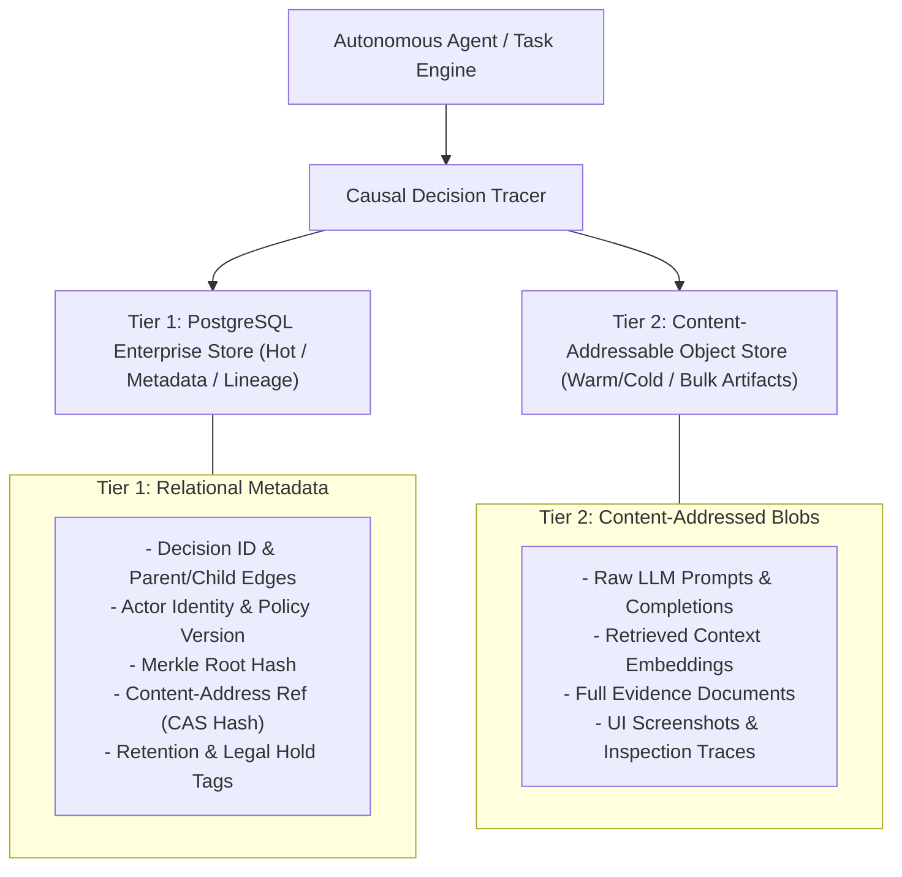
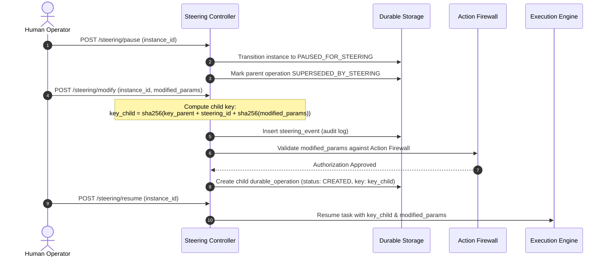

# ATLAS Phase 17 — Architecture Risk Remediation & Governance Blueprint

## 1. Executive Summary

During the Phase 16.12 Independent Audit, the Phase 17 Architecture Proposal ([docs/PHASE_17_ARCHITECTURE_PROPOSAL.md](file:///c:/Users/pc/Documents/antigravity/happy-meitner/docs/PHASE_17_ARCHITECTURE_PROPOSAL.md)) was evaluated as architecturally sound, but conditionally gated pending formal remediation of four core technical and operational risks:

1. **Risk 1:** Collaborative workspace state synchronization mechanism and conflict resolution.
2. **Risk 2:** Decision lineage storage volume, retention, and two-tier architecture.
3. **Risk 3:** In-flight steering protocol and durable idempotency key preservation.
4. **Risk 4:** Hermetic policy simulation sandbox and side-effect prevention.

This document establishes the comprehensive engineering blueprints, mathematical formulations, data contracts, and security invariants resolving all four risks. These remediations are incorporated into the authoritative Phase 17 Architecture Proposal.

---

## 2. Risk 1 Remediation: Collaborative Workspace State Synchronization

### 2.1 Trade-off Analysis: Turn Locking vs. CRDT Synchronization

| Evaluation Dimension | Server-Authoritative Semantic Turn-Locking (Selected) | Conflict-Free Replicated Data Types (CRDTs) |
| :--- | :--- | :--- |
| **Consistency Model** | **Strong Linearizability** (One active writer per task/step). | **Eventual Consistency** (Concurrent edits merged automatically). |
| **Semantic Integrity** | **Guaranteed**. Prevents contradictory parameters (e.g., human changing wire recipient while agent computes transfer total). | **High Risk of Semantic Incoherence**. Merges valid strings that form invalid or illegal business logic. |
| **Auditability & Legal Custody** | **Exact Attribution**. Every edit event is definitively mapped to a single cryptographically signed actor. | **Interleaved Complexity**. Difficult to establish regulatory accountability for merged character-level edits. |
| **Operational Complexity** | **Low**. Reuses battle-tested Phase 16 lease acquisition, heartbeats, and fencing tokens. | **High**. Requires vector clock management, causal graph storage, and tombstone garbage collection. |
| **Offline Behavior** | Reconnection re-syncs state via server snapshot and event journal. | Local editing offline with complex conflict merging upon reconnect. |
| **Network Latency** | Local optimistic preview with 1-RTT server commit. | Zero local latency, background synchronization. |

### 2.2 Selected Strategy: Hybrid Semantic Turn-Locking with Differential Operational Sync
For enterprise workflows governed by strict regulatory compliance (SOC 2, ISO 27001, EU AI Act), **Server-Authoritative Semantic Turn-Locking** is selected as the primary architectural model.

### 2.3 Concrete Protocol Specification
1. **Granularity**: Leases are granted at the **Task Step / Plan Artifact** boundary (not character-level). Both humans and digital workers maintain concurrent read access to the workspace.
2. **Lease Acquisition & Preemption**:
   - To modify a task definition, parameter set, or workflow plan, a client sends `ACQUIRE_EDIT_LEASE(session_id, artifact_id)`.
   - **Human Preemptive Override**: Human enterprise operators always retain supreme authority over autonomous agents. If an agent holds an edit lease and a human requests edit access, the server immediately issues a preemption notice to the agent, invalidates the agent's fencing token, and grants the lease to the human.
3. **Heartbeat & TTL**: Edit leases are granted for 30 seconds and renewed every 10 seconds via WebSocket heartbeat. Disconnection results in automatic lease expiry and release.
4. **Event Ordering**: The session server assigns a monotonically increasing `sequence_id` to every state transition. Clients buffer edits and commit sequentially.
5. **Recovery After Disconnection**: Upon reconnecting, clients transmit `RESUME_SESSION(session_id, last_seen_sequence_id)`. The server emits a differential catch-up stream or full snapshot if the client lag exceeds the memory buffer window.
6. **Multi-Tenant Isolation**: WebSocket sessions are bound to `tenant_id` extracted from validated mTLS or JWT bearer tokens. Cross-tenant channel subscription is rejected at the socket handshake level.

---

## 3. Risk 2 Remediation: Two-Tier Decision Lineage Storage

### 3.1 Two-Tier Storage Architecture
To eliminate PostgreSQL database bloat while guaranteeing tamper-evident auditability, Phase 17 implements a two-tier storage topology:

### 3.2 Tier 1: PostgreSQL Schema (Migration 020)
- **Table `process_decision_lineage`**:
  - `decision_id`: `UUID PRIMARY KEY`
  - `tenant_id`: `VARCHAR(64) NOT NULL`
  - `process_instance_id`: `VARCHAR(64) NOT NULL`
  - `task_instance_id`: `VARCHAR(64) NOT NULL`
  - `agent_id`: `VARCHAR(64) NOT NULL`
  - `selected_action`: `VARCHAR(128) NOT NULL`
  - `rationale_summary`: `TEXT NOT NULL`
  - `policy_version`: `VARCHAR(32) NOT NULL`
  - `merkle_root_hash`: `CHAR(64) NOT NULL` (SHA-256)
  - `evidence_bundle_ref`: `VARCHAR(256) NOT NULL` (Format: `atlas-cas://<sha256>`)
  - `evidence_size_bytes`: `BIGINT NOT NULL`
  - `created_at`: `TIMESTAMPTZ NOT NULL DEFAULT NOW()`
  - `retention_tier`: `VARCHAR(32) NOT NULL DEFAULT 'HOT'`
  - `legal_hold`: `BOOLEAN NOT NULL DEFAULT FALSE`

### 3.3 Tier 2: Content-Addressable Object Storage (CAS)
- **Abstract Driver Interface (`StorageBlobDriver`)**: Supports pluggable backends (S3, GCS, Azure Blob, MinIO, or local filesystem CAS for single-node deployments).
- **Addressing & Integrity Verification**:
  - Every payload is stored at key `<tenant_id>/<sha256(payload)>.blob`.
  - On retrieval, the runtime verifies that `sha256(retrieved_bytes) == expected_hash`. If a mismatch occurs, retrieval halts with `CorruptedLineageArtifactError`.
- **Encryption**: AES-256-GCM envelope encryption with per-tenant Data Encryption Keys (DEKs) managed through Vault or cloud KMS.
- **Retention & Deletion**:
  - Automated lifecycle transitions: 90 days Hot -> 1 Year Warm -> 7 Years Glacier/Cold Archive.
  - Deletion honors `legal_hold = FALSE`. Cryptographic erasure is supported by rotating or purging the tenant DEK.
- **Backup & Disaster Recovery**: Asynchronous object replication synchronized with PostgreSQL PITR WAL archive points.

---

## 4. Risk 3 Remediation: In-Flight Steering & Child Idempotency

### 4.1 The Steering Concurrency Challenge
When a human operator pauses an in-flight workflow and modifies parameters (e.g., reducing a payment amount from \$10,000 to \$5,000 or updating a vendor account), reusing the original idempotency key violates the canonical fingerprint invariant (`CanonicalArgumentFingerprintMismatch`). Conversely, discarding the original key risks double-execution if the original request was already sent to an external service.

### 4.2 Deterministic Child Idempotency Key Derivation Protocol
To guarantee strict execution safety, Phase 17 enforces the following protocol:

### 4.3 Mathematical Formulation:
$$\text{key}_{\text{child}} = \text{SHA-256}\Big(\text{key}_{\text{parent}} \,||\, \text{steering\_id} \,||\, \text{SHA-256}\big(\text{canonical\_json}(\text{modified\_params})\big)\Big)$$

### 4.4 Operational Invariants:
1. **Parent Operation State**: The parent operation transitions from `IN_PROGRESS` to `SUPERSEDED_BY_STEERING` with `child_operation_key = key_child`. It can never be re-executed or retried.
2. **Action Firewall Revalidation**: Parameter modifications MUST be submitted to the Action Firewall as a completely new authorization request before resumption.
3. **Escalation Re-evaluation**: If parameters now require secondary approval, the engine transitions the task to `PENDING_APPROVAL`.
4. **Interrupted Steering Recovery**: If an engine crashes while steering is in-flight, restart recovery detects `SUPERSEDED_BY_STEERING`. If the child operation is incomplete, the workflow remains `SUSPENDED` with `ReconciliationRequiredError`.

---

## 5. Risk 4 Remediation: Hermetic Policy Simulation Sandbox

### 5.1 Sandbox Design Principles
1. **Zero Side-Effects**: All network, database, messaging, and ERP connector calls are strictly blocked at the transport layer.
2. **Credential Isolation**: The simulation environment is initialized with zero production secrets. Synthetic mock identities (`sim-actor@synthetic.local`) and dummy keys are injected.
3. **Network Confinement**: Sockets are bound to an in-memory transport (`MockConnectorTransport`). Any attempt to open an external TCP socket triggers an immediate `SimulationNetworkViolationError`.
4. **Type-Level Safety**: `SimulationProcessEngine` inherits from the execution engine, but its constructor enforces `assert isinstance(connector, DryRunConnectorDriver)`. Registering a live production connector raises a hard initialization exception.

### 5.2 Deterministic Replay & Synthetic Simulation Topology
- **Historical Event Replay**: Historical workflow inputs, connector responses, and approval logs are read from the audit ledger and replayed against the candidate policy version.
- **Monte Carlo Generator**: Synthetic adversarial distributions (e.g. simulated network timeouts, unexpected approvals, parameter boundary overflows) evaluate policy robustness under stress.
- **Policy Version Pinning**: Candidate policies are tagged `DRAFT_SIMULATION` and cannot be activated in production without human sign-off and simulation pass certificates.

---

## 6. Conclusion & Impact on Phase 17 Architecture

With these four blueprints formally established:
- **Risk 1 (Sync):** Server-Authoritative Semantic Turn-Locking guarantees strict linearizability and legal custody.
- **Risk 2 (Storage):** Two-tier storage with Content-Addressed Blobs prevents PostgreSQL bloat while providing cryptographic proof.
- **Risk 3 (Steering):** Deterministic child idempotency keys eliminate double execution and parameter collision.
- **Risk 4 (Simulation):** Hermetic dry-run connector sandbox prevents accidental side-effects during historical policy replays.

All four findings from the Phase 16.12 Independent Audit are definitively **RESOLVED**.
