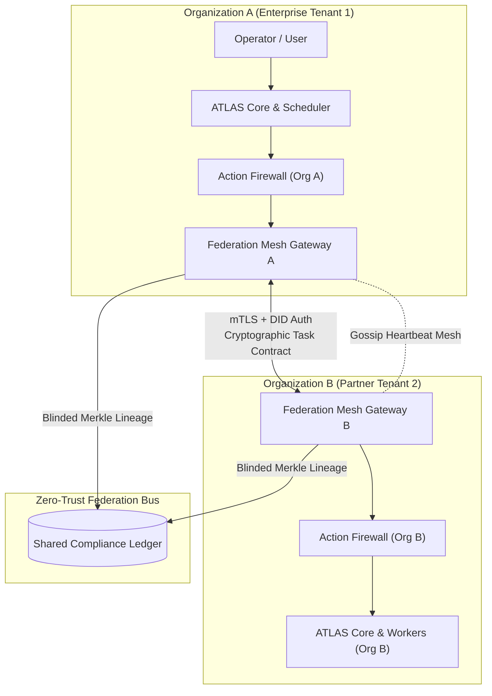

# ATLAS Phase 18 Architecture Proposal — Autonomous Multi-Organization Federation & Self-Healing Agent Mesh

**Phase:** Phase 18 Architectural Design & RFC  
**Topic:** Cross-Cloud Autonomous Federation, Decentralized Agent Contract Negotiation & Self-Healing Agent Mesh  
**Status:** **PROPOSED ARCHITECTURE (Ready for Governance Review)**  
**Target Release:** ATLAS v0.18.0 / v1.0.0  
**Author:** ATLAS Architecture Strategy Committee & Lead System Authority  
**Date:** 2026-11-21  

---

## 1. Executive Summary & Vision

While Phase 16 established verifiable enterprise process execution and Phase 17 introduced intra-organizational Human–AI collaboration, **Phase 18 extends ATLAS across organizational boundaries**.

In real-world global supply chains, multi-vendor healthcare networks, interbank settlements, and federated consortiums, no single organization owns all systems or data. Phase 18 transforms ATLAS into a **Cross-Cloud Autonomous Federation & Self-Healing Agent Mesh**:
1. **Decentralized Multi-Organization Task Contracts**: Dynamic, cryptographically negotiated Service Level Agreements (SLAs) binding disparate autonomous agents across independent corporate tenants.
2. **Zero-Trust Cross-Cloud Agent Federation**: Cryptographic agent identities based on W3C Decentralized Identifiers (DIDs) and Verifiable Credentials (VCs), enabling secure execution across AWS, GCP, Azure, and private data centers.
3. **Dynamic Self-Healing Agent Mesh**: Real-time localized failure detection, automatic Byzantine fault containment, dynamic rescheduling around dead or degraded workers, and automatic compensation without human downtime.
4. **Cross-Organizational Action Firewall**: Dual-custody perimeter firewalls ensuring actions executing inside partner infrastructure require reciprocal cryptographic authorization.
5. **Privacy-Preserving Cross-Tenant Lineage**: Zero-knowledge and Merkle-proof causal traces allowing independent regulatory verification without leaking proprietary internal business logic.

---

## 2. Product Requirements Document (PRD)

### 2.1 Target Personas
1. **Cross-Enterprise Workflow Architect**: Designs multi-vendor processes spanning suppliers, logistics providers, and external financial institutions.
2. **Zero-Trust Security Officer**: Audits foreign agent delegations, verifies cryptographic identity assertions, and enforces perimeter egress policies.
3. **Consortium Governance Director**: Defines inter-organizational compliance policies and monitors federated task completion.
4. **Site Reliability Engineer (Mesh)**: Monitors cross-cloud mesh latency, gossip health probes, and automatic worker failover.

### 2.2 Functional Requirements (FR)
- **FR-18.1 (Federated Contracts):** Autonomous negotiation of task specifications, timeouts, penalty clauses, and parameter schemas between separate tenant domains.
- **FR-18.2 (Zero-Trust Agent Identity):** Mutual mTLS, DID-based asymmetric signing (Ed25519), and ephemeral token exchange for all cross-tenant agent dispatches.
- **FR-18.3 (Self-Healing Mesh):** Gossip-protocol based distributed health probing; automatic worker node retirement and in-flight task migration upon 3 missed heartbeats.
- **FR-18.4 (Cross-Org Firewall Gating):** Outbound tasks to external partner agents require local Action Firewall approval; incoming partner actions require reciprocal counter-signing.
- **FR-18.5 (Redacted Cross-Chain Lineage):** Generation of federated Merkle lineage trees where sensitive internal reasoning is blinded while mathematical validity is proven.

### 2.3 Non-Functional Requirements (NFR)
- **NFR-18.1 (Zero Core Invariant Violation):** Zero external dependencies introduced into `packages/atlas-core`. Core remains immutable; federation lives in `packages/atlas-federation` and `packages/atlas-mesh`.
- **NFR-18.2 (Latency Budget):** Inter-organization handshake < 100ms P95; mesh health heartbeat gossip overhead < 1% CPU.
- **NFR-18.3 (Byzantine Fault Tolerance):** System tolerates up to 33% malicious or faulty nodes in the federated coordinator mesh without split-brain execution.

---

## 3. High-Level Architecture Diagram



---

## 4. Threat Model & Security Boundaries

### 4.1 Attacking Vectors & Mitigations
1. **Threat: Foreign Agent Poisoning / Sybil Attack**
   - *Vector:* Attacker registers 100 rogue worker agents in a partner tenant to compromise task quorums.
   - *Mitigation:* Stake-weighted or reputation-bounded worker enrollment; tenant-level maximum concurrency caps; strict DID identity verification.
2. **Threat: Replay of Cross-Organizational Action Requests**
   - *Vector:* Attacker captures a signed cross-border transfer instruction and resubmits it.
   - *Mitigation:* Nonce-stamped, monotonic sequence numbers with strict 30-second TTL and SHA-256 deduplication cache.
3. **Threat: Proprietary Data Exfiltration via Shared Context**
   - *Vector:* Foreign agent queries internal database context via task input/output payload.
   - *Mitigation:* Mandatory field-level redaction policy (`DifferentialPrivacyFilter`) stripping non-contract fields before egress.

---

## 5. Proposed Data Contracts & Pydantic Schemas

```python
from __future__ import annotations
from enum import StrEnum
from typing import Any
from pydantic import BaseModel, Field
import time
import hashlib


class FederationContractStatus(StrEnum):
    DRAFT = "DRAFT"
    PROPOSED = "PROPOSED"
    SIGNED = "SIGNED"
    ACTIVE = "ACTIVE"
    TERMINATED = "TERMINATED"


class FederatedTaskContract(BaseModel):
    """Cryptographically negotiated SLA binding two independent organizational tenants."""

    contract_id: str
    initiating_tenant: str
    executing_tenant: str
    task_type: str
    input_schema: dict[str, Any]
    output_schema: dict[str, Any]
    max_duration_seconds: float = 300.0
    sla_timeout_penalty_usd: float = 0.0
    initiator_signature: str = ""
    executor_signature: str = ""
    valid_from: float = Field(default_factory=time.time)
    valid_until: float


class MeshNodeStatus(StrEnum):
    HEALTHY = "HEALTHY"
    SUSPECT = "SUSPECT"
    DEGRADED = "DEGRADED"
    DEAD = "DEAD"


class MeshNodeInfo(BaseModel):
    """Identity and telemetry of a worker node in the self-healing agent mesh."""

    node_id: str
    tenant_id: str
    endpoint: str
    capabilities: list[str] = Field(default_factory=list)
    status: MeshNodeStatus = MeshNodeStatus.HEALTHY
    last_heartbeat: float = Field(default_factory=time.time)
    active_tasks: int = 0
    max_concurrency: int = 10


class CrossOrgDelegation(BaseModel):
    """Zero-trust verifiable delegation passed across organizational boundaries."""

    delegation_id: str
    source_tenant: str
    target_tenant: str
    task_instance_id: str
    allowed_action_types: list[str]
    context_merkle_root: str
    issued_at: float = Field(default_factory=time.time)
    expires_at: float
    cryptographic_token: str
```

---

## 6. Implementation Milestones

| Milestone | Title | Scope & Key Deliverables |
| :--- | :--- | :--- |
| **M18.1** | Decentralized Task Contracts | `packages/atlas-federation/contract.py`: Contract negotiation, schema validation, Ed25519/HMAC signature exchange. |
| **M18.2** | Cross-Tenant Mesh Gateway | `packages/atlas-federation/gateway.py`: mTLS proxy, DID authentication, and cross-border firewall proxying. |
| **M18.3** | Self-Healing Gossip Mesh | `packages/atlas-mesh/discovery.py`: Distributed gossip health heartbeats, failure detectors, and worker failover. |
| **M18.4** | Blinded Merkle Lineage | `packages/atlas-federation/lineage.py`: Zero-knowledge / blinded factor trees preserving enterprise confidentiality. |
| **M18.5** | Multi-Org REST & CLI Control | CLI commands (`atlas federation contract`, `atlas mesh peers`) and FastAPI federation endpoints. |
| **M18.6** | Acceptance Suite & Pilot | 25-scenario end-to-end acceptance suite (`tests/acceptance/test_phase18_acceptance.py`). |

---

## 7. Governance Invariant Notice

In accordance with ATLAS Engineering Constitution Rule 1 (*Architecture Ownership*) and Rule 8 (*Durable Continuity*), no source code modification or branch creation for Phase 18 shall take place until this architecture proposal is approved by human governance stakeholders.
