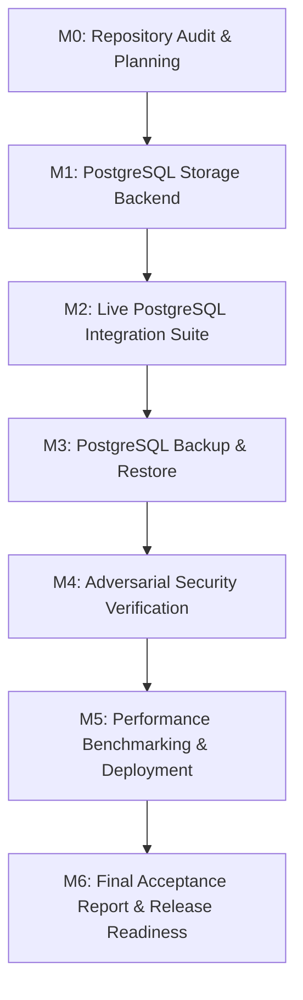

# ATLAS Phase 6.1 Master Implementation Plan
## PostgreSQL Production Integration & Independent Release Audit

**Target Branch:** `feat/phase-6-production-hardening`  
**Base Commit:** `86b4cb2` (Phase 6 Complete)  
**Start Date:** 2026-11-13  
**Status:** IN PROGRESS  

---

## 1. Executive Summary & Objective

In Phase 6, ATLAS achieved production hardening across security, reliability, performance backpressure, Windows interactive worker validation, and Docker Compose topology. However, the Phase 6 acceptance review identified a key gap: while PostgreSQL schema DDL and configuration models were specified in `packages/atlas-storage/src/atlas_storage/postgres.py`, the operational runtime remained exclusively backed by SQLite, and `PostgresTaskStoreInterface` raised `NotImplementedError`.

Phase 6.1 promotes PostgreSQL into a genuinely supported, fully operational storage backend with:
1. Complete implementation of `PostgresStorage` satisfying all 5 storage protocols (`TaskStoreProtocol`, `EventStoreProtocol`, `CheckpointStoreProtocol`, `ActionLedgerStoreProtocol`, `WorkerStoreProtocol`).
2. Production-grade connection pooling (`psycopg_pool`), schema migrations, transaction management, atomic task transitions, optimistic locking, event sequence guarantees, worker lease fencing, action idempotency, and checkpoint integrity.
3. Live end-to-end PostgreSQL integration testing against actual PostgreSQL instances (zero SQLite mocks).
4. Physical PostgreSQL backup and restore tools (`pg_dump` / `pg_restore`) with cryptographic SHA-256 sidecars, integrity verification, clean-database restoration testing, and retention management.
5. In-depth adversarial security verification against DNS rebinding, redirect chains, private IP and IPv6 restrictions, subresource rules, symlink races, Windows UNC paths, approval tampering, replay attacks, token revocation, cross-tenant isolation, and secret scrubbing.
6. Reproducible performance benchmarks under identical workloads comparing SQLite and PostgreSQL.
7. Clean deployment verification and documentation (`docs/POSTGRESQL_OPERATIONS.md`, `docs/PHASE_6_1_ACCEPTANCE_REPORT.md`).

---

## 2. Milestone Breakdown & Schedule

### Milestone 0: Audit & Baseline Verification
- Audit repository, interfaces, contracts, configuration, and dependencies.
- Verify Git status, working tree, and Phase 6 baseline.
- Establish `docs/PHASE_6_1_PLAN.md` and `docs/PHASE_6_1_STATUS.md`.

### Milestone 1: PostgreSQL Storage Backend Implementation
- Update `packages/atlas-storage/pyproject.toml` to include `psycopg[binary]>=3.2.0` and `psycopg-pool>=3.2.0`.
- Implement `PostgresStorage` in `packages/atlas-storage/src/atlas_storage/postgres.py`:
  - Connection pooling via `psycopg_pool.ConnectionPool`.
  - Schema auto-initialization and migration tracking (`schema_version`).
  - Strict transaction demarcation with commit/rollback semantics.
  - Materialized task queries and optimistic concurrency checks (`update_task_status`).
  - Immutable event appending with sequence integrity (`CONSTRAINT uq_task_sequence UNIQUE (task_id, sequence)`).
  - Checkpoint storage with cryptographic hash verification and rollback capability.
  - Action ledger with SHA-256 idempotency key deduplication and UNKNOWN state tracking.
  - Worker registry, heartbeats, and lease fencing tokens (`generation`).
- Update API factory in `apps/api/src/atlas_api/main.py` and CLI in `apps/cli/` to initialize `PostgresStorage` when `ATLAS_DATABASE_URL` is set to PostgreSQL.
- Enforce failure on PostgreSQL unavailability (no silent SQLite substitution).

### Milestone 2: PostgreSQL Integration Test Suite
- Build `tests/integration/test_postgres_storage_e2e.py` executing against a live native PostgreSQL instance:
  1. Schema creation & migration idempotent re-runs.
  2. Task creation, retrieval, and status listing.
  3. Atomic task transitions and invalid state transition rejection.
  4. Concurrent event writes and sequence collision rejection (`SequenceCollisionError`).
  5. Optimistic locking and version conflict rejection (`OptimisticLockError`).
  6. Worker lease fencing generation rejection (`StaleWorkerError`).
  7. Duplicate action delivery and idempotency caching.
  8. Unknown side-effect outcome handling (`NonIdempotentActionUncertaintyError`).
  9. Checkpoint persistence and cryptographic tamper detection (`CorruptedCheckpointError`).
  10. Transaction rollback on transient error.
  11. Worker crash recovery and lease acquisition.
  12. Connection loss and reconnection recovery.
  13. Concurrent task execution and event interleaving.
  14. Cross-tenant private task isolation.

### Milestone 3: PostgreSQL Backup and Restoration Engine
- Implement `create_postgres_backup()` and `restore_postgres_backup()` in `packages/atlas-storage/src/atlas_storage/backup.py`.
- Support native `pg_dump` and `pg_restore` (with logical SQL dump fallback):
  - Generate atomic backup archive.
  - Generate SHA-256 checksum sidecar metadata (`.meta.json`).
  - Record table row counts across primary tables (`tasks`, `execution_events`, `checkpoints`, `worker_leases`, `action_ledger`).
  - Cryptographically verify backup before restoration.
  - Restore into a fresh, clean database and assert zero data loss.
  - Handle interrupted backups, corrupted files, and credential security.
- Create `docs/POSTGRESQL_OPERATIONS.md` covering administration, tuning, migration, and disaster recovery.

### Milestone 4: Security Adversarial Audit & Tests
- Create `tests/unit/test_security_adversarial.py` testing:
  - DNS rebinding attacks with changing IP resolutions.
  - Redirect chains targeting private RFC 1918 addresses and link-local metadata endpoints.
  - IPv6 loopback (`::1`) and unique local addresses (`fc00::/7`).
  - Browser subresource validation.
  - Symlink race conditions and directory traversal guards.
  - Windows UNC path rejection (`\\host\share`) and reserved device names (`CON`, `PRN`, `AUX`, `NUL`, `COM1-9`, `LPT1-9`).
  - Approval signature tampering and replay rejection.
  - Token revocation and cross-tenant artifact access.
  - Secret redaction across exceptions, stack traces, and events.
- Update `docs/SECURITY_THREAT_MODEL.md` with residual risk analysis.

### Milestone 5: Performance Verification & Deployment Testing
- Implement reproducible benchmark script testing SQLite vs. PostgreSQL throughput and latency.
- Measure median, 90th, and 99th percentile latency across task creation, event appending, and checkpointing.
- Verify clean deployment of the full stack (API, Dashboard, Worker, PostgreSQL).

### Milestone 6: Release Readiness, Changelog & Final Acceptance Report
- Update `docs/CHANGELOG.md` with Phase 6.1 release notes.
- Create `docs/PHASE_6_1_ACCEPTANCE_REPORT.md` with explicit PASS/FAIL results for all criteria.
- Update `docs/PROJECT_STATUS.md` and `docs/IMPLEMENTATION_PLAN.md`.
- Run full regression suite across monorepo to ensure 100% green tests.

---

## 3. Constitutional Guarantees

Phase 6.1 strictly enforces the 8 rules of the ATLAS Engineering Constitution:
1. **Architecture Ownership**: Core contracts govern storage; PostgreSQL adapter implements protocols without owning planning.
2. **Action Firewall**: PostgreSQL stores audit trails; action firewall authorizes actions before driver execution.
3. **Zero-Dependency Core**: `packages/atlas-core` remains free of database dependencies.
4. **No Placeholders**: Every PostgreSQL query, error transition, and backup step is empirically implemented and tested.
5. **No Swallowing Exceptions**: Database connection errors and constraint violations raise structured domain exceptions.
6. **No Secret Leaks**: Database passwords and connection strings are scrubbed from logs and metadata sidecars.
7. **Verification Invariant**: Actions and database restores require deterministic post-condition verification.
8. **Durable Continuity**: Complete status and execution evidence tracked in project documentation.
