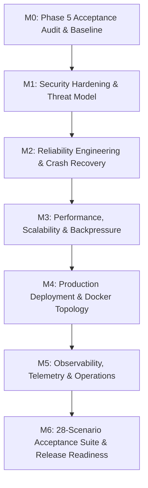

# ATLAS Phase 6 Master Implementation Plan
## Production Hardening, Security & Release Readiness

**Target Branch:** `feat/phase-6-production-hardening`  
**Base Commit (Phase 5):** `06b5cdb`  
**Date:** 2026-11-13  
**Status:** IN PROGRESS (M0 Baseline Audit)

---

## 1. Executive Summary & Mission

The objective of **Phase 6** is to transform the ATLAS autonomous computer-use runtime into a hardened, secure, fault-tolerant, observable, scalable, and reproducibly deployable production platform.

In strict compliance with the **ATLAS Engineering Constitution** (`AGENTS.md`):
1. **Architecture Ownership:** ATLAS retains exclusive ownership of planning, task lifecycle, tool contracts, authorization, verification, and recovery.
2. **Action Firewall:** Models make decisions; ATLAS controls execution. No driver or worker executes an action without deterministic policy and approval gating.
3. **Zero-Dependency Core:** `packages/atlas-core` remains strictly zero-dependency (no external drivers, DBs, or OS APIs).
4. **No Placeholders:** Every security, reliability, and deployment mechanism is implemented with concrete logic and verified via automated tests.
5. **No Swallowing Exceptions:** Failures are structured, logged with context, and handled via explicit recovery or failure transitions.
6. **No Secret Leaks:** Credentials, tokens, and keys must never appear in logs, prompts, artifacts, or events.
7. **Verification Invariant:** Actions require deterministic post-condition verification.
8. **Durable Continuity:** All progress, decisions, risks, and findings are continuously recorded.

---

## 2. Milestone Architecture & Task Breakdown

### Milestone 0: Phase 5 Independent Acceptance Audit (M0)
- Audit the end-to-end task lifecycle across all 14 states:
  $\text{REQUEST} \to \text{VALIDATION} \to \text{PLANNING} \to \text{POLICY} \to \text{APPROVAL} \to \text{SCHEDULING} \to \text{EXECUTION} \to \text{OBSERVATION} \to \text{VERIFICATION} \to \text{RECOVERY} \to \text{COMPLETION}$.
- Verify existing capabilities:
  - Task creation, persistence, state transitions.
  - Multi-driver registry (`PlaywrightBrowserDriver` and `DesktopDriver`).
  - Native Windows interactive session automation and geometry detection.
  - Action Firewall and human approval management.
  - Durable checkpoints, tamper-evident SHA-256 seals.
  - Action ledger, worker leases, and generation fencing tokens.
  - Recovery coordinator, environment reconciler, and replay engine.
  - FastAPI REST endpoints, SSE event streaming, and Operator Dashboard.
  - CLI and worker daemons (`atlas worker run`).
- Establish baseline metrics for test suite (230 tests), linting, and formatting.

### Milestone 1: Security Hardening (M1)
1. **Authentication & Identity Management:**
   - Implement cryptographically hashed token verification (constant-time comparison).
   - Support API key expiration, rotation, and revocation in `atlas-api`.
   - Worker enrollment authentication and mutual identity validation.
2. **Role-Based Access Control (RBAC):**
   - Enforce fine-grained permissions across `admin`, `operator`, `worker`, and `viewer` roles.
   - Prevent cross-tenant/cross-user task access, session tampering, and unauthorized artifact access.
3. **Cryptographically Bound Approval Security:**
   - Bind every sensitive approval request to a SHA-256 integrity signature covering:
     `task_id`, `action_id`, `action_type`, `canonical_parameters`, `exact_target`, `risk_level`, `operator_id`, `policy_version`, and `expires_at`.
   - Invalidate approval if any action parameter or target is modified.
   - Prevent approval replay, reuse, post-expiry execution, or policy-drift bypass.
4. **Network & SSRF Defense:**
   - Multi-layer SSRF filter: resolve destination IPs, block loopback (`127.0.0.0/8`), private RFC1918 subnets (`10.0.0.0/8`, `172.16.0.0/12`, `192.168.0.0/16`), link-local (`169.254.0.0/16`), and IPv6 equivalents (`::1`, `fc00::/7`).
   - Prevent DNS rebinding by re-verifying resolved socket address at connection time.
   - Validate HTTP redirects across all hops.
5. **Filesystem & Command Injection Hardening:**
   - Path traversal defenses across Windows and POSIX: enforce strict path containment, block symlink escapes, reject Windows UNC paths (`\\server\share`) and reserved filenames (`CON`, `PRN`, `AUX`, `NUL`, `COM1-9`, `LPT1-9`).
   - Upload file size quotas and archive extraction decompression bomb guards.
   - Terminal command validation beyond string matching: structured token parsing and strict allowlist enforcement.
6. **Secret & Artifact Sanitization:**
   - Centralize multi-provider regex scrubbing (`redact_secrets`) across logs, exceptions, events, artifacts, screenshots, and traces.
7. **Threat Model:**
   - Author comprehensive `docs/SECURITY_THREAT_MODEL.md` documenting assets, trust boundaries, attack vectors, and residual risks.

### Milestone 2: Reliability Engineering & Crash Resilience (M2)
1. **Distributed Failure Handling:**
   - Test worker process crash recovery and heartbeat expiration.
   - Enforce monotonic lease fencing tokens (`StaleWorkerError`).
   - Browser driver crash recovery with context reconstruction.
   - Database connection loss, busy lock timeouts, and SQLite WAL recovery.
   - Corrupted checkpoint detection and automated rollback to last verified state.
2. **External Side-Effect Safety:**
   - Enforce idempotency keys for repeatable actions.
   - Strictly prohibit blind retries for non-idempotent actions in `UNKNOWN` state (e.g. payment, email, deletion, resource provisioning).
   - Require physical environment reconciliation before resuming interrupted execution.
3. **Backup & Disaster Recovery:**
   - Implement online SQLite and PostgreSQL backup procedures.
   - Executable backup and restore test suite verifying data integrity and cryptographic checkpoint validation.

### Milestone 3: Performance, Scalability & Backpressure (M3)
1. **Performance Baseline Measurement:**
   - Measure real API response latency, task creation throughput, worker scheduling latency, browser launch time, and memory/CPU per worker.
2. **Queue Backpressure & Resource Quotas:**
   - Implement bounded worker task queues with backpressure rejection (`429 Too Many Requests` / `503 Service Unavailable`).
   - Concurrency bounds, execution timeouts, and cancellation propagation.
   - Database connection pooling and query pagination.

### Milestone 4: Production Deployment Topology (M4)
1. **Containerized Multi-Service Deployment (`compose.yaml`):**
   - Production multi-stage `Dockerfile` with Playwright Chromium.
   - Docker Compose orchestrating `atlas-api`, `atlas-dashboard`, PostgreSQL (`atlas-postgres`), and worker pool (`atlas-worker-browser`, `atlas-worker-desktop`).
   - Isolated internal networks, non-root user execution, persistent named volumes, and health check probes.
2. **Windows Local Worker Setup:**
   - Windows worker documentation and interactive desktop validation.
   - Explicit check preventing Session 0 / non-interactive service execution when desktop automation is required.
3. **Configuration & Migration Management:**
   - Sanitized `.env.example`.
   - Alembic / schema migration runner and rollback verification.

### Milestone 5: Observability, Metrics & Operations (M5)
1. **Telemetry & Tracing:**
   - Structured JSON logging with context correlation IDs (`task_id`, `session_id`, `worker_id`, `action_id`).
   - OpenTelemetry trace hooks and Prometheus-compatible metrics endpoint (`/metrics`).
2. **Operational Dashboards & Audit Trail:**
   - Real-time SSE audit feed and operator visibility into running tasks, worker health, and pending approvals.

### Milestone 6: Release Readiness & 28-Scenario Acceptance Suite (M6)
1. **Documentation & Release Artifacts:**
   - Semantic versioning, changelog (`CHANGELOG.md`), release notes, deployment, upgrade, and rollback guides.
2. **Comprehensive 28-Scenario Acceptance Suite:**
   - Implement and execute automated tests covering all 28 required production scenarios.
3. **Final Acceptance Report:**
   - Complete `docs/PHASE_6_ACCEPTANCE_REPORT.md` with full execution logs, benchmarks, and PASS/FAIL audit.

---

## 3. Workstream Execution Timeline

