# ATLAS Phase 9 Architecture Specification: Distributed Execution Network

## 1. High-Level Architectural Overview

Phase 9 transforms ATLAS into an enterprise-grade distributed automation fabric. The central control plane orchestrates autonomous tasks across a distributed fleet of worker agents operating across different platforms, security tiers, and network zones.

```mermaid
flowchart TD
    subgraph ControlPlane["ATLAS Central Control Plane"]
        API["FastAPI Control Plane API<br/>(/api/v1/*)"]
        AUTH["Worker Enrollment Authority<br/>(Provisioning Tokens & Certificates)"]
        SCHED["Distributed Scheduler<br/>(Capability, Tenant & Resource Aware)"]
        COORD["Distributed Task Coordinator<br/>(Multi-Worker DAG & Sync Barriers)"]
        RECOV["Distributed Recovery Manager<br/>(Fencing, Eviction & Side-Effect Safety)"]
        STORE[("Durable Storage<br/>(PostgreSQL / SQLite)")]
        FIREWALL["ActionFirewall Policy Engine"]

        API --> AUTH
        API --> SCHED
        SCHED --> COORD
        COORD --> FIREWALL
        COORD --> STORE
        RECOV --> STORE
    end

    subgraph Workers["Distributed Worker Fleet"]
        W_WIN["Worker Node 1: Windows 11<br/>Active Interactive User Session<br/>(PyAutoGUI, Windows UI Automation, Chrome)"]
        W_LNX["Worker Node 2: Linux Bare-Metal<br/>Headless Automation<br/>(Playwright, Bash, System Tools)"]
        W_CONT["Worker Node 3: Cloud Container<br/>Ephemeral Isolated Sandbox<br/>(Python SDK, CLI, Web Scraping)"]
    end

    W_WIN -->|Outbound ATLAS-REP/1.0| API
    W_LNX -->|Outbound ATLAS-REP/1.0| API
    W_CONT -->|Outbound ATLAS-REP/1.0| API
```



---

## 2. Separation of Concerns & Ownership

| Component | Location | Authority & Responsibilities |
| :--- | :--- | :--- |
| **Control Plane API** | Control Plane | Authenticates clients and workers, exposes management endpoints, and ingests telemetry. |
| **Worker Enrollment Authority** | Control Plane | Issues cryptographic provisioning tokens, validates mutual worker authentication, rotates keys, manages CRL. |
| **Distributed Scheduler** | Control Plane | Multi-dimensional matching of task requirements (OS, GPU, browser, drivers, memory, tenant, security classification) to candidate workers. |
| **Distributed Task Coordinator** | Control Plane | Partitions complex `TaskGraph` DAGs across workers, schedules parallel subtasks, manages synchronization barriers, and aggregates results. |
| **Distributed Recovery Manager** | Control Plane | Detects heartbeats, evicts dead workers, invalidates leases with monotonic fencing tokens, and reconciles unknown side effects. |
| **Worker Agent Daemon** | Worker Node | Outbound authenticated connection, health & resource telemetry, executes signed assignments via approved local drivers, streams events, and enforces cancellations. |
| **Local Execution Drivers** | Worker Node | Low-level OS automation (Playwright, PyAutoGUI, UI Automation, terminal). Gated by control plane policy signatures. |

---

## 3. Worker Identity, Enrollment & Provisioning Architecture

1. **Zero-Trust Identity**: A worker cannot register simply by claiming a `worker_id`. Enrollment requires an authorized, cryptographically signed provisioning token issued by an administrator for a specific tenant.
2. **Mutual Cryptographic Authentication**:
   - The control plane validates the worker's token signature and public key.
   - The worker validates the control plane's signature and TLS certificate.
3. **Capability Advertisements**:
   - Platform OS (`windows`, `linux`, `darwin`), OS version, architecture (`x86_64`, `arm64`).
   - Desktop session type (`interactive_user`, `headless`, `session_0`).
   - Installed drivers (`playwright`, `pyautogui`, `windows_uia`, `bash`).
   - Hardware limits (CPU count, memory bytes, GPU available).
   - Tenant scope and software version.

### Windows Session 0 Invariant
Interactive Windows desktop automation requires an active, unlocked user desktop session. If a Windows worker starts as an unconfigured Windows Service running in **Session 0**, it explicitly advertises `session_type = "session_0"`. The distributed scheduler **strictly refuses** to assign interactive GUI tasks to Session 0 workers, preventing invisible hangs.

---

## 4. Resource-Aware Distributed Scheduler

The scheduler maintains an in-memory priority queue backed by durable storage. Scheduling decisions evaluate:

1. **Hard Requirements Filter**:
   - `task.required_os == worker.platform`
   - `task.required_drivers <= worker.drivers`
   - `task.tenant_id == worker.tenant_id`
   - `task.security_level <= worker.security_level`
   - `task.requires_interactive_desktop` implies `worker.session_type == "interactive_user"`
2. **Resource Optimization Scoring**:
   - Worker load factor: `active_assignments / max_concurrent_assignments`
   - Hardware fit: CPU/RAM headroom
   - Data locality: cached package archives or artifacts
3. **Lease Acquisition & Fencing**:
   - The scheduler assigns the task by atomically acquiring a `WorkerLease` with an incremented `generation` (fencing token).
   - If the worker loses connectivity, its lease expires; any late execution results presented by that worker are rejected by the control plane.

---

## 5. Remote Execution Protocol (`ATLAS-REP/1.0`)

The communication between the Control Plane and Worker Agents uses an outbound-initiated, bidirectional framing protocol:

```
+-------------------------------------------------------------+
| Header: Protocol Version | Message Type | Tenant ID | ID     |
+-------------------------------------------------------------+
| Payload: Encrypted / Signed JSON (Assignment / Progress / ...) |
+-------------------------------------------------------------+
| Signature: HMAC-SHA256 or Ed25519 Detached Signature        |
+-------------------------------------------------------------+
```

### Core Message Types:
- `ENROLL_REQUEST` / `ENROLL_RESPONSE`: Secure enrollment and credential issuance.
- `HEARTBEAT`: Monotonic ping containing worker load, memory, and status.
- `ASSIGNMENT_OFFER` / `ASSIGNMENT_ACK`: Dispatching and acknowledging a task assignment.
- `EXECUTION_PROGRESS`: Real-time streaming of step events, terminal output, and intermediate logs.
- `ACTION_EXECUTION_REQUEST` / `ACTION_EXECUTION_RESULT`: Individual gated driver interactions.
- `CANCEL_DIRECTIVE`: Immediate abort signal for running assignments.
- `ASSIGNMENT_COMPLETE`: Final deliverable, artifact hashes, and verification evidence.

---

## 6. Durable Fault Tolerance & Side-Effect Safety

A fundamental principle of the ATLAS Distributed Network is **Safe Recovery Under Uncertainty**:
1. **Crash Detection**: If a worker fails to send a heartbeat within `heartbeat_timeout_seconds` (e.g. 15s), the control plane transitions the lease to `EXPIRED` and worker status to `DISCONNECTED`.
2. **Fencing Token Rejection**: When an assignment is reassigned to Worker B, the generation token increments (e.g. Generation 2). If Worker A recovers and attempts to report completion with Generation 1, the store rejects it with `StaleWorkerError`.
3. **Unknown External Action Safety**:
   - If Worker A crashed while executing a non-idempotent computer action (e.g. submitting a financial transfer, issuing a remote API write), the action state in the `ActionLedger` is `UNKNOWN`.
   - Before Worker B resumes, ATLAS triggers a **Deterministic Reconciliation Routine**.
   - If external state cannot be deterministically verified, ATLAS raises `NonIdempotentActionUncertaintyError` and pauses for human supervisor authorization rather than repeating the side effect.
