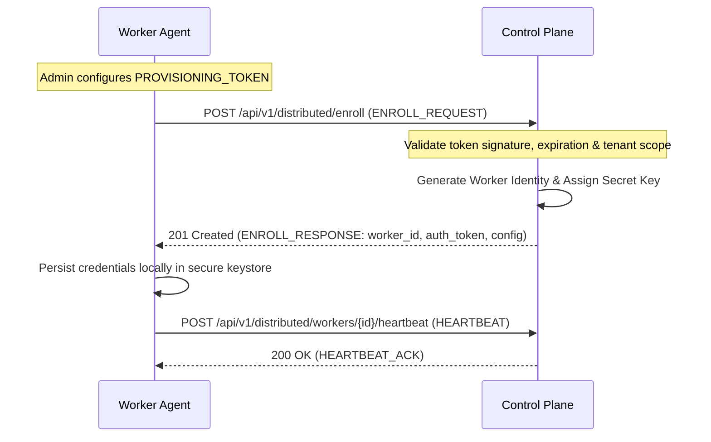
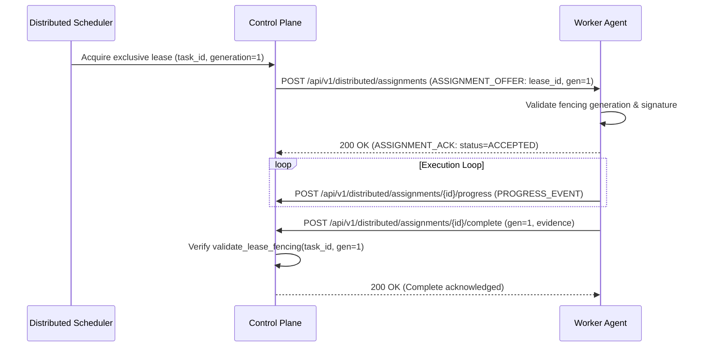

# ATLAS Remote Execution Protocol Specification (`ATLAS-REP/1.0`)

**Version:** 1.0.0  
**Status:** Canonical Draft  
**Transport:** Authenticated HTTP / Server-Sent Events (SSE) / WebSocket / JSON over TLS

---

## 1. Protocol Architecture & Framing

`ATLAS-REP/1.0` defines the wire protocol governing all interactions between the ATLAS Control Plane and distributed Worker Agents.

### Envelope Structure

All messages transmitted between control plane and workers adhere to the following schema:

```json
{
  "protocol_version": "ATLAS-REP/1.0",
  "message_id": "msg_01HJ8Z9X2P...",
  "message_type": "HEARTBEAT | ASSIGNMENT_OFFER | ...",
  "sender_id": "worker_win11_01 | control_plane",
  "recipient_id": "control_plane | worker_win11_01",
  "tenant_id": "tenant_enterprise_01",
  "timestamp": "2026-11-14T09:30:00.000Z",
  "sequence_number": 142,
  "payload": { ... },
  "signature": "hmac_sha256_or_ed25519_signature"
}
```

### Signature Computation
`signature = sign(sha256(canonical_json(payload) + ":" + message_id + ":" + timestamp + ":" + sequence_number))`

---

## 2. Protocol Message Taxonomy

| Message Type | Direction | Description |
| :--- | :---: | :--- |
| `ENROLL_REQUEST` | Worker -> CP | Worker presents provisioning token and hardware/platform capability profile. |
| `ENROLL_RESPONSE` | CP -> Worker | Control plane validates token, issues worker ID, session secret, and lease parameters. |
| `HEARTBEAT` | Worker -> CP | Periodic status ping with CPU/RAM utilization and current task state. |
| `HEARTBEAT_ACK` | CP -> Worker | Control plane acknowledgement with optional pending cancellation flags. |
| `ASSIGNMENT_OFFER` | CP -> Worker | Dispatches a task subtask with lease ID, fencing token, and policy context. |
| `ASSIGNMENT_ACK` | Worker -> CP | Worker accepts the assignment and transitions to RUNNING. |
| `PROGRESS_EVENT` | Worker -> CP | Streams real-time step output, console logs, or intermediate metrics. |
| `ACTION_REQUEST` | Worker -> CP | Gated computer action authorization request before local driver execution. |
| `ACTION_RESULT` | Worker -> CP | Post-execution driver output, screenshot hash, and DOM snapshot. |
| `CANCEL_DIRECTIVE` | CP -> Worker | Instructs worker to abort execution immediately. |
| `ASSIGNMENT_COMPLETE`| Worker -> CP | Subtask completion evidence, deliverables, and final artifact checksums. |
| `RECONNECT_HANDSHAKE`| Worker -> CP | Reconnection request after network interruption with last acknowledged sequence. |

---

## 3. Core Protocol Flows

### 3.1 Worker Enrollment & Registration Flow



### 3.2 Task Assignment & Fencing Token Validation Flow



### 3.3 Network Interruption & Safe Reconnection Flow

1. Worker loses network connectivity to Control Plane.
2. Worker buffers up to 1,000 progress events locally in an in-memory ring buffer.
3. If disconnected duration exceeds local task timeout or lease TTL, worker pauses local drivers.
4. When connectivity resumes, worker sends `RECONNECT_HANDSHAKE` presenting `last_acknowledged_sequence` and `lease_id`.
5. If the lease was expired and reassigned by the control plane, the control plane replies with `410 Gone (LEASE_EXPIRED)` and the worker safely discards uncommitted work.
6. If the lease is still valid, the control plane confirms state and the worker drains its buffered events.
