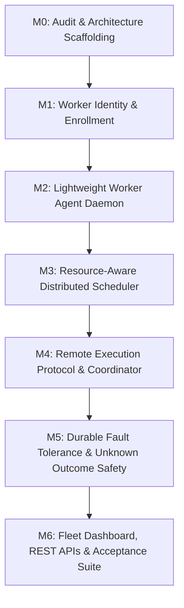

# ATLAS Phase 9 Master Implementation Plan: Distributed Execution Network

## 1. Executive Mission & Strategic Scope

The mission of **ATLAS Phase 9** is to evolve ATLAS from a single-node autonomous execution runtime into a secure, fault-tolerant, high-performance **Distributed Execution Network**.

Phase 9 enables a unified control plane to orchestrate autonomous task execution across a heterogeneous fleet of local and remote workers:
- **Physical Windows 11 Desktops**: Interactive GUI automation running in an active user session (rejecting Windows Session 0).
- **Linux Bare-Metal & VMs**: High-throughput web browsing, CLI, and data processing.
- **Isolated Cloud Linux Containers**: Scalable, ephemeral background task execution.

### Architectural Governance & Invariants (`AGENTS.md`)
1. **Control Plane Ownership**: The central ATLAS control plane retains absolute ownership over the task lifecycle, security policy, authorization, scheduling, multi-agent orchestration, verification evidence, and failure recovery.
2. **Workers as Subordinate Execution Engines**: Workers execute authorized assignments; workers are never independent authorities capable of overriding policies or bypassing firewall controls.
3. **Zero Trust Worker Boundary**: A worker is never trusted merely because it presents a worker ID. All workers must complete cryptographic enrollment with per-tenant provisioning tokens, authenticate every protocol message, and respect monotonic lease fencing tokens.
4. **Side-Effect Safety**: When a worker disconnects or crashes, a lease expiration does not prove the worker ceased execution. A new worker must never blindly repeat non-idempotent computer actions whose outcome is `UNKNOWN`. The external state must be deterministically reconciled before resuming.

---

## 2. Milestone Breakdown & Delivery Schedule

### Milestone 0: Audit, Baseline Verification & Phase 9 Architecture Scaffolding
- **Objectives:**
  - Audit existing Phase 1–8 implementations, baseline test counts (426 tests passing), and verify storage implementations (SQLite & PostgreSQL).
  - Scaffold `packages/atlas-distributed` within the UV monorepo workspace.
  - Author complete architectural and operational specifications: `docs/PHASE_9_*.md`.
- **Deliverables:**
  - `packages/atlas-distributed` directory structure and `pyproject.toml`.
  - Root `pyproject.toml` workspace update.
  - Phase 9 architecture, security model, network protocol, operations guide, and risk register.

### Milestone 1: Worker Identity, Secure Enrollment & Capability Advertisement
- **Objectives:**
  - Implement unique worker identity generation and cryptographic certificate/token management.
  - Build `WorkerEnrollmentAuthority` supporting per-tenant enrollment tokens, expiration, rotation, and revocation.
  - Implement structured capability advertisement: OS platform (Windows, Linux, Darwin), architecture, active desktop session status (detecting Session 0), available drivers (Playwright, PyAutoGUI, UI Automation), software versions, and hardware resources (CPU, RAM, GPU).
- **Deliverables:**
  - `packages/atlas-distributed/src/atlas_distributed/models.py`
  - `packages/atlas-distributed/src/atlas_distributed/enrollment.py`
  - Unit tests in `tests/unit/test_worker_enrollment.py`.

### Milestone 2: Lightweight Installable Worker Agent Daemon
- **Objectives:**
  - Build `WorkerAgent` daemon runtime installable on Windows 11, Linux, and cloud containers.
  - Implement outbound-only authenticated connection to control plane (no exposed inbound ports).
  - Enforce Windows Session 0 protection: detect Session 0 and reject interactive desktop tasks with explicit platform error.
  - Implement local driver execution bridge executing authorized `ComputerAction` tasks.
  - Implement heartbeat streaming, progress event streaming, cancellation handling, and graceful disconnection/reconnection.
- **Deliverables:**
  - `packages/atlas-distributed/src/atlas_distributed/worker.py`
  - Unit tests in `tests/unit/test_worker_agent.py`.

### Milestone 3: Resource-Aware Distributed Scheduler
- **Objectives:**
  - Build `DistributedScheduler` implementing multi-dimensional resource matching:
    - OS requirements (e.g. Windows interactive desktop vs. headless Linux container)
    - Available drivers & browser binaries
    - Hardware constraints (CPU cores, RAM, GPU availability)
    - Tenant isolation boundaries & security classifications
    - Priority queuing, scheduling fairness, and queue backpressure
  - Implement exclusive task lease acquisition with monotonic generation fencing tokens.
- **Deliverables:**
  - `packages/atlas-distributed/src/atlas_distributed/scheduler.py`
  - Unit tests in `tests/unit/test_distributed_scheduler.py`.

### Milestone 4: Remote Execution Protocol & Distributed Task Coordinator
- **Objectives:**
  - Implement Remote Execution Protocol v1 (`ATLAS-REP/1.0`): versioned, envelope-signed, authenticated messaging format over HTTP/SSE/WebSocket streaming.
  - Build `DistributedTaskCoordinator` integrating with `AgentSupervisor` and `TaskGraph`:
    - Multi-worker task graph partitioning and dependency scheduling.
    - Worker-specific subtask dispatch and parallel execution.
    - Result aggregation, synchronization barriers, and artifact transfer.
- **Deliverables:**
  - `packages/atlas-distributed/src/atlas_distributed/protocol.py`
  - `packages/atlas-distributed/src/atlas_distributed/coordinator.py`
  - Unit tests in `tests/unit/test_remote_protocol.py`.

### Milestone 5: Durable Fault Tolerance, Stale Worker Fencing & Unknown Outcome Reconciliation
- **Objectives:**
  - Build `DistributedRecoveryManager` handling worker crashes, network partitions, machine reboots, and control plane restarts.
  - Enforce monotonic fencing token validation on assignment completions (`StaleWorkerError`).
  - Implement unknown external outcome safety: when a worker lease expires with a pending action, verify external state before reassigning; raise `NonIdempotentActionUncertaintyError` if side effect cannot be verified.
- **Deliverables:**
  - `packages/atlas-distributed/src/atlas_distributed/fault_tolerance.py`
  - Unit tests in `tests/unit/test_distributed_fault_tolerance.py`.

### Milestone 6: Fleet Dashboard, REST APIs, Acceptance Test Suite & Final Audit
- **Objectives:**
  - Implement versioned REST API endpoints (`/api/v1/distributed/*`) in `apps/api`.
  - Extend Operator Dashboard (`apps/api/src/atlas_api/routes/dashboard.py`) with real fleet monitoring views:
    - Worker Fleet Overview & Capacity
    - Worker Detail & Real-Time Health
    - Capability Inventory
    - Assignment Queue & Event Timeline
    - Revocation & Provisioning Controls
  - Implement comprehensive 30-scenario integration test suite (`tests/integration/test_phase9_acceptance.py`).
  - Verify complete monorepo regression baseline.
  - Author `docs/PHASE_9_ACCEPTANCE_REPORT.md`.
- **Deliverables:**
  - REST routes, dashboard HTML updates, integration acceptance suite, and acceptance audit report.

---

## 3. Monorepo Verification & Governance Guardrails

1. **Constitutional Alignment**: Every action, driver invocation, and model plan must pass through `ActionFirewall`.
2. **Zero Placeholders**: No stubbed or simulated distributed logic; all multi-process and networking contracts must be physically executable.
3. **No Secret Leaks**: Worker tokens and credentials must be redacted in all logs, metrics, and API responses.
4. **Git Commit Cadence**: Maintain atomic commits per milestone (`feat(...)`), preserving historical branches and `master`.
