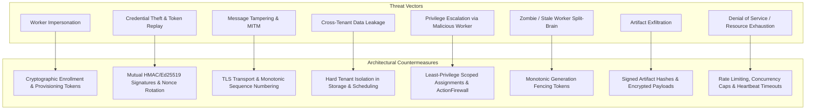

# ATLAS Phase 9 Security Model & Distributed Threat Model

**Document Version:** 1.0.0  
**Phase:** Phase 9 — Distributed Execution Network  
**Security Classification:** Strict Zero-Trust Distributed Execution

---

## 1. Threat Landscape & Adversarial Model

The ATLAS Distributed Execution Network operates under the assumption that workers run in heterogeneous, untrusted, or semi-trusted network environments (including remote user endpoints, third-party cloud instances, and branch office servers).

---

## 2. Threat Vector Analysis & Countermeasures

### 2.1 Worker Impersonation & Rogue Enrollment
- **Threat**: An attacker spins up a malicious worker daemon and attempts to join the cluster to sniff tasks or execute unauthorized actions.
- **Countermeasure**:
  - Registration requires a single-use or administrator-authorized cryptographic **Enrollment Token** bound to a specific tenant ID.
  - The control plane validates token authenticity, expiration, and tenant scope before generating worker credentials.
  - Workers presenting unknown or revoked credentials are immediately rejected with `401 Unauthorized` and logged to the security audit stream.

### 2.2 Credential Theft, Replay & Message Tampering
- **Threat**: An attacker intercepts network traffic or extracts credentials to replay heartbeats, fake assignment completions, or alter action results.
- **Countermeasure**:
  - All protocol messages (`ATLAS-REP/1.0`) contain a timestamp, nonce, monotonic sequence ID, and detached cryptographic signature.
  - Any message with an expired timestamp (TTL > 30s) or a duplicate sequence ID is rejected.
  - Transport Layer Security (TLS 1.3) is mandatory in production deployments.

### 2.3 Cross-Tenant Isolation
- **Threat**: Worker A belonging to Tenant A receives or accesses tasks, memory, or artifacts belonging to Tenant B.
- **Countermeasure**:
  - The distributed scheduler enforces tenant partitioning at the database query level.
  - Assignments are stamped with `tenant_id`; workers are registered with a fixed `tenant_id`.
  - The API rejects any cross-tenant assignment request with `403 Forbidden`.

### 2.4 Privilege Escalation & Unrestricted Secrets
- **Threat**: A worker requests unrestricted control plane secrets or attempts to bypass firewall rules by executing arbitrary local binaries.
- **Countermeasure**:
  - The control plane **never** sends master API keys, database credentials, or tenant private keys to workers.
  - Assignments contain only the minimal task payload and ephemeral scoped credentials needed for that specific assignment.
  - Workers must run all local actions through the `ActionFirewall` evaluation engine.

### 2.5 Split-Brain & Stale Worker Fencing
- **Threat**: Worker 1 experiences a network pause. The control plane times out its lease and reassigns Task 1 to Worker 2. Worker 1 then recovers and attempts to commit results or modify task state.
- **Countermeasure**:
  - Every assignment and task lease carries a monotonic integer **generation fencing token**.
  - Reassignment increments the generation (e.g. from 1 to 2).
  - Storage writes require `validate_lease_fencing(task_id, expected_generation)`. Worker 1's commit with generation 1 is deterministically rejected with `StaleWorkerError`.

### 2.6 Unknown External Side-Effect Protection
- **Threat**: Worker 1 crashes while executing a non-idempotent action (e.g. sending an email, ordering a service). Worker 2 blindly retries the action, causing a duplicate real-world side effect.
- **Countermeasure**:
  - When a worker lease expires while an action is marked in-progress, the action status in `ActionLedger` transitions to `UNKNOWN`.
  - Reassignment mandates an external reconciliation check.
  - If external state cannot be verified deterministically, the control plane raises `NonIdempotentActionUncertaintyError`, suspends the task, and notifies the human operator.

---

## 3. Worker Revocation Protocol (CRL)

The Control Plane maintains a persistent **Certificate Revocation List (CRL)**:
1. When a worker is revoked via API (`POST /api/v1/distributed/workers/{worker_id}/revoke`), its status transitions to `REVOKED`.
2. All active leases held by the worker are immediately revoked.
3. The worker's authentication token is blacklisted in cache and database.
4. Any subsequent heartbeat, progress message, or assignment completion from the worker is rejected immediately.
