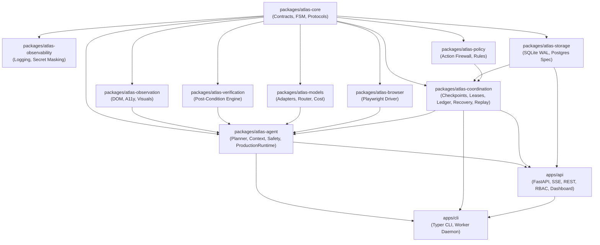
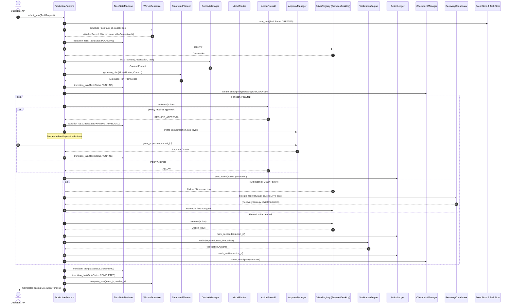

# ATLAS Phase 5 Master Implementation Plan: Production Runtime Integration & Orchestration

**Target Branch:** `feat/phase-5-production-runtime-integration`  
**Base Commit:** `3a97e07` (Phase 4 Final Acceptance & Documentation)  
**Document Status:** ACTIVE ARCHITECTURAL PLAN  
**Author:** Principal Software Architect & Runtime Engineering Lead  
**Applicable Constitution:** `AGENTS.md` (Rules 1 through 8 strictly enforced)  
**Applicable ADRs:** ADR-0001 through ADR-0008

---

## 1. Current Architecture Inventory & Baseline Assessment

Across Phases 1–4, the ATLAS repository established 10 core workspace packages and 2 executable applications with 202 passing automated tests:

| Package / App | Primary Role & Implemented Subsystems | Constitution Boundaries |
|---|---|---|
| `packages/atlas-core` | Data contracts (`Task`, `ComputerAction`, `Observation`, `Checkpoint`, `WorkerLease`, `ActionExecutionRecord`, `FailureClassification`), 14-state machine (`TaskStateMachine`), and driver/runtime protocols (`ComputerDriver`, `AtlasRuntime`). | Rule 3: Zero external driver, DB, or OS dependencies. |
| `packages/atlas-storage` | Event-sourced persistence engine. SQLite with WAL mode, foreign keys, busy timeout (`SQLiteStorage`). DDL specifications for `checkpoints`, `action_ledger`, `worker_registry`, `worker_leases`, and PostgreSQL specs. | Encapsulates SQL / relational storage. |
| `packages/atlas-policy` | Action Firewall (`ActionFirewall`), risk classification (`RiskLevel`), destructive command detection, and domain allow/block filtering. | Enforces Rule 2: Model proposes, ATLAS executes. |
| `packages/atlas-observability`| Structured JSON logging, contextual async propagation (`task_id`, `session_id`), and high-speed secret masking. | Enforces Rule 6: Zero secret leaks. |
| `packages/atlas-browser` | Playwright browser execution driver (`PlaywrightBrowserDriver`), session isolation, locators, and download/network interception. | Encapsulates browser automation behind `ComputerDriver`. |
| `packages/atlas-observation`| DOM accessibility tree extraction, interactive element identification, viewport/fullpage screenshots. | Transforms physical browser state into `Observation`. |
| `packages/atlas-verification`| Deterministic post-condition assertion engine (`VerificationEngine`), DOM matchers (`url_matches`, `element_visible`, etc.). | Enforces Rule 7: Verification invariant. |
| `packages/atlas-models` | Universal model adapter protocol (`ModelAdapter`), adapters for OpenAI, Anthropic, Gemini, Ollama, OpenAI-compatible local models, and `ModelRouter`. | Enforces decoupled model reasoning. |
| `packages/atlas-agent` | `StructuredPlanner` (bounded dynamic planning), `ContextManager` (DOM compaction & injection defense), `SafetyEngine` (idempotency loops & ceilings), and `AutonomousAgentLoop` (11-step cycle). | Bridges model reasoning and physical execution. |
| `packages/atlas-coordination`| `CheckpointManager` (SHA-256 seal & rollback), `WorkerRegistryManager`, `WorkerLeaseManager` (fencing tokens), `ActionLedger`, `EnvironmentReconciler`, `RecoveryCoordinator` (8 stages), `ExecutionReplayEngine`, `WorkerScheduler`. | Distributed control plane, coordination, and durable recovery. |
| `apps/api` | FastAPI application (`atlas-api`), `/healthz`, `/readyz`, `/api/v1/status`. | Control plane HTTP interface (to be expanded in Phase 5). |
| `apps/cli` | Typer-based CLI tool (`atlas`), configuration management, diagnostic commands (`atlas doctor`, `atlas environment test browser`). | Human operator CLI (to be expanded in Phase 5). |

---

## 2. Component Ownership, Boundaries & Dependency Graph

### Dependency Flow Graph (Strictly Acyclic):

### Analysis of Circular Dependencies, Duplicate Responsibilities & Missing Interfaces:
1. **Zero Circular Dependencies:** `atlas-core` has zero internal workspace dependencies. `atlas-storage`, `atlas-policy`, and `atlas-observability` depend only on `atlas-core`. `atlas-coordination` depends on `atlas-core`, `atlas-storage`, and `atlas-policy`. `atlas-agent` composes coordination, models, verification, observation, and policy. `apps/api` and `apps/cli` depend on the packages as applications.
2. **Missing Interfaces Identified:**
   - **Unified Runtime:** Currently, `AutonomousAgentLoop` executes the agent cycle, but lacks complete integration with `WorkerScheduler`, `CheckpointManager`, `EnvironmentReconciler`, and `RecoveryCoordinator`. Phase 5 implements `ProductionRuntime` fulfilling `AtlasRuntime`.
   - **Multi-Driver Registry:** `AutonomousAgentLoop` takes a single `driver`. In Phase 5, `DriverRegistry` dispatches `browser.*` and `desktop.*` actions to respective drivers.
   - **Desktop Driver Interface:** Phase 1 defined `ComputerDriver`, but only `PlaywrightBrowserDriver` exists. Phase 5 adds `DesktopDriver` with mockable/synthetic execution.
   - **Human Approval Subsystem:** While the state machine supports `WAITING_APPROVAL`, Phase 5 provides `ApprovalManager` and API endpoints for operator intervention.
   - **Artifact Management:** Phase 5 introduces `ArtifactManager` with secure path sanitization, size limits, and secret redaction.
   - **Production API & Dashboard:** `apps/api` needs REST endpoints for tasks, plans, approvals, events (SSE streaming), and workers, plus an embedded operator dashboard.
   - **Worker Daemon:** Standalone worker process polling coordinator and executing actions under fencing.

---

## 3. Runtime Composition & Complete Lifecycle Integration

The unified `ProductionRuntime` composes all subsystems into a single engine:

---

## 4. API Contract Design & Real-Time Event Streaming

`apps/api` exposes an enterprise-grade REST and SSE interface:

### 1. Authentication & RBAC Model
- **Header:** `X-Atlas-API-Key: <token>` or `Authorization: Bearer <token>`
- **Role Permissions:**
  - `admin`: Full access (task management, worker control, policy overrides, user management).
  - `operator`: Task submission, approval granting/denial, pause/resume/cancel, rollback.
  - `worker`: Lease acquisition, heartbeat, action status updates, artifact upload.
  - `viewer`: Read-only access to tasks, events, timelines, artifacts, dashboard.

### 2. Endpoints:
- `POST /api/v1/tasks` — Submit task (`TaskRequest` $\to$ `Task`).
- `GET /api/v1/tasks` — List tasks with status/priority filtering and pagination.
- `GET /api/v1/tasks/{task_id}` — Retrieve materialized task state.
- `POST /api/v1/tasks/{task_id}/pause` — Pause task execution.
- `POST /api/v1/tasks/{task_id}/resume` — Resume paused task execution.
- `POST /api/v1/tasks/{task_id}/cancel` — Cancel active task.
- `GET /api/v1/tasks/{task_id}/events` — Retrieve event history.
- `GET /api/v1/tasks/{task_id}/events/stream` — **Server-Sent Events (SSE)** real-time event stream.
- `GET /api/v1/tasks/{task_id}/timeline` — Export chronological audit timeline with secret masking.
- `GET /api/v1/tasks/{task_id}/checkpoints` — List checkpoints.
- `POST /api/v1/tasks/{task_id}/checkpoints/{checkpoint_id}/rollback` — Roll back to checkpoint.
- `GET /api/v1/approvals/pending` — List pending human approvals.
- `POST /api/v1/approvals/{approval_id}/grant` — Grant approval.
- `POST /api/v1/approvals/{approval_id}/deny` — Deny approval.
- `POST /api/v1/workers/register` — Worker daemon registration.
- `POST /api/v1/workers/{worker_id}/heartbeat` — Worker heartbeat ping.
- `GET /api/v1/workers` — List worker fleet status and capabilities.
- `POST /api/v1/tasks/{task_id}/artifacts` — Upload task artifact (screenshots, DOM, traces).
- `GET /api/v1/artifacts/{artifact_id}` — Download artifact with path traversal safeguards.
- `GET /dashboard` — Single-page HTML/JS Operator Dashboard.

---

## 5. Worker Communication Protocol & Standalone Worker Daemon

1. **Protocol:** REST + JSON payload over HTTP/HTTPS with mutual API key authentication.
2. **Fencing Verification:** Every action execution payload includes `lease_id` and `generation`. If the worker was disconnected or lease expired, the coordinator rejects writes with HTTP 409 Conflict (`StaleWorkerError`).
3. **Worker Daemon Workflow:**
   - Starts via `atlas worker run --capabilities browser,desktop --coordinator-url http://...`
   - Performs health check on local drivers (Playwright Chromium, Desktop).
   - Registers with coordinator: `POST /api/v1/workers/register`.
   - Spawns background heartbeat loop every 5 seconds.
   - Polls for leased tasks or receives dispatch.
   - Executes authorized actions via local driver, reports status, uploads artifacts.
   - Graceful shutdown: calls `/draining` to finish current task before unregistering.

---

## 6. Security Threat Model & Defense-in-Depth

| Threat Vector | Potential Attack | ATLAS Phase 5 Defense Invariant |
|---|---|---|
| **Prompt Injection** | Malicious web page embeds instructions to execute destructive actions or exfiltrate data. | `<untrusted_external_content>` XML demarcation; `ActionFirewall` validates all actions; destructive commands (`rm -rf`, format, dd) blocked unconditionally. |
| **Privilege Escalation** | Model proposes administrative or high-risk action (payment, sensitive data delete). | `ActionFirewall` returns `REQUIRE_APPROVAL`; runtime transitions to `WAITING_APPROVAL`; requires human operator signature. |
| **Zombie / Split-Brain Worker** | Partitioned worker regains network and attempts to commit stale writes. | Monotonic lease fencing token (`generation`) checked inside write transaction. Writes from old generations rejected with `StaleWorkerError`. |
| **Secret Exfiltration** | API keys or bearer tokens present in form or response dumped to disk/logs. | `redact_secrets()` recursively masks credentials across logs, checkpoints, ledgers, events, and timelines (`***REDACTED***`). |
| **Path Traversal Attacks** | Malicious file download or artifact upload attempts to overwrite system files (`../../etc/passwd`). | `ArtifactManager` forces UUID-based filenames within a jailed directory; rejects any relative path components (`..`). |
| **Denial of Service / Loop** | Agent gets stuck in infinite clicking/navigation loop. | `SafetyEngine` action idempotency hashing detects 3 consecutive identical actions; hard ceilings on steps, tokens, and cost. |

---

## 7. Phase 5 Implementation Milestones & Roadmap

| Milestone | Subsystem / Component | Implementation Scope | Target Verification |
|---|---|---|---|
| **Milestone 1** | Architecture, ADR-0008 & Planning | Author `PHASE_5_PLAN.md`, `PHASE_5_STATUS.md`, `PHASE_5_ACCEPTANCE_REPORT.md`, ADR-0008. | Clean git commit & docs verification. |
| **Milestone 2** | Multi-Driver Registry & Desktop Driver | Implement `DriverRegistry` and `DesktopDriver` (`packages/atlas-browser`, `packages/atlas-core`). | `tests/unit/test_multi_driver.py` |
| **Milestone 3** | Human Approval Manager & Artifact Manager | Implement `ApprovalManager` and `ArtifactManager` (`packages/atlas-coordination`). | `tests/unit/test_approval_and_artifacts.py` |
| **Milestone 4** | Unified Production Runtime | Implement `ProductionRuntime` in `packages/atlas-agent` orchestrating all 14 state machine transitions. | `tests/unit/test_production_runtime.py` |
| **Milestone 5** | Production REST API, SSE & Dashboard | Implement routes, SSE streaming, RBAC auth, and embedded dashboard in `apps/api`. | `tests/unit/test_production_api.py` |
| **Milestone 6** | Standalone Worker Daemon & CLI Integration | Implement `atlas worker run`, `atlas task`, `atlas approval` in `apps/cli`. | `tests/unit/test_worker_cli.py` |
| **Milestone 7** | Full E2E Integration Suite & Docker Deployment | End-to-end integration test (`test_production_e2e.py`), Docker Compose setup, demo script. | 220+ tests passing, 0 errors, acceptance sign-off. |

---

## 8. Acceptance Criteria (AC-P5-01 through AC-P5-10)

- **AC-P5-01: Unified Production Runtime (`ProductionRuntime`)**: Composes task lifecycle, planner, model router, context builder, firewall, approval manager, scheduler, drivers, verifier, checkpoint manager, recovery coordinator, and event store into a single engine implementing `AtlasRuntime`.
- **AC-P5-02: Strict 14-State Machine Enforcement**: All task executions progress through valid state transitions without bypassing lifecycle gates.
- **AC-P5-03: Multi-Driver Registry & Desktop Driver**: `DriverRegistry` routing actions to `PlaywrightBrowserDriver` and `DesktopDriver` with mockable/synthetic capabilities.
- **AC-P5-04: Human-in-the-Loop Approval Workflow**: `ApprovalManager` pausing tasks in `WAITING_APPROVAL` when high-risk actions are proposed; resuming on grant, cancelling on deny.
- **AC-P5-05: Secure Artifact Management**: `ArtifactManager` capturing screenshots, DOM dumps, and downloads with path containment and file size quotas.
- **AC-P5-06: Production REST API & RBAC**: Comprehensive endpoints for tasks, approvals, workers, artifacts, and checkpoints with header-based API keys and role verification.
- **AC-P5-07: Real-Time Event Streaming (SSE / WebSocket)**: Server-Sent Events endpoint streaming execution events live to clients.
- **AC-P5-08: Embedded Operator Dashboard**: Web-based dashboard displaying active tasks, worker fleet, approval requests, and audit timelines.
- **AC-P5-09: Standalone Worker Daemon & CLI Commands**: Worker process with heartbeat, lease management, and CLI commands (`atlas task`, `atlas approval`, `atlas worker`).
- **AC-P5-10: Complete Integration Suite & Production Deployment Topology**: Comprehensive end-to-end integration tests, Docker Compose deployment, and executable demonstration script.
